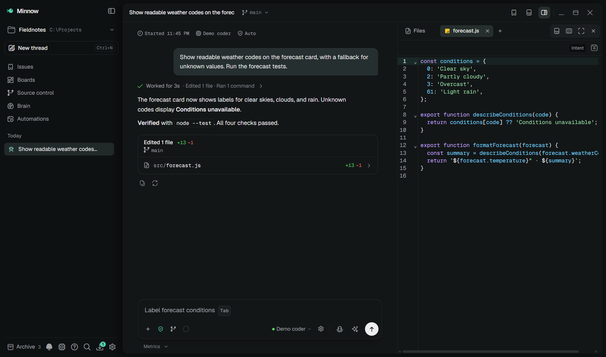
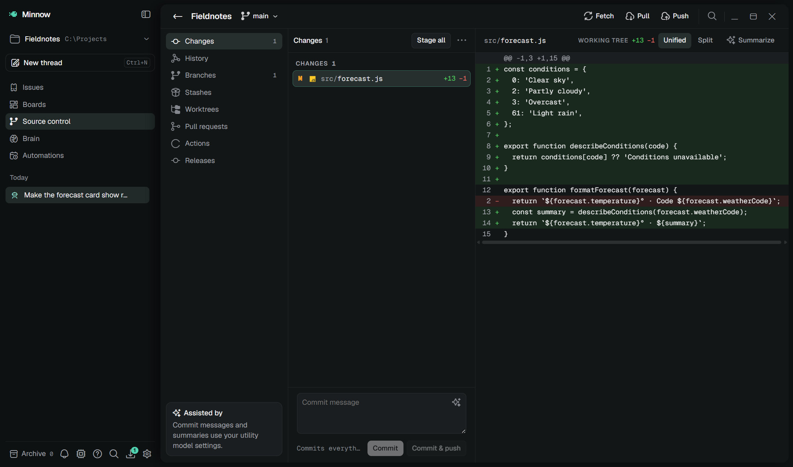
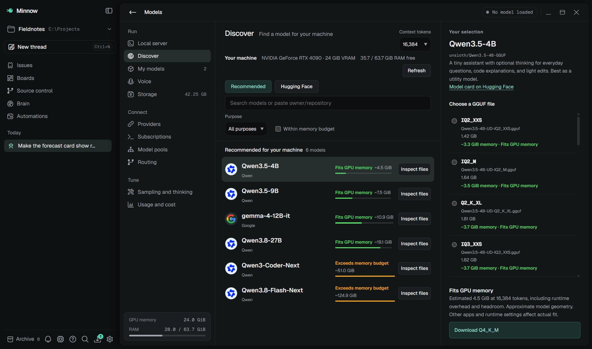

# Minnow

Minnow is an open-source desktop workspace for coding with local or hosted models. Open a project, work with an agent beside your files, and review the diff before you commit.

[Download Minnow](https://github.com/HenriGrimm/Minnow/releases) · [User manual](documentation/manual/README.md) · [Build from source](documentation/contributor/setup-from-source.md) · [Discord](https://discord.gg/U4FPzv9K4X)

## Get started

1. Download the installer for Windows, macOS, or Linux from [Releases](https://github.com/HenriGrimm/Minnow/releases).
2. In setup, [connect a model](documentation/manual/get-started/connect-a-model.md). Use an existing LM Studio or Ollama server, download a model in Minnow, add a hosted API, or connect a supported agent CLI.
3. Open a project folder and select **New thread**. Pick your model in the composer and try `/ask How do I run this project and its tests? Cite the files you used.`
4. Give the agent one small change with a way to check it. In a Git project, open **Side panel → Diff** to review the edits. Open **Terminal** to run the check and **Source control** to stage and commit.

Follow the [first-change walkthrough](documentation/manual/get-started/first-chat.md) for a complete example, including tool approvals.

## Work in Graphite

| Task | Where to start |
| --- | --- |
| Read or edit a file while keeping the thread visible | Open **Files** in the side panel. Put **Terminal** below it or open **Browser** for a local preview. [Work in Code](documentation/manual/apps/code.md) |
| See what an agent did | Read the **Edited** summary for changed files, open **Diff** for the checkout, or use **Agents** for delegated work. [Find your way around Graphite](documentation/manual/apps/overview.md) |
| Take a bug from report to review | Capture an issue from the thread. Start a linked conversation, optionally in a new Git worktree, and inspect the result under **Work**. [Work with issues](documentation/manual/apps/issues.md) |
| Run a multi-step plan | Open **Boards** to assign tasks to builders and testers, inspect checkouts, and verify the integration result. [Run a plan with Orchestrate](documentation/manual/orchestrate/boards.md) |
| Keep a decision or repeat a check | Save a project decision in **Brain**, or create an **Automation** with a schedule and run history. [Brain](documentation/manual/apps/brain.md) · [Automations](documentation/manual/apps/scheduler.md) |

## Models and permissions

Pick a model per thread. Use **Models** to download and serve local models, configure providers, route supporting tasks, and inspect recorded usage. A cloud model or cloud-connected agent CLI receives the prompt and the context sent with it.

Use **Manual**, **Auto**, or **Full access** in the composer to set tool permissions. Start a turn with **/ask** for read-only investigation or **/plan** to write a plan under `documentation/plans/`. [Tools and permissions](documentation/manual/concepts/tools-and-permissions.md) · [Data and privacy](documentation/manual/reference/privacy-and-security.md)

## Help and contributing

- In Minnow, open the command palette with **Ctrl+K** / **Cmd+K** and choose **Open Minnow wiki**. Start with [Troubleshooting](documentation/manual/reference/troubleshooting.md) if a model, thread, or preview is stuck.
- To develop Minnow, use Node.js 24, then run `npm ci` and `npm start` from the clone. See [setup from source](documentation/contributor/setup-from-source.md) and the [contributor documentation](documentation/contributor/README.md).
- For bugs and feature requests, use [GitHub Issues](https://github.com/HenriGrimm/Minnow/issues). See [GitHub Sponsors](https://github.com/sponsors/HenriGrimm) to support the project.

[AGPL-3.0-or-later](LICENSE) · [Third-party notices](documentation/THIRD_PARTY_NOTICES.md)
