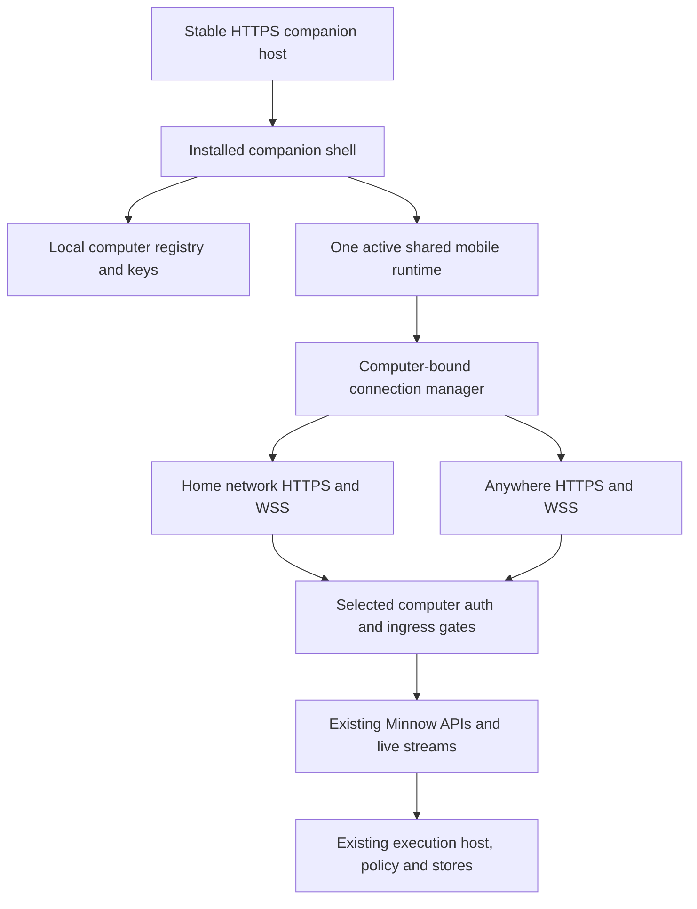

# Independent companion PWA

Status: proposed implementation plan. No feature in this document is shipped by this plan alone.

Date: 2026-11-08.

## Outcome

Install Minnow once on a phone or tablet, add any number of personal computers, and choose which computer to use. Each computer can have a Home network connection and an Anywhere connection. Changing computers or connection routes stays inside the same installed app.

The companion is a client of the existing Minnow workspace. Chats, agents, tools, permissions, issues, boards, files, providers, and execution remain owned by the selected computer. The work does not create another chat engine, merge computers' session stores, or turn Minnow into a cloud workspace.

Production readiness includes installation, pairing, route selection, network changes, storage loss, updates, compatibility, accessibility, diagnostics, and migration from existing installations. A computer picker over links to separate websites does not meet the outcome.

## Product decisions

| Decision | Planned behavior |
| --- | --- |
| Installation | One stable HTTPS companion origin with one manifest identity, independent of any user's computer. |
| Computer identity | A persistent installation identity and public key; names and addresses are attributes, not identity. |
| Pairing | Approve the companion separately on each computer. Pair once for that computer's verified local and Anywhere routes. |
| Connection preference | Per computer: **Automatic**, **Home network only**, or **Anywhere only**. Automatic is the default. |
| Automatic routing | Prefer a usable, verified Home network route; fall back to an enabled Anywhere route. Never change computers automatically. |
| Manual routing | A forced route stays forced. A failure offers an explicit alternative without silently changing the preference. |
| Active computer | One active workspace connection per companion window. Other computers continue their work independently. |
| Workspace integration | Reuse the existing mobile screens, shared composer, command admission, live presentation, and permission policy. |
| Hosting | The companion host distributes client assets. It receives no chat, file, model, or device-authentication traffic. |
| Accounts | No new Minnow account. Existing Tailscale requirements still apply to the Anywhere feature. |
| Self hosting | Publish the same companion artifact for a user-controlled HTTPS origin. Pairings and installation belong to that origin. |
| First release | Multiple computers, both routes, route controls, recovery, migration, and compatibility are one release scope. An Anywhere-only preview is not completion. |

**The principal engineering gate is secure local access from a hosted PWA.** The existing HTTP LAN endpoint is not a portable foundation for an HTTPS app. This plan includes solving and certifying the local transport; it does not assume that changing API base URLs is sufficient.

## Existing foundations and boundaries

The following describes the checkout used for this plan. Changes in progress in these areas must be reconciled before implementation.

| Current implementation | Implication |
| --- | --- |
| `src/companion/bootstrap.ts` waits for same-origin authentication before normal application boot. | Separate the independent computer picker from boot of a connected workspace. An unreachable computer must never trap the user behind its boot screen. |
| `src/api/session-token.ts` keeps existing device secrets in HttpOnly cookies; `install-fetch-auth.ts` decorates same-origin requests. | Keep that path for host-served clients. Add an explicit independent-companion credential and transport rather than exposing the old cookie. |
| `src/api/stream-fetch.ts` shares one same-origin WebSocket across live subscriptions. | Scope it to a computer and connection generation, including disposal and authentication. Rewriting ordinary fetch calls alone is incomplete. |
| `src/mobile/` provides Chats, Boards, Issues, Files, workspace navigation, and the real composer. | Extract a companion entry around those surfaces. Do not implement parallel screens or a second send path. |
| `server/runtime/auth-middleware.js` emits no CORS headers; `request-auth.js` enforces same-origin cookie requests. | Add a narrowly scoped, separately authenticated cross-origin path. Preserve same-origin cookie protections and host-only administration. |
| LAN uses a separate HTTP listener on 9480; Anywhere uses the bundled tsnet sidecar and HTTPS. | LAN needs a secure endpoint suitable for the independent PWA. Keep listener provenance authoritative. |
| Devices have multiple credentials; revocation closes tracked transports. | Extend that device model with a companion public-key credential and track every resulting connection. |
| `public/sw.js` caches index/manifest as fallback and bypasses APIs. | Build a dedicated companion worker that caches its complete required shell and handles updates safely. Do not precache device-authenticated HTML. |
| Canonical chats use server-owned execution and receipts; older chats can still use renderer-owned `/api/chat-sync` commands. | Negotiate and reuse the correct execution path per chat. A companion never promotes ownership or substitutes itself as an execution host. |

Authoritative integration references are [context.md](../context.md), [remote devices](../contributor/remote-devices.md), and [ordinary server execution rollout](../contributor/chat-server-execution-rollout.md). The remote-device guide's renderer-owned execution section describes the legacy path; it must not override the newer canonical admission contract.

## User experience

### Launch and computer selection

The first launch shows **Your computers**, an explanation that Minnow runs on the user's computers, and **Add computer**. Installation is available before pairing. A returning launch opens the last selected computer if one exists, with an immediately available computer switcher while reconnecting. A prolonged outage returns a useful connection screen rather than a blocking spinner.

The mobile header exposes the current computer and actual route. Computer selection stays separate from workspace selection:

```text
MacBook Pro ▾                    Home network
Minnow / my-project

Your computers
✓ MacBook Pro                   Connected · Home network
  Office PC                     Last connected yesterday
  Home server                   Not connected
  + Add computer

Connection for MacBook Pro
  Automatic                     Selected
  Home network only
  Anywhere only
  Manage computer
```

Use **Home network**, matching desktop Settings → Devices, rather than an ambiguous Local label. Do not label an unprobed computer Offline or Asleep. Distinguish an authenticated live connection from a historical last-seen time. Inactive computers are not continuously polled just to paint green dots.

Support duplicate computer names with a short identity suffix and a local nickname. Rename the companion entry without renaming the actual computer. Order by explicit pins and recent use; provide search when the list becomes long. Opening the picker is always possible, including before authentication, during initial loading, after revocation, and after a failed update.

On tablets, adapt the same controls to available width. There is no separate tablet connection model. Browser use, installed use, touch, keyboard, and screen-reader navigation all use the same computer registry.

### Add a computer

The computer's Settings → Devices gains **Connect to companion** alongside the existing host-served flow. It explains whether Home network and Anywhere are ready, and offers the stable companion install address, a QR, and an accessible copy-link alternative.

1. On the phone, open Add computer and scan the host's QR. The scanner is lazy loaded and has a paste-link fallback.
2. The QR supplies a versioned descriptor: machine identity, public-key fingerprint, candidate endpoints, short-lived single-use pairing ticket, and intended companion origin. It contains no reusable credential.
3. The companion validates the format and permitted schemes, selects a certified reachable route, and displays the computer name and connection type. A ticket cannot change the PWA's own origin or redirect to an arbitrary application.
4. The companion generates a key for this computer and claims the ticket with proof of possession. The computer records a public-key credential under the same existing device record when the operation explicitly reconnects that device.
5. Only after the authenticated machine identity matches the descriptor does the companion save the computer and enter the workspace.

A QR containing only a ticket uses the existing explicit Connect action. Entering an address instead uses Request access, a matching verification number on both screens, and approval on the computer. Numeric shortcuts retain their existing LAN-only restrictions; they do not become internet pairing secrets. Funnel pairing windows, throttling, name privacy, expiry, and pending-request limits remain enforced.

Scanning a second route for an already paired computer adds or repairs its endpoint after identity verification; it does not create a second computer. Scanning a known name with a different identity presents a different computer. A changed identity on an existing address requires a visible re-pair action; it is never silently accepted.

External Camera scans may open the ordinary browser instead of an installed iOS PWA. The link must give correct installation/opening instructions, while pairing from the installed app remains the dependable path. Do not promise that an external link can reach an existing iOS app's private storage.

### Change computers

Selecting a different computer saves the old computer's draft and navigation, stops its client subscriptions, and boots the new computer's runtime. Server work on the old computer continues. Switching is not a Stop command or cancellation of a submitted tool action.

Restore the selected computer's last valid workspace, tab, conversation, or file after validating that it still exists and is accessible. Fall back to its normal root screen if it was deleted. A failed switch leaves the computer picker available and offers **Back to MacBook Pro**. It never displays the old machine's files or model list under the new machine's name.

An input whose acknowledgement is uncertain stays associated with its original computer, workspace, chat, and command ID. Switching does not re-send it to either computer. Reconcile its receipt on return. Draft edits made after an attempted send remain distinct from the send-time snapshot.

### Change Home network and Anywhere

Automatic selection handles the common case. A user can force either route from the same header sheet without visiting desktop settings or reinstalling the app. Show **Using Anywhere — Home network unavailable** when an automatic fallback succeeds. In forced Home network mode, show a failed route with **Use Anywhere** as an explicit preference change.

Changing the route for the same machine preserves workspace, screen, scroll position, composer text, attachments, and command identities. The network layer reconnects subscriptions and reconciles snapshots/receipts before enabling commands again. Existing work continues on the computer.

The phone may choose an already enabled route. Turning on LAN exposure, starting Anywhere, signing in to Tailscale, approving devices, and changing network configuration remain host-only operations. A phone offers instructions to enable these on the computer rather than gaining new administration authority.

### Manage and recover

Each computer detail screen includes nickname, verified computer name, connection preference, routes and readiness, last successful connection, server/client versions, connection diagnostics, Reconnect, and Remove computer.

**Disconnect** stops the current view while keeping pairing. **Remove computer** revokes this companion credential on that computer when reachable, then clears its local key, registry entry, drafts, and cached state with a clear draft-deletion confirmation. Other browser/Home Screen credentials on that physical device are preserved. A separate desktop **Revoke device** action continues to revoke the entire device.

If the computer cannot be reached, offer **Forget on this device** with the explanation that remote access has not been revoked and can be revoked in the computer's Devices settings. Do not queue a revocation using a private key that is then deleted, and do not claim remote revocation succeeded.

Storage eviction, reinstall, and a new companion origin can require pairing again. The recovery screen says why, retains non-secret local drafts when available, and never presents an empty local workspace as a replacement for the computer.

## Architecture



There are three boundaries: the installable shell has no dependency on a user's server; the active workspace runtime is bound to one computer; the selected endpoint is a replaceable route to that identity. Hosted assets never proxy requests to private networks. The companion is not a gateway through the first paired computer.

### Build and entry point

Add a dedicated companion HTML/TypeScript entry and build artifact, using Vite and existing TypeScript conventions. Extract the minimum boot dependencies for mobile screens, the real composer, presentation stores, themes, notifications, and connection controls. Do not serve a second copy of the desktop application with different constants, import the desktop's full boot as a shortcut, or bundle Electron-only behavior into the hosted client.

Shared modules continue to be shared source. Introduce an explicit runtime role (`desktop-host`, `host-served-device`, `independent-companion`) rather than treating every tokenless page as a same-origin paired phone. Never place a host per-boot token into a companion build, injected config, or service-worker cache.

For the first production version, switching between different computers uses a same-origin document navigation to the dedicated companion entry with a non-secret saved-computer ID. This resets module singletons reliably. The cached shell makes the transition quick. An in-place runtime teardown can follow only when it proves the same isolation; it is not required for easy switching.

The shell renders the picker and recovery controls before loading any host-dependent application modules. Route changes within the same computer occur through the connection manager without document navigation. Do not use cross-origin iframes or rely on extending PWA scope to unrelated hosts.

### Connection context

All machine operations accept or capture an immutable context before their first await:

```ts
interface CompanionConnectionContext {
  machineId: string;
  identityFingerprint: string;
  credentialId: string;
  endpointId: string;
  endpointOrigin: string;
  generation: number;
  workspaceId?: string;
  signal: AbortSignal;
}
```

Generation changes invalidate old callbacks, probes, streamed messages, uploads, temporary URLs, and deferred saves. Controllers and channels are owned by that context. A late result cannot mutate the next generation's stores or read a new global base URL to continue an old operation.

Create a shared API transport seam for JSON, binary, streaming, and upload requests, plus the shared WebSocket. Preserve native fetch semantics for `Request`, headers, abort, body streams, and content type. Keep host-served same-origin defaults for existing desktop/browser/headless callers. A compatibility adapter may support current `/api/` call sites during migration, but it must capture the connection at dispatch and fail closed when none exists.

Audit more than `fetch`: `StreamEventSource`, WebSocket, image/media URLs, issue attachments, file previews/downloads, Markdown file links, audio streams, service workers, beacon calls, and generated absolute links. Provider inference always uses the selected computer's existing proxy; the companion must not silently contact a provider on the phone or leak its credential to an arbitrary URL.

Authenticated media uses transport fetch plus scoped Blob URLs or a deliberately designed short-lived resource mechanism. Do not put long-lived credentials in ``, `<audio>`, download links, persisted Markdown, or browser history. Revoke Blob URLs on close/switch and enforce size limits. Remote desktop/browser automation remains available only where the selected computer's capabilities already support it.

## Secure Home network transport

### Why it needs its own milestone

Cross-origin CORS approval does not bypass mixed-content rules, establish TLS trust, discover computers, or enable unavailable local-network browser APIs. Chrome documents permission-gated exceptions for some HTTP local-network access, but they are not the cross-browser security baseline. See [mixed content](https://developer.mozilla.org/en-US/docs/Web/Security/Defenses/Mixed_content) and [Chrome local network access](https://developer.chrome.com/blog/local-network-access).

The production baseline is **trusted HTTPS and WSS on both routes**. Existing plain HTTP LAN access remains a host-served compatibility path, not the independent PWA's default. Do not require disabling browser protections, accepting certificate interstitials, installing a private root certificate, or configuring a router for the standard experience.

### Selected candidate to prove

Provide an opt-in secure LAN listener with a per-installation opaque DNS hostname and a publicly trusted certificate whose private key is generated and retained on the computer. A hostname under a dedicated service-controlled zone resolves to that computer's chosen private interface address. Host-authenticated DNS updates track DHCP changes. DNS-01 can validate a domain without exposing its webserver to the internet; it does not validate private IP literals. See [ACME challenge types](https://letsencrypt.org/docs/challenge-types/).

This requires an explicit **DNS and certificate provisioning service**, in addition to static companion hosting. It is infrastructure work in this plan, not an assumed existing Minnow feature. It handles opaque installation registration, narrowly scoped DNS challenge/update authority, abuse limits, availability, and cleanup. It does not store device keys, mint device access grants, or forward workspace traffic. An opaque DNS label and private address still disclose metadata; setup must explain that precisely.

Use distinct LAN and Anywhere endpoint names with the same verified machine identity. Do not repoint the existing Tailscale name or assume a `ts.net` certificate covers a private IP or `.local` name. Existing tsnet HTTPS remains responsible for Anywhere. TLS provisioning does not automatically enable LAN exposure or Funnel.

The host's DNS registration key, ACME account material, and certificate private key stay on the host with owner-only permissions and appropriate encryption. Never distribute one wildcard private key to all Minnow installations. The service authorizes one installation's exact names, never arbitrary DNS records. Registration proves control of the host identity but grants no right to impersonate another installation or claim someone else's DNS name.

Select and document a fixed secure LAN port after testing platform conflicts; retain 9480 for current HTTP clients. A busy secure port is a visible error, never silent drift. Bind only to intended remote interfaces and preserve live toggles. Treat secure LAN as a provenance-tagged LAN listener with a separate transport scheme; adapt `ingressScheme` and access checks deliberately rather than guessing from peer address or caller headers.

Evaluate router DNS-rebinding protection, private-address DNS answers, encrypted DNS, IPv4/IPv6, multiple interfaces, VPNs, client-isolated Wi-Fi, certificate renewal, name registration outages, and firewall prompts. Publish only usable endpoint addresses, not every interface or VPN route. Authentication and explicit Host validation remain mandatory even for a provisioned hostname.

### Offline and dependency contract

Home network means the **workspace data path stays on the home network**. Initial installation, managed certificate/DNS provisioning, and certificate renewal require internet access. Once installed, the cached picker works without the companion host, and an established local session continues during a WAN outage.

A cold local reconnect during an internet outage also needs working DNS resolution and a valid certificate. An expiring certificate or uncached public DNS name cannot be solved by the PWA pretending to be offline capable. Phase 0 must measure this and specify exactly which cold-reconnect scenarios the baseline supports. Offer a supported user-controlled DNS/TLS configuration for users needing stronger offline guarantees; never represent cached DNS as a guarantee.

If secure LAN cannot provide the intended iPhone/Android experience without routine router work, stop this transport choice before the main implementation. Compare an authenticated WebRTC data-channel alternative, including signaling availability, reconnects, binary transport, revocation, sidecar cost, and whether a cloud broker would become necessary. WebRTC is a fallback architecture to evaluate, not an invisible promised escape hatch. A new relay or mandatory phone app is a product decision requiring a revised plan.

**Phase 0 exit:** one written decision and measured browser matrix with the chosen LAN mechanism, operational ownership, setup dependencies, offline limitations, and recovery behavior. Do not proceed on a green desktop Chrome demo alone. Do not mark the feature complete by silently dropping Home network support.

## Connection selection and recovery

### Machine and endpoint model

Persist one machine record with multiple verified endpoint descriptors. A descriptor contains endpoint ID, route kind, origin, secure transport kind, advertised readiness, descriptor revision, and last successful verification. Hostname/IP changes are updates to a route, not new computers.

The computer publishes its descriptor only after authentication, signed by its installation identity. A pairing QR establishes the initial expected identity; manual-address pairing establishes it through trusted TLS plus explicit host approval. Descriptor updates cannot change the trusted machine key. Rotation uses an old-key-authorized transition while possible, or explicit re-pairing.

Do not probe arbitrary subnets, infer ownership from a `.local` name, or send credentials to every QR URL. The registry contains only explicitly supplied or authenticated advertised endpoints. Browser network information is a hint; successful authenticated reachability is authoritative.

### Automatic algorithm

1. Render the saved computer and preference immediately. Capture a new connection generation.
2. Try the last healthy permitted endpoint promptly. For Automatic, give an eligible LAN probe a 750 ms head start before starting the Anywhere probe. Each probe has a four-second deadline; tune these values from mobile measurements.
3. Validate transport security and machine identity before requesting machine-bound authentication. An endpoint that answers with another identity is quarantined, not a failover target.
4. Establish exactly one active command transport. Parallel probes are reads; they never claim execution, send chat inputs, or replay writes.
5. If Anywhere wins, keep it stable while a bounded LAN verification finishes. Prefer LAN on a stable successful check, with a minimum 30-second dwell and two successes separated by five seconds before an elective return. An explicit user route change bypasses the dwell.
6. On active-route failure, try another permitted verified route immediately. Authenticate it, reconnect streams, reconcile revisions/command receipts, then enable writes. Keep the computer identity unchanged.
7. Re-probe on wake, visibility return, online, and pageshow. Abort suspended probes first. At most one probe per endpoint is in flight. `navigator.onLine` is not proof of host availability.
8. Back off unsuccessful foreground reconnects with jitter from one to 30 seconds. Pause routine probes while hidden; wake reconnects immediately. Permission denials do not trigger repeated prompts. User Retry is immediate.

For a forced mode, consider only its route family. If Automatic has never received local-network permission, ask from an explicit user action to enable Home network; avoid an unexpected browser prompt on every launch. After denial, use Anywhere when permitted and show how to enable local access. If no route is usable, the picker and Add computer remain live.

Treat advertised readiness, reachability, browser permission, authentication, version compatibility, and chat-host availability as separate dimensions. An Anywhere endpoint that happens to use a direct Tailscale peer connection is still the selected Anywhere route; do not claim that it is the LAN listener.

### Connection states

| State | User sees | Allowed recovery |
| --- | --- | --- |
| No computers | Your computers and Add computer | Scan or paste pairing link |
| Connecting | Computer name, selected preference, bounded progress | Switch computer, choose route, cancel |
| Connected | Actual route in the header | Normal supported workspace actions |
| Switching route | Small reconnect status; current screen and draft retained | Reconcile before re-enabling commands |
| Unreachable | Can't reach this computer; last connection time | Retry, route selection, computer picker |
| Browser blocks local access | Local connection could not be opened; verified browser-specific guidance when known | Grant permission through a user action, or choose Anywhere |
| TLS/DNS setup issue | Secure Home network needs attention | Host-side diagnostics; no insecure downgrade |
| Authentication expired | Reconnecting securely | Fresh challenge, keeping pairing and drafts |
| Credential revoked | Access removed for this computer | Re-pair; other computers stay usable |
| Identity changed | This address belongs to a different installation | Explicit identity review and pairing |
| Version mismatch | Update this computer or companion; supported access only | Open diagnostics or choose another computer |

Fetch failures often cannot reveal whether the cause is DNS, CORS, TLS, or a permission. Use a known permission state or host diagnostic when available; otherwise say that the connection failed and give bounded checks. Do not invent a precise cause from a generic `TypeError`, or claim an unreachable computer is asleep.

## Pairing and authentication design

### Separate credential for an independent origin

Keep existing cookie authentication unchanged for host-served clients. The independent companion uses one P-256 key pair per paired computer, generated with Web Crypto. Persist the private `CryptoKey` as non-extractable in IndexedDB; the computer stores only its public key, credential ID, companion origin, label, and revocation state. Verify actual installed-browser persistence in Phase 0.

The long-lived authority is the registered public key. A bounded, single-use challenge authenticates possession and creates a short-lived opaque device access token, initially five minutes, held only in memory. Renew before expiry over the selected secure route. A restart or route change can repeat the challenge without user approval. Access tokens are device credentials with the existing device permissions, never host credentials.

Specify the exact signed challenge schema, protocol version, purpose, nonce, machine audience, credential ID, companion origin, issue/expiry times, and server boot/session binding. Use maintained cryptographic/JWS primitives, fixed approved algorithms, strict size/schema checks, a bounded replay cache, and test vectors. The protocol review must distinguish key authentication from optional token sender-constraining; do not call a custom scheme DPoP. [RFC 9449](https://www.rfc-editor.org/rfc/rfc9449) is the reference if standards-based sender-constrained tokens are selected during review.

Tokens travel in an authorization header to the exact authenticated endpoint with `credentials: 'omit'` and redirects refused. Neither an HTTP redirect nor an attachment URL can carry authorization to another origin. Failed renewal is temporary until the authenticated computer explicitly confirms invalid/revoked credentials. Provider 401s and stale endpoint responses do not erase pairing. Key material, access tokens, tickets, proof payloads, and request secrets never enter logs, query strings, telemetry, registry exports, or error reports.

Non-extractable storage prevents ordinary key export; it does not prevent compromised same-origin code from signing requests. The companion host and its deployed JavaScript are trusted with the user's paired access. Document that boundary and protect its supply chain accordingly. See [Web Crypto](https://developer.mozilla.org/en-US/docs/Web/API/Web_Crypto_API) and [CryptoKey extraction](https://developer.mozilla.org/en-US/docs/Web/API/CryptoKey/extractable).

### HTTP and WebSocket gates

Apply cross-origin handling only to a reviewed set of companion-supported API methods/routes on remote listeners, including bounded unauthenticated pairing/auth bootstrap. Use the configured exact companion origin, never reflected arbitrary origins, `*`, `null`, origin suffix matching, or a QR-supplied authorization rule. Self-hosted origins require host-local configuration and explicit pairing; origin configuration is a transport rule, not a replacement for the shared tool/URL permission policy.

Preflight validates ingress, Host, exact Origin, route, requested method, and header names without requiring a device token. It grants no action authority. Actual requests still require a valid companion credential and the existing authorization checks. Return `Vary: Origin`, expose only required revision/auth/protocol headers, and emit appropriate CORS headers on authorized-origin error responses so recovery is possible. Never enable cross-origin cookie credentials. See [CORS](https://developer.mozilla.org/en-US/docs/Web/HTTP/Guides/CORS).

Central authentication normalizes a verified companion credential into the existing device principal. Keep the host-token loopback restriction, always-denied secret-store floor, Manual/Auto/Full access policy, chat-scoped approvals, workspace path validation, and host-only device/network management. Reject credential type confusion, browser requests for host-only APIs, and unsigned identities supplied in a payload. A transport certificate is not a permission grant.

For live streams, mint a short-lived, single-use socket ticket through authenticated HTTPS, bound to machine, device credential, exact Origin, endpoint, and protocol. Use an audited WebSocket subprotocol encoding or a strictly bounded initial authentication exchange; prefer subprotocol tickets so the upgrade can authenticate before attachment. Never use a reusable bearer token in the WebSocket URL. Validate Origin independently because WebSockets do not use CORS preflight. Apply limits to unauthenticated upgrades and redact credential-bearing subprotocols from logs.

The shared socket propagates the real device principal and listener provenance to internal stream requests. It may access only routes that the equivalent authenticated device could access over HTTP. Adapt `server/runtime/stream-ws.js` deliberately; never forward a host token or manufacture loopback authority. Reuse device transport tracking so revocation closes HTTP streams/sockets and invalidates access tokens and unused socket tickets immediately. Idle long-lived connections also recheck credential validity; five-minute token expiry is not the revocation mechanism.

### Proposed protocol surface

Finalize schemas in Phase 0, then implement shared runtime validators and typed client contracts. The proposed namespace is `/api/companion/v1`; it supplies connection/authentication operations, not a duplicate workspace API.

| Operation | Authority | Contract |
| --- | --- | --- |
| `GET /info` | Pairing bootstrap with existing privacy/window limits | Supported connection protocol ranges and minimal readiness. No unrestricted computer name or workspace inventory. |
| `POST /pairings/claim` | Valid single-use QR ticket plus new-key proof | Atomically consumes the ticket and registers the key/origin; returns credential ID and verified machine descriptor. Repeated enrollment with the same request ID recovers that enrollment without issuing another credential. |
| `POST /pairings/requests` and bounded status polling | Existing host-approval window and per-request secret | Registers a pending public key, intended origin, and request ID; shows the verification number. Host approval remains in existing host-only APIs. |
| `POST /auth/challenge` | Bounded key-authentication bootstrap | Accepts credential ID and fresh client nonce; returns a short-lived challenge signed by the installation key. Uses uniform failures to limit credential enumeration. |
| `POST /auth/session` | Valid new proof over the complete challenge | Consumes the challenge once, rechecks credential/origin/revocation, and issues a memory-only access token, expiry and device principal. No refresh secret is persisted in the browser. |
| `GET /descriptor` | Valid companion access token | Signed identity/endpoints, revision, server version, protocol/capability ranges and route readiness. Does not grant access to arbitrary host configuration. |
| `POST /socket-ticket` | Valid companion access token | Single-use, initially 30-second ticket for the exact endpoint, credential, Origin and agreed stream protocol. |
| `DELETE /credential` | Valid companion access token and matching own credential | Revokes only this credential and returns an idempotent revocation receipt. It cannot revoke other credentials or devices. |

The full path includes the namespace for every operation above. Existing `/api/auth/claim` and cookie routes keep their semantics; the new pairing operations reuse their underlying ticket/approval stores with a credential-type discriminator rather than interpreting one request as both cookie and key enrollment.

A signed machine descriptor contains `protocolVersion`, `machineId`, `identityPublicKey`, `identityFingerprint`, `revision`, `issuedAt`, `serverVersion`, `companionProtocolRange`, `capabilities`, and `endpoints[]`. Each endpoint contains `id`, `kind`, `origin`, `transport`, and `readiness`. The signature covers a canonical encoding with an explicit descriptor purpose. Only authenticated descriptors can disclose the complete endpoint inventory. Limits on descriptor/QR size, endpoint count, labels, and supported URL forms are validated before any network activity.

The server signs its challenge with the expected installation key and echoes the client's nonce, endpoint audience, companion origin, protocol and expiry. The client checks that signature and identity before signing its response or sending an existing token. This is the mutual identity check; echoing a public machine ID is insufficient. Challenges, sessions and socket tickets are bounded in memory with unpredictable IDs, expiries, atomic consumption and per-source/per-credential issuance limits. A restart invalidates outstanding challenges and tokens; the registered key survives and can obtain a new session.

Use stable typed errors such as `PAIRING_EXPIRED`, `PAIRING_DENIED`, `AUTH_RENEW_REQUIRED`, `CREDENTIAL_REVOKED`, `IDENTITY_MISMATCH`, `PROTOCOL_UNSUPPORTED` and `RATE_LIMITED`. Detailed credential status is returned only after appropriate proof and verified machine authentication. Respect `Retry-After`; malformed JSON, CORS-hidden failures, a stale generation, and an unrelated provider's 401 are never interpreted as revocation.

An initial TLS/certificate failure may prevent reaching the application protocol at all. Keep such browser failures separate from signed machine responses. Do not suppress a failed identity check by retrying with an unsigned compatibility mode.

## Persistence and identity lifecycle

### Companion storage

Use a versioned IndexedDB database with transactional migrations. Keep only small non-secret presentation preferences in localStorage.

| Store | Contents and scope |
| --- | --- |
| Computers | Machine ID and fingerprint, nickname, verified display name, endpoint descriptors, preference, last success, compatibility snapshot. |
| Credentials | Per-computer non-extractable key reference, credential ID, protocol metadata. No host secret or reusable stored bearer token. |
| Navigation | Computer ID plus workspace identity, tab and validated target. |
| Drafts | Computer ID plus workspace identity plus chat ID; text and bounded attachment drafts with timestamps. |
| Pending commands | Original computer/workspace/chat, command ID, intent fingerprint and receipt reconciliation state. No blind offline send queue. |
| Preferences | Companion-local theme/accessibility choices, installed hints, picker order. Host preferences remain host data. |

Two computers can have identical workspace paths and chat IDs without sharing anything. Session summaries, history revisions, provider catalogs, model selection, issues, board clients, search caches, resource URLs, notification targets, approvals, and pending request answers must all be scoped or reset. Audit existing `minnow.*` local/session-storage keys and module-level maps, including command retries and view identity.

Persist drafts on input with a short bounded debounce, before send, and before navigation. Do not rely solely on unload events, and do not let a failed save erase the visible draft. IndexedDB failure or quota exhaustion produces a specific persistence message. An optional remembered key that fails to persist does not become a falsely durable pairing.

Request persistent storage where supported and handle denial. Provide a small registry metadata export/import without keys, tokens, tickets, or drafts; imported entries always require authentication/re-pairing. Browser storage can be evicted, so recover honestly. See [browser storage and eviction](https://developer.mozilla.org/en-US/docs/Web/API/Storage_API/Storage_quotas_and_eviction_criteria).

Coordinate registry updates and removal across same-origin tabs with revision checks and BroadcastChannel where available. Each tab can view a different computer; one tab's selection must not redirect another tab's pending writes. Removing a credential invalidates all tabs that use it.

### Host storage and backup

Define an additive device-store migration for public-key credentials without dropping v1/v2 cookie credentials. Preserve device identity, revocation, and existing home-screen/browser labels. Keep migrations idempotent and atomic with a fixture for mixed old/new credentials.

Give the installation a durable random machine ID and identity key under `auth/`, separate from hostname, workspace, per-boot host token, and Tailscale node identity. Identity private material follows Minnow's encrypted-secret rules. Add DNS/TLS provisioner state to an explicitly classified machine-bound root, updating `server/backup/catalog.js` and its tests for any new top-level entry.

Backups must not turn a restored copy into a second active computer with the same identity. Define stable same-machine recovery versus migration to another machine explicitly; a different or unverified installation creates a fresh machine identity and requires re-pairing. Machine-bound DNS registrations, ACME credentials, certificate private keys, and network identities are not restored into a second machine as active state. Preserve old revocation evidence as appropriate, but do not copy active device sessions/access tokens. Extend restore behavior and evidence tests before enabling this storage in a release.

Losing `.key` cannot silently recreate an identity that old companions should trust. Show the existing secret-loss error and explicit recovery/re-pairing. Local aliases never authorize a replacement installation.

## Shared workspace integration

### Chats and execution

Reuse `sendRemoteChatCommand`, `managed-chat-client`, canonical request/approval UI, shared transcript, and existing receipt recovery. Canonical chats stay on the computer's execution host; legacy renderer-owned chats retain their explicit compatibility requirements. If a legacy chat requires an available desktop renderer, say so. A connected server is not proof that every legacy chat can run.

Computer or route switching never claims a turn, promotes a raw chat, resumes interrupted tools, changes a permission level, or cancels work. Read-only observer reconnects remain read-only. Reconcile accepted commands by ID and revision after a timeout; do not manufacture new IDs or transfer intents between machines. Extend exactly the idempotent contracts needed by existing mobile mutations that lack them before allowing transparent mutation retries.

Switching routes may retry reads. Retry a mutation automatically only when the original operation has a server-enforced idempotency/receipt contract, using its exact identity and original machine. For other mutations, present an uncertain result and refresh state before offering another action. This includes issue edits, board actions, workspace changes, uploads, and answers to approvals, not only chat Send.

### Workspaces, models, and settings

After authentication, load the selected computer's real capabilities, workspace access, server configuration, provider registry, models, sessions, and current activity. Preserve the existing workspace-switch guard and checkout identity protections. Merely activating a computer does not change its desktop workspace or active chat. A companion workspace choice uses the current supported workspace contract, with no new arbitrary host path authority.

Store view state per computer and workspace. Keep phone-local appearance preferences separate from server settings. Never fall back to the phone's local configuration or a previously connected computer's providers during an outage. Show capability-specific unavailable states for host-only features and hidden apps, using the released app registry rather than advertising unfinished surfaces.

### Files, boards, issues, voice, and notifications

The existing mobile surfaces all participate in the same selected connection. Release verification includes file reads and previews, issue attachments, board attempt streams, model selection, shared composer attachments, questions, approvals, and voice where currently supported. A working chat demo alone is insufficient.

Local notifications and deep links carry machine identity plus workspace and resource identity. Tapping a target for another saved computer switches explicitly to that computer and validates the target before opening. Notification payloads cannot nominate a new server URL or approve work. Stop stale notifications from acting on a newly selected computer with the same chat ID.

Do not promise live background activity from every paired computer while maintaining only one active connection. Background aggregation and web push are separate future scope. Their absence must not break existing selected-computer notification behavior.

## Installation, updates, and hosting

Give the independent companion its own fixed manifest ID, scope, start URL, icons, theme colors, and name. Its manifest is public static content with no computer address, handoff token, or device identity. Launch always reaches the picker shell before machine authentication.

Install before pairing is the preferred iOS flow. If a browser has already paired, offer a short-lived transfer grant bound to that browser's existing credential and the new installed companion's public key. Implement and certify the actual iOS handoff behavior before promising automatic transfer. On failure, the installed app offers pairing again; it never exports a raw long-lived credential or claims to share Safari storage.

The companion worker caches versioned shell assets, required lazy chunks, CSS, fonts, and local icons from a generated build manifest. Cache only public static assets; APIs, auth payloads, machine descriptors containing pairing material, and private media bypass Cache Storage. Ensure picker and basic recovery work on a cold offline launch after a successful install. Do not reuse the current worker's index-only cache as proof of offline readiness.

Use atomic release caches and an update-ready lifecycle. Keep the current app and all its referenced chunks available until a safe transition. Save drafts before reload; do not force `skipWaiting`/`clients.claim` and reload a user during composition or uncertain command admission. A user can apply the update from a clear banner. Remove old caches only after no controlled client needs them. The server continues running during a companion update.

Deploy immutable hashed assets, revalidated entry HTML, an uncached/revalidated worker, release metadata, and a tested rollback. A companion rollback retains forward-compatible storage or explicitly opens recovery without destructive migration. Keep the origin stable across hosting changes; changing it changes browser storage and installation identity.

The companion host needs HTTPS, an asset-only deployment, SPA routing, a health check, release provenance, an incident owner, and rollback tooling. Avoid analytics and third-party runtime scripts. Apply CSP with self-hosted scripts/assets, strict framing/base/object restrictions, and narrowly necessary media/worker permissions. A configurable direct-connect client may need broad HTTPS/WSS `connect-src`; document this limitation and enforce the selected endpoint in the transport. CSP is not the endpoint identity check.

Treat DNS/TLS provisioning as a separately deployed service with its own availability and abuse model, API authentication, rate limits, certificate issuance budget, monitoring, retention limits, and shutdown/self-host instructions. Static hosting uptime does not certify that service. Its outage must not disconnect established workspace sessions.

Provisioning includes renewal well before expiry, retry/backoff, host-visible expiry/readiness diagnostics, and a plan for registered-domain CA issuance limits at expected adoption. Validate quotas against the selected CA before rollout; do not assume unbounded per-install certificates under one domain. Separate control-plane names and public web hosting onto appropriate domain boundaries so local/private DNS records do not accidentally broaden cookie or certificate authority for the companion host.

Do not imply that self hosting automatically migrates credentials or removes all external dependencies. The static artifact and provisioning service have independent deployment/configuration requirements. Publish supported HTTPS origin configuration and custom DNS/TLS integration without requiring a paid Minnow service.

## Compatibility and migration

Add a versioned companion capability handshake containing machine identity, server version, supported companion/auth protocol ranges, supported mobile routes/actions, descriptor revision, and execution capabilities. Before pairing, expose only the minimum information permitted by the existing pairing window/privacy rules. Fetch detailed capabilities after authentication.

Negotiate an overlap rather than comparing version strings. Support the current and previous companion protocol major during the defined migration window. Unsupported auth or transport versions block connection before loading mutable workspace state. Missing optional capabilities disable the relevant action. Independently verify canonical chat-protocol support; a compatible connection does not imply every chat workflow is supported.

Older servers show **Update Minnow on this computer** and retain their existing host-served URL flow. Never try the new credential as an old host token, or fall back from failed canonical admission to renderer-owned inference. New servers keep existing per-computer PWA and browser access working during migration.

From an existing paired per-computer page, offer **Use the companion app**. That page can ask its own computer to authorize a short-lived migration grant bound to the target companion origin and a new key. The independent PWA must not read another origin's cookies/storage. Transfer one computer at a time; there is no browser API to discover all old installations or silently uninstall their Home Screen icons.

Migration attaches the new companion credential to the existing device where the host can prove continuity. It does not merge devices based on a user-supplied name. Old credentials remain until the user revokes them, allowing rollback. The companion's route preference replaces the old LAN → Anywhere move prompt only in the independent client; keep existing handoffs for legacy clients.

User-facing manual and README updates land only when the feature ships. At that point update [context.md](../context.md), the remote-device contributor guide, Settings → Devices help, companion/install/troubleshooting manual pages, backup behavior, and the release checklist together. Until then, this plan is the engineering reference and any product-direction link belongs in the roadmap.

## Implementation map

Names below are proposed seams, not a requirement to create a new subsystem for every row.

| Area | Existing integration | Planned work |
| --- | --- | --- |
| Companion entry/build | `src/main.ts`, `vite.config.ts`, `index.html`, `public/manifest.json`, `public/sw.js` | Dedicated entry, role-aware shared boot, separate asset/worker build and hosting artifact. |
| Computer management | `src/companion/`, `src/mobile/shell.ts`, `chrome.ts`, `sheet.ts` | Registry, picker, detail sheet, routes, add/remove/recovery screens, early shell. |
| Client persistence | Existing local/session keys and draft stores | Versioned IndexedDB repository, per-computer namespaces, tab coordination and export. |
| Request boundary | `src/api/install-fetch-auth.ts`, `session-token.ts`, `device-auth.ts` | Explicit connection context, public-key credential client, controlled cross-origin transport. |
| Live transport | `src/api/stream-fetch.ts`, `stream-event-source.ts`, `server/runtime/stream-ws.js` | Scoped socket, single-use ticket, preserved device principal, generation-aware disposal and replay. |
| Identity and auth | `server/auth/{device-store,pairing,requests,routes,device-transports}.js` | Additive credentials, machine descriptor, challenge/session endpoints, revocation and limits. |
| Network gates | `server/runtime/{auth-middleware,request-auth,authenticate-token,ws-attach}.js`, `server/network/` | Exact-origin companion CORS, principal verification, secure LAN scheme and explicit Host validation. |
| Remote configuration | `server/remote/{config,ingress-manager,middleware,tailnet}.js`, `tools/minnow-tailnet/` | Secure LAN lifecycle, verified endpoint publication, TLS provisioning adapter; preserve tsnet Anywhere. |
| Desktop Devices | `src/ui/settings-devices*.ts`, `src/api/remote-admin.ts` | Companion QR/link, route readiness, provisioning errors, credentials and existing approval UX. |
| Shared feature clients | Chat, state/session sync, mobile, notifications, attachments and voice | Use transport seam; clear/namespace caches and retry identities; preserve existing feature authorization. |
| Host persistence | `server/backup/catalog.js`, restore identity handling | Classify machine-bound state, migration and clone-safe restore. |
| Operations | Build scripts, CI, performance budgets, contributor runbooks | Companion deployment/rollback, protocol fixtures, provisioner service, browser certification and size reports. |

## Delivery sequence and exit criteria

### Phase 0 — Prove browser transport and installation

Create disposable probes with two scratch Minnow homes, distinct identities, fake inference, and a real HTTPS companion origin. No live profile writes, network exposure changes, or paid model calls. Test packaged server behavior as well as development; do not expose Vite internals through public Funnel.

Prove HTTPS LAN, WSS, trusted name/certificate issuance, private DNS answers, local permission behavior, IndexedDB CryptoKey persistence, challenge authentication, real stream messages, local/Anywhere route changes, and iOS installed-app launch/return. Test with third-party cookies disabled. Test Home network without Anywhere configured and with the first computer powered off while selecting the second.

Test provisioning failure/renewal and WAN-loss scenarios separately: established LAN session, cached-shell launch, and cold DNS reconnect. Record exact OS/browser versions, topology, required firewall prompts, and whether DNS-rebinding protection or VPN configuration blocks the candidate. Validate a user-controlled HTTPS endpoint as the self-host option.

**Exit:** an evidence matrix and final LAN/auth/install decisions under `documentation/plans/verification/`, a bounded protocol contract, required infrastructure/runbook scope, and no unresolved iPhone blocker concealed behind a mock. If the chosen LAN design fails, revise it here before Phase 1. All later phases depend on this exit.

### Phase 1 — Host identity, secure routes, and credential protocol

Implement the approved secure LAN mechanism and provisioner integration, durable identity, additive device schema, signed endpoint descriptors, challenge/session flow, reviewed CORS/preflight handling, socket tickets, immediate revocation, backup rules, and capability handshake. Keep existing clients unchanged.

**Exit:** two real scratch servers accept only their own approved key/origin/identity combinations over both route families. Revocation blocks the next request and closes streams. Host-only APIs and permission floors remain enforced. Certificate/DNS failures have real readiness states. Desktop/cookie/headless regression suites pass.

### Phase 2 — Independent shell and computer registry

Build the dedicated artifact, public manifest, early picker, transactional registry/key storage, Add computer flow, computer details, connection preferences, installation instructions, and offline shell. Add desktop Connect to companion integration using the same pairing controls.

**Exit:** install once, add two computers, restart phone/browser and both computers, and still select either computer with the other unavailable. No reusable secret appears in URLs, manifest, localStorage, caches, or logs. Storage-loss recovery works. The shell loads without a host request.

### Phase 3 — Shared runtime, transport coverage, and isolation

Wire existing mobile screens and shared composer through the connection seam. Scope streams, caches, commands, drafts, resources, view IDs, notification targets, and pending answers. Implement safe cross-computer document navigation and same-computer route handover. Audit every host request and media path.

**Exit:** Chats, Boards, Issues, Files, attachments/previews, model selection, questions/approvals, and supported voice operate against either computer. Reused chat IDs and identical workspace paths never mix state. Pending callbacks and uncertain sends cannot cross computers. Canonical and legacy execution retain their established ownership rules.

### Phase 4 — Route automation and failure recovery

Implement bounded probes, permission-aware selection, jittered reconnect, route preferences, identity verification, return-to-LAN hysteresis, resume behavior, command reconciliation, connection diagnostics, and multi-tab coordination. Test sleep, device lock, Wi-Fi/cellular handover, DHCP change, and server restart.

**Exit:** route changes preserve the screen and drafts, accepted commands execute once, forced modes never silently fall back, and no outage revokes a valid pairing. Inactive computers do not cause unbounded polling or repeated permission prompts. A failed connection never prevents selecting another computer.

### Phase 5 — Installation migration, updates, and compatibility

Implement old per-computer migration grants, installed-app handoff, current/previous protocol support, safe worker activation, cache retention, client rollback, metadata export/import, removal/revocation UX, and privacy-preserving diagnostic export. Certify origin changes as re-pair operations, not transparent migrations.

**Exit:** real iOS Home Screen and Android installed flows pass first install, already-paired browser, expired transfer, force quit, reboot, worker update during composition, and old-server/new-client cases. Old per-computer installations still work. A companion hosting rollback preserves drafts and registry access.

### Phase 6 — Production certification and release

Run the full browser/device/network matrix, accessibility and theme checks, packaged host smoke tests, performance measurements, supply-chain/auth review, and a sustained mobile soak. Deploy infrastructure with tested rollback and named ownership. Update shipped docs only after release acceptance. Roll out behind an independent companion capability flag before making it the recommended install flow.

**Exit:** every acceptance criterion below has evidence, no known cross-computer or duplicate-command failure, and both local and Anywhere paths meet the certified platform scope. A kill switch can disable new companion pairing or a broken protocol without corrupting existing credentials, stopping computer-side work, or disabling legacy access.

## Verification plan

### Automated contracts and integration

Use existing `test/remote/`, `test/api/companion-*`, `test/mobile/`, device security, stream, chat, backup, and UI harnesses. Add meaningful integration tests for the new boundaries; do not substitute string-presence assertions for authentication or network behavior.

| Area | Required cases |
| --- | --- |
| Identity | Restart/rename/IP change retains identity; wrong machine at a remembered address is refused; signed endpoint updates and identity rotation validated; restore/clone cannot impersonate the original. |
| Credential | Wrong key, origin, audience, algorithm, nonce, expiry, replay, revoked credential, missing key store, clock skew, interrupted enrollment, and mixed old/new device schema. |
| CORS and ingress | Trusted/untrusted/null/suffix origins; permitted and forbidden preflights; forged proxy headers; missing provenance; LAN/Funnel/loopback principal separation; old cookie CSRF rules unchanged. |
| Sockets | Missing/reused/expired/wrong-endpoint tickets, Origin mismatch, unauthenticated connection limits, revocation, backpressure, resume, stale generation frames, and internal relay permissions. |
| Route selection | LAN wins, Anywhere wins, forced preference failure, denied permission, route flap/dwell, DHCP change, hung probe, wrong identity, certificate failure, and no network scanning. |
| Isolation | Same chat ID/path on two hosts; delayed old fetch/save/answer/upload; A → B → A; two tabs on different machines; removal in another tab; no old catalogs or secrets under the new name. |
| Commands | Server accepts then response is lost during route change, receipt replay, concurrent answer, unknown non-idempotent mutation result, stopped connection versus explicit Stop, canonical/legacy ownership. |
| Storage | Interrupted migration, quota failure, missing CryptoKey, eviction, draft save failure, export/import without credentials, and a new origin with empty storage. |
| PWA | Manifest identity independent of machines, no private shell precache, all required chunks available offline, old/new worker clients coexist, rollback and update during draft/send. |
| Feature parity | Actual shared composer, approvals/questions, issue media, file previews, board events, selected-computer model catalog, and notification targets through real transport adapters. |
| Infrastructure | Per-install DNS authority, malicious DNS update/CSR, issuance budget, renewal failure, name cleanup, service outage, private key retention, and self-host configuration. |

Use two real HTTP/TLS servers with distinct fake identities/providers and a controlled disconnect proxy for route/receipt tests. Keep native browser certificates/trust distinct from mocks. Network helpers must have deadlines and clean teardown; homes and credentials are scratch-only.

### Real-device certification

At release, record tested supported versions rather than assuming all versions of a browser behave alike. Minimum platforms: current and previous supported iOS/iPadOS Safari in both browser and installed mode; Android Chrome in both modes; desktop Safari/Chrome/Edge for setup and tablet-width checks. Include Firefox where claimed supported. Do not infer iOS Chrome behavior from Android Chrome.

Required scenarios:

- Two computers on one Wi-Fi; Home network with Anywhere disabled; computer A unavailable while choosing B.
- Normal home router, client-isolated guest Wi-Fi, private-DNS/rebinding protection, VPN on/off, IPv4 and supported IPv6.
- Wi-Fi → cellular → Wi-Fi while reading, composing, sending, streaming, answering an approval, and viewing an attachment.
- Forced Home network away from home; forced Anywhere at home; unavailable Anywhere service; no silent mode change.
- Lock/unlock, OS background suspension, force quit, phone reboot, computer sleep/wake/restart, and DHCP/hostname change.
- WAN outage with an established local session, cached shell launch, and separately documented DNS/certificate cold-reconnect limits.
- First Home Screen launch, browser-to-installed transfer, expired/reused grant, storage reset, worker update, and stale server/client protocol.
- Desktop engine unavailable for a legacy chat; server-managed chat continues without making the phone its execution host.
- Screen reader, keyboard, focus restoration, reduced motion, large text, landscape, safe-area insets, software keyboard, and all shipped themes.

Use 44px minimum touch targets, labeled route state beyond color, meaningful live announcements, and existing `--mn-*` tokens/components. Visible picker/dialog roots participate in `markPreviewOccluder` where required; cleanup restores focus and removes the occluder. Connection changes must not repeatedly announce every background probe.

### Performance and operational targets

These are proposed release targets, measured on a named mid-range phone and controlled network, excluding permission/approval time and computer sleep:

| Measurement | Target |
| --- | --- |
| Cached shell and usable computer picker, including when the last computer is down | p95 ≤ 1 second |
| Computer picker reaction to a tap | p95 ≤ 100 ms |
| Cached-shell switch to an authenticated warm LAN computer's usable first screen | p95 ≤ 2 seconds |
| Warm Anywhere connection under a stated ≤150 ms RTT test network | p95 ≤ 4 seconds |
| Automatic recovery after a route becomes available while visible | p95 ≤ 5 seconds |
| Background/inactive computer probes | Zero continuous inactive-computer polling; bounded picker/manual checks |
| Basic shell installation and offline launch | Include every required shell asset; publish compressed JS/CSS and total installed bytes |
| Sustained test | 24-hour soak with repeated switches, suspend/resume, two hosts, and concurrent computer-side work; no leaked subscriptions or duplicate mutations |

Report protocol/auth/connection timing separately from history hydration and first transcript paint. Keep lazy session summaries/history behavior and incremental live updates; do not download every computer's histories or fork a full session store for the picker. Set companion-specific bundle ceilings after Phase 0 and preserve existing desktop ceilings in `budgets.json`; any increase needs the repository's normal rationale/baseline process.

Diagnostics show actual preference/route, machine and protocol version, sanitized connection state, last success, and bounded failure codes. Export is explicit and local; mask private addresses and computer names by default. No prompt, file path/content, token, signature, device secret, or raw auth URL enters the report. Do not install third-party analytics to measure connection performance.

Run the appropriate focused tests throughout implementation, then `npm run test:check-coverage`, `npx tsc --noEmit`, `npm test`, production/headless builds where affected, `npm run check:performance-budgets`, and `npm run test:product-wiki` for shipped docs. Existing unrelated failures must be identified with baseline evidence, not treated as permission to skip new regressions. Update suite discovery for any new companion suite rather than hand-maintaining isolated test-file lists.

## Release acceptance

- [ ] One installed PWA adds at least two computers and can reach either with the other off.
- [ ] A computer has one verified identity across Home network and Anywhere; scanning either route does not duplicate it.
- [ ] Automatic prefers a certified local route and safely falls back; forced modes stay forced; actual route is always visible.
- [ ] The selected secure LAN solution works in the certified installed iPhone and Android environments without disabling browser security or routine router/certificate work.
- [ ] LAN setup, DNS/certificate dependencies, offline limits, and self-host behavior are accurate in UI and shipped docs.
- [ ] Switching computers cannot mix files, chats, drafts, credentials, approvals, catalogs, history revisions, notifications, or command retry identities.
- [ ] Switching routes preserves the current workspace view and never duplicates an accepted action.
- [ ] Connection loss keeps valid pairing; only authenticated revocation/invalidity ends it, and only for the affected computer.
- [ ] Revocation closes live access promptly; forgetting offline is never represented as remote revocation.
- [ ] Shared execution, host-only controls, workspace path checks, and Manual/Auto/Full access remain unchanged in authority.
- [ ] Every existing supported mobile surface works through the new transport, including private media and live streams.
- [ ] Picker/recovery work without a reachable computer or companion asset host after a complete install.
- [ ] Installation, storage loss, safe updates, protocol mismatch, rollback, and migration have real-device evidence.
- [ ] Restore/clone behavior prevents duplicate machine identities; new persistence follows backup/secret rules.
- [ ] Hosting and provisioning have deployment/rollback runbooks, owners, privacy boundaries, monitoring, and a self-host path.
- [ ] Tests, accessibility, performance budgets, packaged regressions, security review, and soak evidence meet the stated release bar.

## Decisions to close in Phase 0

The product scope and user-facing route behavior above are fixed planning defaults. The following engineering decisions require evidence before implementation is considered ready:

1. Secure LAN hostname/certificate mechanism, port, DNS-provider behavior, and whether its setup/offline limits meet the iOS product bar. If not, replace it with a fully specified alternative rather than weakening the acceptance criteria quietly.
2. Production companion/provisioning domain names, service operator, cost and abuse limits, and supported self-host configuration. Addresses used in prototypes are not a deployment commitment.
3. Exact signed-challenge/access-token/socket-ticket protocol and maintained crypto libraries after a focused threat/protocol review.
4. Certified browser/OS floor, install transfer behavior, and key/storage persistence after real device testing.
5. Published compatibility window, companion bundle budget, and performance baselines from the actual extracted mobile build.

Phase 0 produces implementation inputs and acceptance evidence for these decisions. It does not authorize deployment to a public origin or changes to anyone's live network settings. Implementation can proceed in the subsequent phases once the chosen design is concrete; public deployment remains a separate release action.
