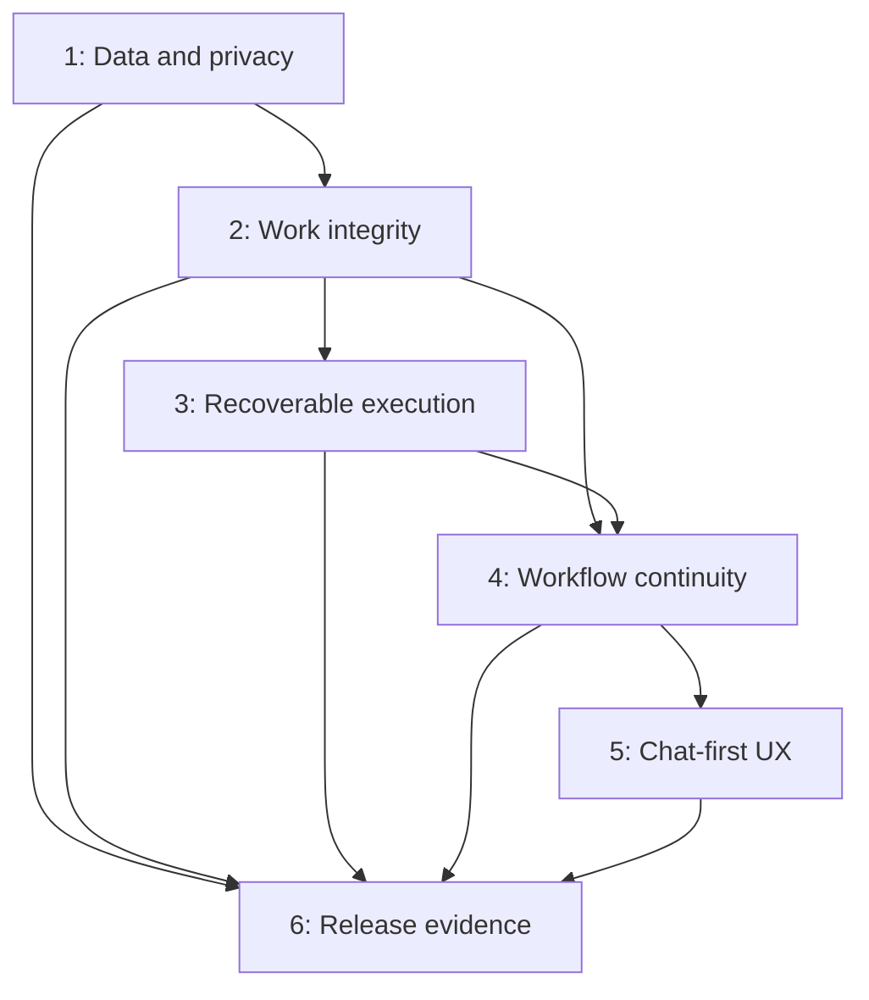

# Minnow review remediation plan

Date: 2026-10-23. Status: **planned; implementation not started**.

Source: [comprehensive review](../reviews/2026-10-23/COMPREHENSIVE-REPORT.md) and its [12 section reports](../reviews/2026-10-23/README.md). Review baseline: `ba2068d1c5353f86287f9a02b665fb7ea0bbac3f`. Recheck current source before starting a package; a finding may already have changed after that baseline.

## Direction and boundaries

**Chat-driven building is the center. Code is the central workspace and mainly a chat.** Supporting tools should help a person describe a goal, supervise work, try the result, request changes and approve delivery.

Prioritize preserving data and private context, then reliable execution, then continuity between surfaces, then the default experience. Keep the shared runner, worktree isolation, deterministic board core, revision checks and separate-origin previews.

**Reef's placement stays undecided.** Repair its confirmed faults in place. No separate launcher, extraction, distribution, rebranding, rail relocation or convergence project is included. A future placement decision is separate from this plan.

The present deliverable is an ordered execution plan; application fixes have not begun. There are no completed remediation items, assigned agents or delivery-date commitments. Package IDs below are planning identifiers, not issues already created in a tracker.

## Phase map

| Phase | Goal | Packages | Exit condition |
|---|---|---|---|
| **1. Protect stored data and private context** | Prevent credential loss, incoherent restore, unexpected payload persistence and retained revoked access. | A1–A5 | Concurrent/restart/fault tests establish the security and storage invariants below. |
| **2. Preserve workspace and conversation integrity** | Keep work, instructions and knowledge attached to their actual owner. | B1–B8 | Switching, concurrent chats and failure cannot silently lose drafts, misdirect actions or duplicate/drop accepted instructions. |
| **3. Make execution recoverable** | Contain bad records and failed processes; keep usable results and repair paths. | C1–C8 | Unrelated work remains usable after a job, model, integration, app record or initialization failure. |
| **4. Connect workflows and trustworthy delivery** | Carry one assignment through planning, boards, review and landing. | D1–D5 | Originating tasks reconcile after restart, and approval applies to the revision reviewed. |
| **5. Make chat and results the default experience** | Reduce setup and navigation burden; make outcomes, controls and accessibility clear. | E1–E6 | The core build/review/revise journey is usable without routinely opening code. |
| **6. Validate release behavior and prevent recurrence** | Close test/documentation gaps and exercise real supported environments. | F1–F4 | Recorded release evidence, current help and effective regression gates. |

Phases establish priority, not a requirement to serialize unrelated files. A bounded repair can land as soon as its dependencies and validation pass. Do not hold a finished safety fix for a whole phase-sized PR. Final release validation is cumulative; testing and documentation accompany every package.

Accessibility repairs in E1 can be pulled forward independently. Safety/permission documentation in A5 accompanies the corresponding repair rather than waiting for Phase 6.

## Execution rules

- Treat each package as a cohesive change with one acceptance contract. Split a larger package into the PRs named below; avoid a single remediation megabranch.
- Use existing stores and contracts before creating new ones. Unify user-facing identity and semantics without replacing all execution engines or forcing every surface into one controller.
- Add meaningful regressions at the failing boundary. Existing review scripts sometimes assert the bug and exit successfully; convert them into tests that assert the repaired invariant under `test/`. Do not copy their success criteria unchanged.
- Preserve compatibility and prior data. Define any migration's old/new forms, idempotence, failure behavior and rollback before changing persisted state. Never rotate an existing key as part of initialization or claim an overwritten key can be recovered.
- Keep uncertain risks separate from confirmed fixes. Reproduce or measure a risk before adding a structural rewrite to the critical path.
- Run targeted checks during each package and wider checks at integration milestones. Document unrelated baseline failures rather than suppressing them or weakening assertions.
- All runtime/fault/backup tests use disposable profiles and repositories. First repair the hardcoded diagnostic path before exercising provider-error integration fixtures. Never use the real profile as a restore or migration fixture.

## Phase 1 — Protect stored data and private context

**Priority:** immediate. These packages do not depend on product redesign.

### A1 — Stop private payload dumps and enforce profile isolation

- [ ] Replace unconditional full-request/provider-response dumps with bounded non-sensitive error metadata.
- [ ] Route all diagnostic paths through the configured Minnow home. Make detailed content capture explicit, redacted, permission-restricted and subject to retention.
- [ ] Test an actual provider-error boundary under a scratch home with filesystem spies proving no write reaches the primary home; include HTML error and ordinary HTTP refusal.

**Done when:** ordinary errors persist no full prompt/tool payload; alternate-profile errors stay under that profile; configured content capture has a clear lifecycle. Do not inspect, upload or automatically delete existing user diagnostics as part of the repair.

**Source:** MODEL-01 / 08-04. **Primary area:** `server/generations/upstream.js`, diagnostics and backup exclusions. **Dependency:** none. Land first so subsequent error-path tests are isolated.

### A2 — Make master-key initialization safe, then encrypt the HF token

- [ ] Coalesce concurrent initialization inside one process; use exclusive atomic creation across processes and read the winning key.
- [ ] Test simultaneous first encryptions, separate child processes, restart and malformed-key behavior. An existing invalid key must fail explicitly rather than be replaced.
- [ ] In a separate dependent PR, migrate plaintext `models.hfToken` to the existing encrypted secret mechanism. Keep masked/configured API responses and preserve backup secret classification.

**Done when:** every successfully stored synthetic envelope decrypts after concurrent initialization and restart; legacy HF token migration is repeatable and removes the plaintext only after a durable encrypted write. Already unreadable credentials get an actionable recovery/re-entry state; initialization does not invent recovery.

**Source:** 08-01, MODEL-03. **Primary area:** secret-box, Models settings/token resolver. **Dependency:** none for key repair; key repair before token migration. **PR split:** key invariant, then token migration.

### A3 — Make restore crash-safe and stop boot on unresolved recovery

- [ ] Persist a per-root restore journal around staged/parked/live transitions, with ordering/flush behavior appropriate to the supported platform.
- [ ] Make resume and rollback idempotent; preserve the previous profile and the existing staging/path/SQLite checks.
- [ ] Keep restore application staged and free of store imports; retain the pre-store startup boundary.
- [ ] Stop normal store initialization if recovery cannot establish a coherent profile; show an explicit recovery path.
- [ ] Kill a child process at each move boundary and restart against synthetic profiles, including an interruption during rollback.

**Done when:** each injected interruption yields a coherent old or restored profile, or an explicit recovery state before stores open. Repeated startup must not compound the failure or combine timelines.

**Source:** 08-03. **Primary area:** backup restore-apply and bootstrap. **Dependency:** none. **PR split:** journal/recovery contract and fixtures, then host recovery presentation if needed; do not ship the durable mutation without its boot guard.

### A4 — Make device revocation close existing privileged connections

- [ ] Retain device/credential identity on terminal connections and close matching sockets when revoked.
- [ ] Inspect other privileged long-lived transports for the same lifecycle gap; repair demonstrated equivalents within a bounded follow-up.
- [ ] Test real local WebSocket upgrade, revocation acknowledgement and subsequent input refusal with a mocked PTY. Include listener shutdown and credential-specific revocation.

**Done when:** a revoked credential cannot keep sending input over an existing connection; other devices remain connected; stale/cross-process credential state has an explicit revalidation policy.

**Source:** 08-02. **Primary area:** auth/device store, terminal WS and connection lifecycle. **Dependency:** none.

### A5 — Correct the security and permission explanations

- [ ] Resolve the contradictory Windows Require/Prefer guidance to match actual runtime behavior.
- [ ] Describe Plan's scoped file-write policy and intentionally allowed shell/external-tool behavior accurately; the path repair itself is B3.
- [ ] Align General's approval descriptions with the actual shared Full/Ask/Off policy.
- [ ] Keep encryption and diagnostic claims accurate during the A1/A2 transition; update architecture/storage notes with the implementation.

**Done when:** manual, Settings and agent-facing guidance agree with the implemented boundary on each supported host. Copy changes do not substitute for enforcement fixes.

**Source:** 12-03, CHAT-06 and related Plan/privacy findings. **Dependency:** update with each relevant contract change; no dependency for correcting existing contradictions.

**Phase 1 gate:** A1–A4 have regression evidence; migration/recovery failure states preserve existing data; A5 describes the actual state. No live profile testing.

## Phase 2 — Preserve workspace and conversation integrity

**Priority:** remaining loss/misdirection risks, before broad workflow or layout changes.

### B1 — Pass immutable delegation context per tool call

- [ ] Remove mutable global parent context from sub-agent execution decisions; pass chat, turn, tool-call, mode, workspace and captured model identity through the existing call context.
- [ ] Cover list/status/spawn with interleaved chats paused at config/permission gates and with the other chat's teardown.

**Done when:** A always reads/spawns for A regardless of B's progress or active UI selection. Extend the review's reproduced list crossover with an actual synthetic spawn-target test.

**Source:** CHAT-01. **Dependency:** none; A1 before provider-error fixtures.

### B2 — Pin issue Git operations to their originating repository

- [ ] Capture issue workspace/repository and intended branch/worktree once; carry cwd through branch, push, PR, commit lookup and retry paths.
- [ ] Verify project B's issue cannot mutate active project A, including a workspace change while an operation awaits.

**Done when:** all-workspaces issue actions operate only in the captured repository and append links to the correct issue. Existing read-only review scoping remains intact.

**Source:** 03-04. **Dependency:** none; do not wait for the larger task model in Phase 4.

### B3 — Enforce canonical Plan write containment

- [ ] Validate normalized destinations under the actual plans root, including mixed separators, absolute paths, `..`, case behavior and symlink/junction parents.
- [ ] Share validation semantics across client and server; preserve legitimate plan Markdown editing.

**Done when:** the actual Plan HTTP/tool write boundary rejects escaped destinations, not only the string helper. Intentional Plan shell policy stays separate and is documented in A5.

**Source:** CHAT-02. **Dependency:** none.

### B4 — Preserve drafts and invalidate stale editor/terminal actions

- [ ] Protect every dirty editor tab before checkout/chat-root transitions. Start with Save/Discard/Cancel or retained scoped drafts; do not require a large draft-store redesign for the first repair.
- [ ] Add activation/session checks after every terminal attach and Quick Edit await/callback; stale completions must not take ownership or enable Accept.
- [ ] Test inactive tabs, pending saves, reversed completions, cancellation and closing a view mid-request.

**Done when:** root changes cannot silently discard drafts, the selected terminal owns its socket, and only the owning completed Quick Edit can be accepted.

**Source:** W1–W3. **Dependency:** none. **PR split:** draft transition guard; terminal ownership; Quick Edit ownership. Durable cross-restart draft storage remains a separate scoped enhancement if needed.

### B5 — Keep learned knowledge in its source workspace

- [ ] Scope synthesis dedupe/link/retirement to explicit fact ownership. Define global/personal supersession separately from workspace facts.
- [ ] Persist origin workspace on proposals and use it at acceptance. Recover legacy origin from source chat where possible; require an explicit destination if ambiguous.
- [ ] Test two projects with matching topic titles, proposals reviewed in another window and deliberate personal/global knowledge.

**Done when:** learning for A cannot retire B's page; accepting A's proposal from B preserves A's destination; ambiguous legacy records are not guessed into the current project.

**Source:** B1/B2 in report 06. **Dependency:** none. **PR split:** automatic synthesis scope, then proposal schema/acceptance migration.

### B6 — Preserve each accepted instruction exactly once

- [ ] Replace last-write-wins steering with ordered identified entries or explicit recoverable replacement semantics.
- [ ] Acknowledge queued messages at durable user-row acceptance, independently of execution success.
- [ ] Test multiple Push now actions, direct steer plus queued steer, Stop, accepted failure, pre-admission failure and reload.

**Done when:** no accepted instruction disappears or simultaneously remains queued and sent; only work rejected before acceptance returns to the queue. Tool execution is not claimed to be globally exactly-once.

**Source:** CHAT-03/04. **Dependency:** coordinate with B1's call identity; no requirement to serialize all chats.

### B7 — Report partial Undo honestly

- [ ] Distinguish conversation rewind from file restoration; retain restore error and safety snapshot reference.
- [ ] Preserve a usable retry/recovery path on failure; determine operation ordering without erasing the only recovery record.

**Done when:** a chosen file restore failure is visible as partial success/failure rather than ordinary Undo success. Worktree Undo remains explicitly unavailable unless separately implemented and verified.

**Source:** CHAT-05 and report 01 D2. **Dependency:** draft/recovery semantics from B4 where affected.

### B8 — Make Models settings updates transactional

- [ ] Move read/merge/write into the existing serialized config updater.
- [ ] Test disjoint Models changes and Models-versus-General changes in parallel.

**Done when:** independent successful updates survive together, including migrated HF secret metadata; atomic file replacement alone is not treated as a transaction.

**Source:** MODEL-02. **Dependency:** coordinate with A2 token migration to avoid overlapping persistence edits.

**Phase 2 gate:** the interleaving, navigation, acceptance and cross-project cases pass at the actual caller boundary; old data loads safely. Core safety fixes are independently landable and need not wait for every Phase 2 package.

## Phase 3 — Make execution recoverable

**Priority:** reliable background work and usable supporting services. E3 speech polish is tracked below rather than blocking this phase.

| Package | Work and acceptance | Source | Dependency / suggested split |
|---|---|---|---|
| **C1. Isolate corrupt scheduled records** | List metadata even when a prompt is unreadable; decrypt within each job's failure boundary; retain repair/delete access. One bad row must not block healthy admission. | 09-01 | Independent; include A2-style key-loss and malformed-row cases without altering real keys. |
| **C2. Bound scheduled cancellation** | Use owned process-tree termination with graceful deadline, escalation and bounded settlement or explicit quarantine. Test ignored signals and descendants; do not free capacity while pretending unmanaged work stopped. | 09-03 | A1 before error fixtures. Separate shared cancellation utility changes from scheduler integration if necessary. |
| **C3. Preserve machine results independently of logs** | Use a separate result/control artifact with schema validation; keep human logs bounded. Long success/failure output must retain chat ID and outcome metadata. | 09-02 | None beyond safe test isolation. |
| **C4. Compose all quota/cooldown scopes** | Check every applicable provider/family/model blocker and probe owner; recovery at one scope must not clear another live quota. | MODEL-04 | None; keep tests deterministic with injected time. |
| **C5. Verify and repair existing model artifacts** | Reuse only verified revision/size/digest state or offer explicit bounded repair. Test truncated and same-size corruption plus split shards. Avoid hashing every large file on every normal launch. | MODEL-05 | None; fixture downloads only. |
| **C6. Recover supporting Code services** | Carry canonical root through editor LSP lifecycle/queries; retain dev-server action failures with Retry/Edit/Ask chat; retry failed Code initialization steps without rerunning successful ones. | W4/W5; 12-01 = report 02 R4 | B4; separate PRs for LSP, dev-server errors and per-step initialization. |
| **C7. Repair MCP tool identity** | Make server/tool names reversible and unique, retaining exact original dispatch names. Handle existing ambiguous IDs explicitly. Test both delimiter IDs and hyphen/underscore collisions against dispatch. | E1/E2 | None; do not silently rename saved IDs without migration/repair guidance. |
| **C8. Repair Reef faults in place** | Recover interrupted dependency installs; isolate malformed app records; validate composed initial request before persistence/admission. Align the stale picker test with actual provider-group interaction and retain CLI selection coverage. | REEF-01/02/03; report 10 test failure | A1 for error fixtures; separate lifecycle/record/admission repairs. No placement work. |

**Phase 3 gate:** one damaged record/service cannot hide healthy work; timeouts have observable bounded handling; result links survive long output; model/app repair can be retried without manual internal-directory deletion. The repeatable Reef test failure is resolved by preserving the intended interaction contract, not deleting coverage.

## Phase 4 — Connect workflows and trustworthy delivery

**Priority:** make planning, delegation, review and landing agree about the same assignment.

### D1 — Use one admission contract for issue launch paths

- [ ] Check eligibility before overwriting run metadata. Reuse admission across keyboard, palette, Dashboard and issue controls.
- [ ] Replace the nonexistent `write_file` path with the supported scoped save/handoff.
- [ ] Commit planned/in-progress status only after the corresponding artifact/run exists; retain prior state and retry details on failure.

**Done when:** a repeated shortcut cannot detach a running agent, a missing plan can be created through the real path, and rejected/failed launches leave truthful status.

**Source:** 03-01/02/05. **Dependency:** B1/B2 and the applicable save guard. Existing P1 admission overwrite can land early once verified, without waiting for the rest of Phase 4.

### D2 — Persist and reconcile issue/board ownership

- [ ] Store the actual issue↔chat/run/board association in all launch paths, including plain Issues Send-to-board.
- [ ] Derive progress/attention/review from durable execution state; reconcile on events, refresh and restart.
- [ ] Distinguish execution finished, verification passed, needs review and landed. Preserve existing ordinary chats and board journals.

**Done when:** a board's success/failure/cancel result reaches the originating issue after restart; dependent work is not stranded by an orphaned queued flag; verified but unmerged work is not called shipped.

**Source:** 03-03; shared result vocabulary in 03/04. **Dependency:** D1 and B1; C1–C3 where scheduled work feeds the same lifecycle.

### D3 — Bind approval to inspected content

- [ ] Extend the stronger Issues Work inspection contract to Dashboard merges: expected source/target heads, relevant branch identity and content fingerprint.
- [ ] Request and retain the explicit full PR head OID; use host-qualified repository review keys with conservative migration.
- [ ] Enforce the reviewed head at the final PR merge operation; freshness lookup failure requires recovery rather than fallback authorization.

**Done when:** an intervening source/target change or failed freshness read cannot land unseen content through a reviewed action. Ordinary explicit override, if retained, is separately labelled and cannot masquerade as approval of the old review.

**Source:** 04-01 through 04-04. **Dependency:** B2. **PR split:** PR identity/head metadata; Dashboard inspection enforcement; reviewed-PR final head enforcement. Pull P1 enforcement work forward as soon as its identity prerequisite exists; do not wait for UX redesign.

### D4 — Make scheduled admission and intervention explicit

- [ ] Return durable run identity promptly from Run now; distinguish submitting, admitted, running and terminal state.
- [ ] Add Stop current run independently of Pause future runs and Delete schedule, using C2's cancellation contract; retain history/chat.
- [ ] Correlate activity/notifications with that run and its owning conversation.

**Done when:** submission gets immediate truthful feedback, duplicate clicks are controlled, users can intervene, and pause/delete consequences are explicit.

**Source:** 09-04 and 09-05 proposal. **Dependency:** C1–C3; coordinate D2 state semantics. Stop is a scoped workflow enhancement rather than a previously verified existing capability.

### D5 — Update the contract vocabulary and authoritative help

- [ ] Document actual Plan→board behavior; remove obsolete `delegate_tasks` instructions.
- [ ] Define the common user-facing states in one shared mapping and adapt existing engines; avoid an up-front replacement task database.
- [ ] Make completion receipts carry actual checks/revision/unknowns where available. Unknown verification remains unknown.
- [ ] Codify the user-confirmed chat-first direction in PRODUCT.md and relevant prompts/help alongside the changes, without claiming unimplemented UX.

**Done when:** the assistant's official manual and the visible states agree, and the outcome UI in Phase 5 can consume trustworthy status/evidence.

**Source:** 12-02, report 01 D3, 03-06, 04-05. **Dependency:** D1–D4 contract decisions; update documentation with each shipped portion.

**Phase 4 gate:** goal/issue→plan→chat or board→checks→review→landing is traceable after restart. Negative scenarios include missing model, failed setup, duplicate dispatch, board failure, moved branch heads and failed remote freshness checks.

## Phase 5 — Make chat and results the default experience

**Priority:** product improvements on top of trustworthy execution. Keep functional repairs separate from design proposals.

| Package | Work | Acceptance | Dependency |
|---|---|---|---|
| **E1. Repair accessibility boundaries** | Contain/restore setup focus; hide/inert the covered desktop rail on phone; fix informational-text contrast and phone list semantics. Investigate the observed composer ARIA state before treating it as a universal defect. | Forward/reverse Tab stay in the correct surface; phone accessibility tree has no covered desktop navigation; sampled informational text meets contrast; valid populated/empty lists. Retain reduced-motion behavior. | Independent; pull forward. Sources UX-1–UX-4 and root scan. |
| **E2. Present useful results and verification** | Reuse an outcome view for request, demonstrated behavior, checks/revision, unknowns, Try/Open result and Request changes. Reveal diffs/logs/files as supporting evidence. | A user can judge progress, try the result and request a correction without opening source; a completed turn is never promoted to tested success without evidence. | D2/D5 and actual preview/server readiness; incrementally integrate engines. |
| **E3. Rebalance Code around conversation** | Make conversation dominant by default, keep project/task/checkout context visible and provide a predictable supporting result pane. Preserve remembered direct-edit layouts and obvious technical access. | New chat, running work, preview, failure and return-to-chat have consistent navigation; no draft/scope regression at narrow desktop widths or zoom. | B4, E2; source proposals 02 D1/D3 and 11 D1/D3. |
| **E4. Shorten the primary setup journey** | Reach a usable model, permission understanding, project and first goal; defer optional appearance/routing/search/GitHub/knowledge extras. Preserve restore and advanced setup. Recheck queued approvals after Always allow. | Fresh-profile users can reach the real composer without optional accounts/keys; optional failure does not imply the selected model is unusable; existing queued read approvals do not repeat needlessly after permission changes. | A5, E1; shared model/config contracts from A2/B8/C4. |
| **E5. Make recovery and model status actionable** | Keep Stop/Retry/partial Undo/restore consequences beside the task; explain unavailable worktree Undo; show actual bound model/pool and reason for waiting/rerouting. Distinguish optional-provider trouble from selected-model failure. | The next safe action and affected scope are clear; failures retain evidence and draft; model changes apply with accurate active-versus-next-run semantics. | B7, C2/C6, D4/D5; do not replace errors with generic success. |
| **E6. Make knowledge, integrations and costs understandable** | Show memory origin/provenance and correction path; provide a connection/capability receipt; display known cost plus unpriced coverage instead of unknown as $0. Preserve trusted-native versus sandboxed-panel distinctions. | A user can identify project/global scope, what an integration can access and whether cost totals are incomplete. Defaults describe shipped dictation/read-aloud, not a future duplex voice feature. | B5, C7, D5; MODEL-06 and reports 06/07 proposals. |

Design E2–E4 as small reviewable flows before implementation; validate defaults with a fresh profile and a person who mainly works through conversation. Do not turn layout work into removal of editor, Git, terminal or expert controls.

**Phase 5 gate:** describe goal→watch work→try result→request change→review/approve works in Code, with keyboard access, clear scope and honest verification. Validate phone and direct-edit regressions separately. No claim of whole-product WCAG certification from token tests alone.

## Phase 6 — Validate release behavior and prevent recurrence

| Package | Deliverable and acceptance |
|---|---|
| **F1. Run the integrated regression/release matrix** | Discovery, architecture, TypeScript, full test suite, required product-wiki/board contracts, normal production build and bundle budgets. Exercise packaged headless/Desktop and supported OS lanes; keep actual native install/update evidence distinct from reducer tests. Record baseline/unrelated failures explicitly. |
| **F2. Verify realistic user journeys** | Disposable-repo cases for local/worktree chats, provider failure, stop/retry/restart, long output, board→issue reconciliation and intervening commits before approval. Add opt-in real local/hosted/native-CLI, physical GPU and phone checks with documented environments and test budgets. Synthetic providers do not measure build quality. |
| **F3. Align CI guidance and shipped docs** | Reconcile the intended required status checks with branch-protection guidance; inspect actual remote settings before proposing an administrative change. Replace duplicated counts with generated references; refresh first-run, Scheduler and permission/verification help. Rebuild the shipped wiki through normal tooling after manual edits. |
| **F4. Establish measured performance baselines** | Measure first usable chat, cold/warm installed start, project switch and long-history reopen on documented hosts. Investigate eager imports/retained memory before budget increases. Current baseline: 11,707.2 KB budgeted assets against 11,725 KB; a passing loader harness does not establish full startup speed. |

F1–F4 collect evidence throughout the earlier phases; do not postpone regressions, safety documentation or package-level validation until the end. Keep current bundle ceilings; justify any proposed increase with measurements and the repository's normal budget-change process.

## Dependencies and parallel work

The diagram shows milestone order, not every code dependency. Key exceptions:

- A1, A2 key initialization, A3 and A4 are independent implementation areas. HF migration follows the key fix.
- B1/B2/B3/B5 can proceed independently; coordinate B4's shared UI files and B8/A2's config writes.
- P1 issue admission and reviewed-merge enforcement may land before the complete Phase 4 milestone when their prerequisites pass.
- E1 accessibility repairs need no state-model redesign. E2 outcome UI requires real execution evidence and state semantics, so it follows D2/D5.
- Avoid concurrent edits to shared session, config, issue store and chat adapter contracts without explicit ownership. No agents are launched by this plan.

## First execution batch

Start with these bounded, independently reviewable changes:

1. **A1:** remove unconditional payload logging and prove scratch-home isolation.
2. **A2, first PR:** fix key initialization and test same-/multi-process first use.
3. **A3:** define and implement durable restore recovery with fault-boundary tests and a boot guard.
4. **A4:** close credential-bound terminal connections on revocation.
5. **B3 and B1:** close Plan traversal and global delegation-context races; both are independent of product redesign and can be prepared in parallel with distinct file ownership.

Follow with A2's token migration, B4 draft preservation and B5 knowledge scope. Carry A5 documentation with the relevant repairs. These are the first implementation priorities, not a claim that other P1 findings are acceptable to leave unresolved.

## Deferred investigations and smaller work

Keep these visible without treating unmeasured risk as a confirmed defect or blocking critical repairs:

| Investigation | Decision/evidence required before larger changes |
|---|---|
| Long-build requirement retention | Test changed/later/non-English constraints across compaction and model switches; decide whether a separate inspectable requirements record improves measured outcomes. |
| Remaining document/dictation/attachment races | Reproduce same-path cross-root tab misuse, delayed formatting/completion edits, pending transcription after chat switch and reference-root handling. Preserve current absolute-path mitigation. |
| Brain proposal concurrency and ingest/reject semantics | Reproduce concurrent store loss; define update-versus-create and rejecting an updated memory before changing persistence or deletion behavior. |
| Large Brain/Reef histories | Benchmark scoped corpus reads, full-history live payloads and revision-heavy app libraries before indexing/pagination/retention changes. |
| MCP result/discovery behavior | Specify supported error/media/resource results and budgets for slow connectors; avoid silently representing non-text results as success. Test before extending the adapter contract. |
| Voice cancellation | Fix E3's pending start promise in a small bounded patch when convenient; production-controller mitigation makes it lower priority than the P1 work. |
| Webhook lifecycle | Decide whether disable cancels queued retries; test DNS deadlines and subscription changes with local fixtures. |
| PTY/startup resources | Measure abandoned-session capacity and duplicate dev-server starts; audit real process descendants and retry behavior on supported OSes. |
| Reef acceptance/steering/containment | Evaluate generated-check coverage and supported-utility explanations separately from placement. No extraction, new launcher or distribution decision. |
| Hidden apps and broad decomposition | Preserve release gates, data compatibility and reused modules. No release/removal of hidden apps and no wholesale controller rewrite in this plan. |

## Completion tracking

All packages are initially **not started**. For each completed package record: implementation/PR reference, exact findings covered, migrations and compatibility, checks and platform evidence, remaining limitations and any changed dependency. A test passing by asserting today's defective behavior does not close a package.

The phase gates are the release/readiness criteria. Do not mark a phase complete because code landed if recovery, migration or integration evidence is still missing. Keep product proposals distinguishable from shipped behavior when updating the manual and review follow-ups.
