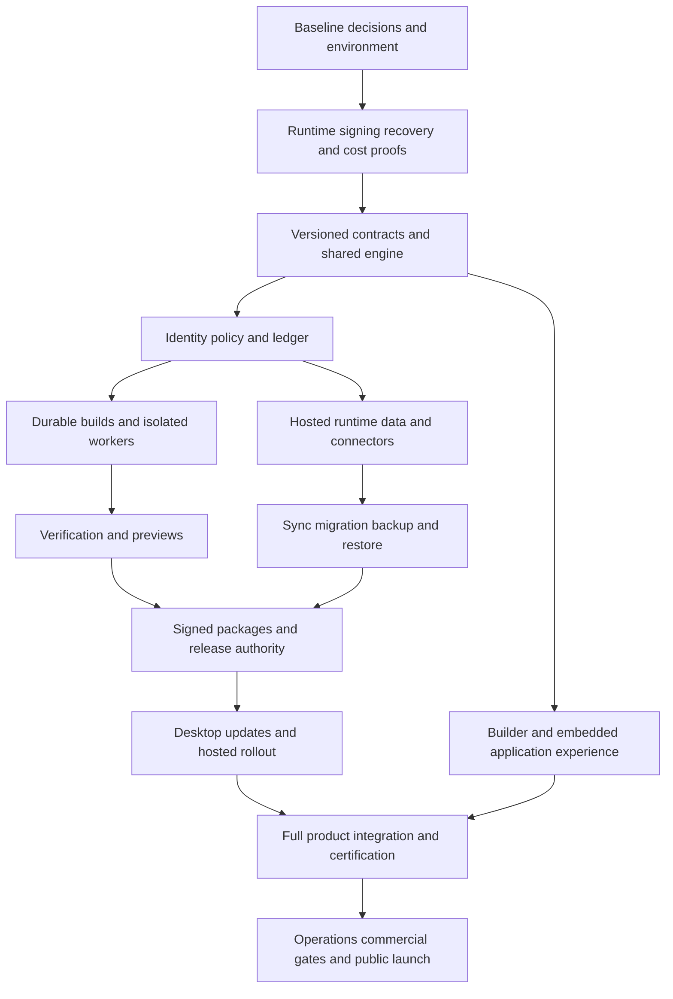

# Spore Complete Launch Implementation Plan

**Date:** November 13, 2026  
**Status:** Planned, not implemented  
**Product contract:** [Spore PRD 1.1](spore-prd.md)  
**Review:** [Gaps and contradictions](spore-prd-review.md)  
**Traceability:** [Requirement coverage matrix](spore-requirement-coverage.csv)

This plan delivers the complete Spore product in one public launch. Its 64 work packages define dependencies, accountable roles, concrete outputs, and verification. Internal integration checkpoints are engineering controls, not smaller product releases. All 147 numbered PRD requirements, 40 acceptance scenarios, and the non-numbered launch obligations must close before public signup opens.

The work authorized by this planning document is specified below; writing the plan does not execute infrastructure purchases, publish software, create accounts, or mark tests complete. All work packages initially have status **not started**. Owners are role assignments to be filled with named people before execution.

## 1 Execution rules

1. The PRD controls behavior. This plan controls implementation order and evidence. An architecture decision cannot silently reduce a product promise.
2. Decision records D-01 through D-13 close before the affected design is frozen. A rejected vendor or failed feasibility proof stops the dependent branch until a compatible solution is proven.
3. Build a separate Spore product with its own accounts, identity, service, profile, releases, and support. Do not transform the live Minnow checkout or user profile into Spore.
4. Reuse shared engine contracts and test fixtures. Do not transplant the entire Minnow shell or create a second independent tool loop.
5. Treat generated application code, build scripts, dependencies, documents, and model responses as untrusted at their respective execution boundaries.
6. Maintain exact requirement-to-task-to-test-to-release evidence. A passing unit test or successful demo cannot stand in for a required production integration or packaged-platform test.
7. Keep existing user changes intact. Record the current baseline and use isolated implementation branches/worktrees when execution begins; this plan creates no branch or repository.
8. Do not bulk-create tracker issues until task ownership and repository placement are settled. The SP identifiers below are stable planning references suitable for later issue creation.

## 2 Target repository and component layout

The proposed destination is a new **Spore monorepo**. The following are planned paths, not existing files in Minnow. Choose the actual location in SP-001 before creating it.

| Proposed target | Responsibility |
| --- | --- |
| `apps/builder-web/` | Browser builder, library, chat, preview, administration |
| `apps/builder-desktop/` | Desktop builder shell, managed local-worker installation and device handoff |
| `apps/app-host/` | Branded generated-app shell, trusted broker, local storage, bundle activation, embedded chat |
| `services/control/` | Accounts, apps, conversations, requests, authorization, entitlement state |
| `services/build-coordinator/` | Durable jobs, checkpoints, leases, budgets, repair/reconciliation |
| `workers/build/` | Disposable implementation, dependency, verification, and packaging jobs |
| `services/runtime/` | Hosted ingress, trusted business data/capability API, policies, jobs |
| `services/provisioner/` | App resources, environments, regions, domains, reconciliation and cleanup |
| `services/connections/` | OAuth/token vault, connector actions, effect receipts, notification/payment brokers |
| `services/releases/` | Immutable manifests, approvals, signing requests, channels, deployment coordination |
| `services/commerce/` | Rate cards, subscriptions, ledger, reservations, metering, reconciliation |
| `packages/contracts/` | Versioned app, execution, data, identity, sync, release and event schemas |
| `packages/app-sdk/` | Generated-app capability API and local/hosted compatibility contract |
| `packages/design/` | Accessible generated-app components and theme primitives |
| `packages/local-runtime/` | Restricted execution, native broker, local database and offline queue |
| `packages/sync/` | Operations, conflict handling, tombstones, snapshots, recovery epochs |
| `infra/` | Reproducible environments, networks, secrets references, capacity, observability |
| `test/contracts/`, `test/integration/`, `test/acceptance/`, `test/packaged/` | Boundary, live-integration, user-journey and installed-platform tests |
| `documentation/decisions/`, `documentation/evidence/`, `documentation/runbooks/` | Decisions, immutable evidence references, operator procedures |

Use the repository's existing Node/TypeScript patterns where useful. Select concrete framework, database, queue, and package-tool versions through recorded decisions and pin them; this plan does not presume that unspecified vendor libraries already satisfy the contract.

The canonical shared agent package is extracted from Minnow's runner and consumed by both products through a versioned dependency. Preserve origin/provenance and a single maintenance location. Its API must not import either product's DOM, profile singleton, billing, or app registry. Separate policy/model adapters only when the import audit demonstrates a clean boundary; do not front-load a broad unrelated Minnow refactor.

### 2.1 Mandatory trust and data contracts

- **Execution identity:** account/business, app, environment, actor, role/policy revision, request, source revision, budget reservation, worker lease and fencing token.
- **App schema:** stable entity/field IDs, validated types, decimal/date/time rules, relationships, indexes, access policy, attachments, migrations, offline/conflict rules, and capability declarations.
- **Mutation envelope:** operation ID, expected record revision, principal, policy revision, recovery epoch, schema version, idempotency/effect key, and correlation ID.
- **Source capsule:** verified source/brief revision, dependencies, assets/provenance, migrations, runtime recipe, integrity digest, and ownership metadata without secrets or executable old grants.
- **Release manifest:** immutable app identity, bundle/host artifacts, target matrix, signature provenance, required capabilities, schema/sync compatibility, verified scenarios, migration plan, approval record and rollout policy.
- **Ledger:** integer minor units/precise metered units, rate-card version, reservation, provider attribution, settlement/reversal, invoice and webhook identity. Never implement money with imprecise floating-point accumulation.
- **Effect receipt:** intent, provider idempotency key where supported, dispatch attempt, accepted/rejected/uncertain result, reconciliation evidence and cancellation limit.
- **Recovery manifest:** database point, object versions, operation cursors, deletion/revocation state, key references, outbox receipts and new recovery epoch.

### 2.2 Proposed service API inventory

These are planned interfaces to freeze in SP-007, not routes that exist in Minnow. Business/application APIs and control APIs use distinct origins and token audiences. Every mutation accepts a durable idempotency key, derives actor/tenant from verified credentials, and uses expected revisions where stale state matters. A request body cannot assign its own authority. Responses carry correlation and operation IDs without exposing credentials.

| Interface | Authority and contract | Owning tasks |
| --- | --- | --- |
| `POST /v1/apps`, `GET /v1/apps` | Authenticated business/app creation; slim paginated library; complete request validation before persistence | SP-012, SP-013, SP-051 |
| `GET/PATCH /v1/apps/{app}/brief` | Builder access and expected brief revision; append decision history | SP-012, SP-020 |
| `POST /v1/apps/{app}/changes` | Build grant, source base, approved spending maximum and processing policy; durable admission receipt | SP-017, SP-048 |
| `POST /v1/changes/{change}/commands` | Stop, resume or steering with authority and expected execution revision | SP-017, SP-052 |
| `GET /v1/apps/{app}/events` | Scoped replay cursor; bounded deltas and snapshot recovery without transcript leakage | SP-017, SP-052, SP-057 |
| `POST /v1/apps/{app}/previews` | Exact candidate and dataset authorization; returns short-lived isolated preview grant | SP-022 |
| `POST /v1/apps/{app}/releases/{release}/approvals` | Publisher reauthentication where required; exact manifest hash, capability/data impact and expiry | SP-041, SP-054 |
| `POST /v1/apps/{app}/releases/{release}/publish` | Current policy and fenced release coordinator; compare-and-swap active release | SP-041, SP-046 |
| `POST /v1/installations/enroll` | One-use device/app grant and verified OS/device binding | SP-016 |
| `GET /v1/installations/{installation}/updates` | App/platform/channel authorization; signed metadata and expiring download grant | SP-045 |
| `POST /v1/installations/{installation}/health` | Device-scoped signed receipt; release/runtime/data epoch correlation | SP-045, SP-057 |
| `POST /runtime/v1/data/query`, `/mutate` | App and end-user/job audience; trusted typed policy broker; no raw production credentials | SP-014, SP-024, SP-025 |
| `POST /runtime/v1/sync` | Principal, device, schema and recovery epoch; accepted/rejected/conflicted operation receipts | SP-035 |
| `POST /v1/apps/{app}/environments` | Hosted entitlement plus provisioning capability; durable provider reconciliation | SP-023, SP-047 |
| `POST /v1/apps/{app}/connections` | Owner/admin connection grant; provider scope request and protected callback | SP-027 |
| `POST /runtime/v1/actions/{action}` | User or job action authority, connection handle, budget and effect receipt | SP-026 through SP-032 |
| `POST /v1/apps/{app}/recovery` | Owner-approved recovery point, newer-write impact and fenced cutover | SP-038 |
| `POST /v1/apps/{app}/exports` | Separate source/data grants; export receipt, integrity and expiring download | SP-012, SP-039, SP-040 |
| `POST /v1/apps/{app}/lifecycle` | Distinct archive/pause/transfer/delete operations; expected ownership and billing revisions | SP-040, SP-050 |
| `GET /v1/billing/usage`, `POST /v1/billing/purchases` | Billable business permission; rate-card version; explicit maximum and receipt | SP-047 through SP-050 |

Provider callbacks/webhooks are separate signed endpoints with replay protection. Provisioning, signing and ledger service-to-service APIs are private and use workload identities; they are never exposed as unrestricted generated-app tools. Large uploads/exports use scoped object grants with content/size/integrity validation rather than flowing unbounded data through ordinary control requests.

### 2.3 Required transaction and authority boundaries

1. **Admission:** validate full intent and current authority, reserve budget, persist source/brief base and request, then enqueue through a durable outbox. If the ledger and job store are separate, reconcile a reservation/intent saga; neither a stranded reservation nor an unreserved running job is acceptable.
2. **Execution:** claim a fenced lease, prepare only the scoped source revision, run under its capability ceiling, and durably checkpoint before exposing completion. Late worker messages cannot advance a replaced lease.
3. **Candidate:** bind verified results to the immutable source/artifact/migration digest. Steering or rebasing changes that digest and invalidates stale evidence.
4. **Publication:** recheck publisher grant, signed manifest, target completeness, environment revision and migration readiness. Fence publication, data writes and scheduled jobs as required. Update active identity through a recorded compare-and-swap, not a best-effort sequence of unrelated writes.
5. **Installation:** verify and stage locally, preserve pending work, activate with a journal and collect health. Server publication does not imply installation success.
6. **Settlement:** reconcile model/provider/effect receipts, charge only authorized usage, release remaining reservation and retain audit identity. Cancellation cannot reverse an external action that already committed.

Authorization-related service outages must use an outage/error state rather than pretending the user's permissions were changed. Count failures of promised serving operations in the availability measurement even when failing closed is the correct security behavior.

## 3 Ordering and integration checkpoints

| Checkpoint | Exit evidence | Next work unlocked |
| --- | --- | --- |
| IC-0 Baseline and long-lead work | SP-001/002/008, named decision owners, provider/signing applications submitted, baseline recorded | Feasibility proofs and contract design |
| IC-1 Architecture proven | SP-003 through SP-007; actual local/hosted parity, signing, recovery and cost evidence | Production implementations against frozen contracts |
| IC-2 End-to-end internal integration | One app created, installed, changed and updated using real identity, budgets, isolated workers and source capsule; include a hosted and offline-data path | Broader workflow, integration and platform certification |
| IC-3 Feature-complete release candidate | All implementation packages complete; all advertised connector actions available; draft support and operations material | Frozen benchmark, adversarial review, load/restore/packaged tests |
| IC-4 Launch approval | SP-060 through SP-064 and every PRD gate satisfied against exact release/configuration | One full public launch |

The dependency graph is intentionally not equivalent to numeric task order. For example, durable build admission depends on the ledger, and publication depends on recovery capability. UI work can use contract fixtures early but is not complete until connected to the production service implementations.

## 4 Work packages

Each package's verification includes its lower-level automated tests and the referenced AT acceptance scenarios. AT references are integration coverage, not permission to omit granular tests. Dependencies below are exit prerequisites; design work can overlap, but dependent deliverables cannot be declared complete against missing implementations.

### SP-001 Baseline provenance and repository ownership

**Owner:** Engineering lead. **Dependencies:** None.  
**Requirements:** ARCH-08. **Acceptance:** AT-20, AT-26.

**Deliver:** Record Minnow HEAD, existing modifications, current runner imports and affected test baseline. Inventory Reef from the pinned pre-extraction commit, including known review defects. Establish the new Spore repository, shared-package maintenance location, naming, local storage roots and release identities. Inventory licenses/notices and contribution provenance without assuming that ownership of one repository resolves all dependency obligations.

**Verify:** Minnow and Spore fixtures can run with separate scratch profiles; no test reads a live user home. Every imported source subtree has a pinned origin, owner and test inventory. Unrelated Minnow work remains unchanged.

### SP-002 Close product vendor and platform decisions

**Owner:** Product and platform leads. **Dependencies:** SP-001.  
**Requirements:** PKG-04, ARCH-06, ARCH-07, SEC-08, OPS-09. **Acceptance:** AT-20, AT-40.

**Deliver:** Own D-01 through D-13, with named decision-makers and evidence deadlines. Start production OAuth verification, email/domain reputation setup, signing enrollment, payment onboarding, data-region and vendor reviews immediately. Freeze precise OS/browser/architecture versions, package formats, processing policy, rate-card definitions and support lifetime after the proofs. Record compatible alternatives and stop conditions for a vendor denial.

**Verify:** Each decision has a dated record and closure evidence. No launch requirement is marked optional merely because the vendor application is pending. Public pricing and retention terms cannot be finalized from unmeasured assumptions.

### SP-003 Prove runtime and sandbox feasibility

**Owner:** Runtime and security engineering. **Dependencies:** SP-001, SP-002, SP-008.  
**Requirements:** ARCH-02, ARCH-09, SEC-03, SEC-13. **Acceptance:** AT-22, AT-32, AT-36.

**Deliver:** Build a representative app using relationships, decimal/date fields, attachments, one transaction and one queued action against local and hosted adapters. Prove local generated-code isolation and full local build-tool isolation separately on each target. Record memory/CPU/process/network/host-file restrictions, installation prerequisites and fallback behavior.

**Verify:** Adversarial code cannot read sibling files, host credentials or metadata services, spawn unrestricted processes, or exfiltrate through undeclared networking. A Node subprocess or existing provider sandbox report alone is not a pass. If a target fails, revise the design before SP-007 freezes its contract.

### SP-004 Prove signed host and bundle update design

**Owner:** Desktop and release engineering. **Dependencies:** SP-003, SP-008.  
**Requirements:** PKG-09, REL-03, REL-05, BILL-08. **Acceptance:** AT-14, AT-29.

**Deliver:** Produce two separately branded installed apps with independently signed hosts and signed external app bundles. Demonstrate host-only security patching without inference or an app rebuild, bundle-only updates, trust-root rotation, stable identity and private delivery. Use actual supported desktop signing/update mechanisms.

**Verify:** OS signatures remain valid; updating one app never changes the other's data/channel. Tampering, replay and a wrong-app bundle fail before execution. A cancelled subscriber receives the supported host patch. Restart, partial download and locked-file failures recover. Record the chosen design as D-08/D-11 evidence.

### SP-005 Prove backend recovery and migration semantics

**Owner:** Data and platform engineering. **Dependencies:** SP-003, SP-008.  
**Requirements:** DATA-09, DATA-13, REL-06, ARCH-06. **Acceptance:** AT-08, AT-09, AT-27.

**Deliver:** On candidate infrastructure, create realistic database and object histories, incremental/journal recovery, a schema migration, stale device operations and external-effect receipts. Restore a consistent recovery set and fence old workers/clients. Measure recovery at the included-size envelope and test a location outage scenario.

**Verify:** Meet proposed RPO/RTO without resurrecting deletions or replaying side effects. Demonstrate provider object/version retention is sufficient, not just database rollback. Freeze a viable provider/adapter only after the full set can be restored; otherwise select an alternative preserving requirements.

### SP-006 Validate economics capacity and support obligations

**Owner:** Product, finance and operations. **Dependencies:** SP-002, SP-008.  
**Requirements:** ARCH-07, BILL-01, BILL-08, HOST-07. **Acceptance:** AT-17, AT-38, AT-40.

**Deliver:** Establish representative workload sizes and a cost workbook/model covering inference, images/voice, repairs, workers, signing, source/artifacts, backups, hosting, email, identity, payment fees and support. Include cancelled customers' host-security delivery and idle app retention. Calculate median/p90/p99 sensitivity and launch concurrency budgets; propose the actual customer rate card and overspend reserve.

**Verify:** Record the PRD contribution-margin calculation with measured inputs where available and explicit uncertainty elsewhere. SP-060 refreshes it with full benchmark measurements. USD 20 pricing is not approved solely because a hosting vendor's entry price is low.

### SP-007 Freeze shared contracts and compatibility rules

**Owner:** Architecture lead. **Dependencies:** SP-003, SP-004, SP-005, SP-006.  
**Requirements:** ARCH-01, ARCH-09, APP-01, APP-04, REL-13. **Acceptance:** AT-08, AT-28, AT-35.

**Deliver:** Implement `packages/contracts/` schemas for the identities and envelopes in section 2.1. Define transaction boundaries, role/policy revisions, typed data semantics, error categories, protocol support window, pending-operation preservation, rate versions and release eligibility. Publish valid/invalid fixtures and generated client/server types.

**Verify:** Both adapters reject incompatible types, unknown capabilities, forged actors and stale revisions consistently. Old/new protocol compatibility tests are executable. Decisions include examples for dates/DST, decimals, nulls, file references, transaction limits and recovery epochs.

### SP-008 Bootstrap reproducible development and service environments

**Owner:** Infrastructure engineering. **Dependencies:** SP-001, SP-002.  
**Requirements:** SEC-02, SEC-07, SEC-10, OPS-08. **Acceptance:** AT-22, AT-24.

**Deliver:** Create dev/staging/production isolation, infrastructure-as-code, secret references, workload identities, network boundaries, artifact registry and CI. Separate privileged signing/release jobs from generated-code workers. Pin dependencies/toolchains, generate dependency inventory and scan build inputs. Provide portable fixture homes and deterministic fake providers for tests.

**Verify:** A worker cannot acquire production/signing authority through CI variables or artifact uploads. Recreate a staging environment from code and restore its protected configuration. Clean-checkout CI runs the designated build/type/contract checks on every supported executor.

### SP-009 Extract and integrate the shared agent engine

**Owner:** Agent engineering. **Dependencies:** SP-001, SP-007.  
**Requirements:** BUILD-04, BUILD-07, ARCH-01, ARCH-08. **Acceptance:** AT-02, AT-04.

**Deliver:** Extract the minimum host-neutral runner entry points from `server/runner/`, with injected model/tool/transcript/event dependencies. Port continuation, cancellation, bounded context, structured outcomes and event tests. Adapt both Minnow and Spore consumers through versioned interfaces rather than source-copying the engine into each product.

**Verify:** Run relevant existing runner/headless tests, Spore contract tests and Minnow regression checks against a clean baseline. The package has no renderer, Minnow profile, app registry or Spore billing import. A headless bundle runs without the source tree or developer dependencies.

### SP-010 Model gateway and auxiliary inference

**Owner:** Agent and platform engineering. **Dependencies:** SP-002, SP-007, SP-008, SP-009.  
**Requirements:** BUILD-13, SEC-08, SEC-02, CHAT-07. **Acceptance:** AT-17, AT-38, AT-39.

**Deliver:** Adapt provider routing, streaming, cancellation and usage from Minnow into a service-owned gateway. Define separate development/runtime AI meters, image and voice processing, redaction/consent labels, authorized provider-region fallback and model-version rollout. Emit signed usage facts to the commerce contract; do not debit balances inside provider adapters.

**Verify:** Failover preserves privacy policy and budget identity. Duplicate, missing, delayed or partial usage reports reconcile without invented certainty. Provider outage, context exhaustion, malformed output and auxiliary-model failure have bounded recovery and visible outcomes.

### SP-011 Tools capabilities and mutation policy

**Owner:** Agent and security engineering. **Dependencies:** SP-007, SP-009.  
**Requirements:** CHAT-05, CHAT-06, BUILD-03, ARCH-02, SEC-04. **Acceptance:** AT-12, AT-22, AT-32.

**Deliver:** Reuse the shared permission classification/dispatch patterns with explicit Spore app/environment/actor capabilities. Separate source mutation, runtime data actions, provisioning intent and release authorization. Recheck grants before effects and after human waits. Define bounded file/shell/network tools for workers and an exact approval envelope for consequential operations.

**Verify:** Prompt injection, altered tool parameters, revoked grants, forged source paths and stale approval receipts cannot cross boundaries. No model tool directly holds signing, unrestricted provider-admin or production database credentials.

### SP-012 App source vault brief and legacy import

**Owner:** App lifecycle engineering. **Dependencies:** SP-007, SP-009, SP-011.  
**Requirements:** APP-01, APP-02, APP-06, APP-08, APP-11, DATA-01, DATA-02. **Acceptance:** AT-02, AT-19, AT-26.

**Deliver:** Adapt Reef's app/source lifecycle into durable normalized records, private source capsules, versioned briefs, bounded retrieval and isolated source revisions. Add explicit legacy Reef import from a selected scratch copy, per-record validation and quarantine. Duplicate source with new identity and no copied credentials/grants.

**Verify:** One malformed app never hides the library. Capsule import restores a maintainable app without replaying work. Source, private chat and data permissions remain distinct. List queries return summaries and paginate history rather than serializing every build transcript.

### SP-013 Accounts businesses apps and membership

**Owner:** Identity/control engineering. **Dependencies:** SP-007, SP-008.  
**Requirements:** AUTH-01, HOST-05, HOST-09, APP-01, SEC-11, ARCH-03. **Acceptance:** AT-10, AT-12, AT-13, AT-34.

**Deliver:** Implement control entities and migrations for accounts, businesses, memberships, app ownership and invitations. Separate builder identity from generated-app identity and connected-service identity. Establish immutable app IDs, expected-revision writes, audit events and minimum-owner recovery rules.

**Verify:** Invite acceptance, expiration, wrong-account acceptance, duplicate identities, owner removal and recovery cannot create orphaned authority or cross-business access. Direct API tests cover every membership mutation, not just UI controls.

### SP-014 Trusted data authorization and policy cache

**Owner:** Security and data engineering. **Dependencies:** SP-007, SP-011, SP-013.  
**Requirements:** AUTH-08, CHAT-02, CHAT-03, CHAT-04, CHAT-06, SEC-06, ARCH-03, ARCH-10. **Acceptance:** AT-12, AT-13, AT-32, AT-33.

**Deliver:** Compile business access policy into a trusted runtime data broker using verified user/job principals. Enforce row/field/action/file policy, joins/search/aggregate visibility and privileged migration separation. Define signed, bounded policy caches and revocation epochs for serving during control-plane loss.

**Verify:** Raw credential access and generated administrator assertions fail. Exercise list/count/search/export/attachment leaks, background principals and revoked builders. Cache expiry fails closed as specified; forged or cross-app snapshots cannot authorize operations.

### SP-015 Managed sign-in and account security

**Owner:** Identity engineering. **Dependencies:** SP-002, SP-013, SP-014.  
**Requirements:** AUTH-01, AUTH-02, AUTH-03, AUTH-04, AUTH-10, SEC-11. **Acceptance:** AT-10, AT-16, AT-33, AT-40.

**Deliver:** Complete email, Google and Microsoft sign-in for generated apps and the builder's own login/recovery/MFA lifecycle. Implement verified identity linking, redirect/state handling, invitation-only policy, session listing, expiry and revocation. Complete production provider configuration and approvals, not only developer-mode flows.

**Verify:** Wrong redirect, replay, unverified email collision, account recovery and cross-origin session confusion fail safely. Test denial, blocked organization consent, provider outage and healthy-connectivity revocation bounds using real provider test tenants.

### SP-016 Device enrollment and web desktop handoff

**Owner:** Desktop and identity engineering. **Dependencies:** SP-004, SP-007, SP-015.  
**Requirements:** UX-09, PKG-10, HOST-11, SEC-04, SEC-11. **Acceptance:** AT-20, AT-34, AT-35.

**Deliver:** Create short-lived device-link grants, authenticated deep links, installation grants and app-scoped sessions. Handle multiple OS users, user sign-out, device loss and reconnect. Web builder handoff requires a verified app/device target and cannot grant arbitrary local folder access.

**Verify:** Replay, malicious URL parameters, wrong user/app, expired grant and localhost-origin attacks fail. Standalone local records remain available after subscription expiry, while business cached records obey access policy. No cross-app keychain or data-directory adoption occurs.

### SP-017 Durable change requests and execution coordination

**Owner:** Lifecycle engineering. **Dependencies:** SP-012, SP-014, SP-048.  
**Requirements:** BUILD-01, BUILD-02, BUILD-07, BUILD-08, BUILD-10, ARCH-04, ARCH-05. **Acceptance:** AT-04, AT-05, AT-06, AT-38.

**Deliver:** Implement request admission with budget reservation, durable outbox, execution lease/fencing, ordered steering and app source revision. Separate request/build/release/install states. Bind stop/resume/retry to the same request and accounting identity, with fixed retry/repair/deadline counters.

**Verify:** Crash before/after admission, lost response, duplicate delivery, lease expiry and leader replacement produce one authorized job and no conflicting publication. Simultaneous requests preserve final intent. No restart grants fresh money or repair attempts.

### SP-018 Disposable cloud build workers

**Owner:** Build infrastructure. **Dependencies:** SP-008, SP-011, SP-017.  
**Requirements:** BUILD-03, BUILD-09, BUILD-10, SEC-03, SEC-05. **Acceptance:** AT-04, AT-22.

**Deliver:** Provision isolated workers with scoped source, controlled dependency egress, CPU/memory/disk/process/time limits, model gateway access and no production authority. Support browser verification and platform-specific packaging pools. Drain/kill workers on lease loss and clean resources through a reconciler.

**Verify:** Host/network/credential escape attempts fail. Kill workers during install, tests and artifact upload; jobs resume with checkpoint/cost integrity. Orphan sweeps reclaim billable resources without deleting active jobs. Saturation queues work honestly and preserves tenant fairness.

### SP-019 Managed local build execution

**Owner:** Desktop runtime engineering. **Dependencies:** SP-003, SP-011, SP-016, SP-017.  
**Requirements:** BUILD-09, BUILD-10, PKG-03, SEC-13, DATA-02. **Acceptance:** AT-04, AT-20, AT-36.

**Deliver:** Package a managed local-worker installer, verified toolchain cache, sandbox capability probe, disk checks and resume journal. Use the same engine/job/model gateway contracts as cloud execution. Describe remote signing and inference processing before the owner chooses this route.

**Verify:** Clean machines require no developer setup. Sleep/resume, sandbox unavailability, antivirus/file locks, missing dependency cache and low disk preserve work. Cloud fallback requires explicit consent. A failed capability probe never starts unrestricted build scripts.

### SP-020 App planning generation and change reconciliation

**Owner:** Agent/app engineering. **Dependencies:** SP-009, SP-010, SP-011, SP-012, SP-017, SP-018.  
**Requirements:** APP-02, APP-03, APP-04, BUILD-02, BUILD-04, BUILD-08, BUILD-12, UX-06. **Acceptance:** AT-01, AT-02, AT-05, AT-06.

**Deliver:** Adapt Reef's planner/builder/repair stages to current shared-runner contracts. Generate against the app SDK/schema, preserve requirements and business rules, and rebase candidate intent when the active source changes. Checkpoint source and partial dependency installation transactionally; maintain readable stage events.

**Verify:** Tests cover interrupted dependency setup, incomplete records and combined-input validation before app creation. Concurrent changes reconcile and reverify without user Git work. A model's final prose cannot mark a job successful; completion requires host stage results.

### SP-021 Independent verification and release evidence

**Owner:** Verification engineering. **Dependencies:** SP-007, SP-018, SP-020.  
**Requirements:** BUILD-04, BUILD-05, BUILD-06, BUILD-11, SEC-10, REL-01. **Acceptance:** AT-01, AT-02, AT-22, AT-23.

**Deliver:** Build an independently owned scenario harness from versioned app briefs. Run static/type/dependency checks, data/access tests, browser workflows, visual/accessibility checks, migration fixtures and platform contract checks. Separate generated tests from host-owned required assertions. Record inputs, source digest, observations, failures and signed evidence.

**Verify:** An app that compiles but has a fake submit button or permissive API fails. Builders cannot remove a test to pass. Real connector tests use test accounts and forbid production side effects. Repair budgets remain bounded; unverified artifacts never reach signing.

### SP-022 Isolated previews and test datasets

**Owner:** Preview/platform engineering. **Dependencies:** SP-021, SP-023, SP-024.  
**Requirements:** HOST-03, HOST-11, DATA-11, BUILD-06, UX-04. **Acceptance:** AT-01, AT-21, AT-31.

**Deliver:** Create authenticated preview origins and resources tied to a candidate release, synthetic/approved masked datasets and device-size views. Meter test work to its build/test budget. Implement lease-aware 72-hour inactivity expiry, two-preview defaults and owner-visible cleanup state.

**Verify:** Preview can neither read production secrets nor mutate production endpoints. A flood of preview requests cannot consume production quota. Expiry during an inactive session shows recovery; a live authorized verification lease is not deleted underneath a build.

### SP-023 Managed backend provisioning

**Owner:** Platform engineering. **Dependencies:** SP-007, SP-008, SP-013.  
**Requirements:** HOST-01, HOST-02, HOST-08, HOST-09, HOST-12, ARCH-06, OPS-07. **Acceptance:** AT-10, AT-11, AT-13.

**Deliver:** Implement idempotent provisioning of per-app database, storage, compute, auth configuration, logs and job bindings in selected regions. Track every provider resource with app/environment ownership. Define readiness, compensation, cancellation, pause and orphan reconciliation; use service capability APIs instead of model-written provider commands.

**Verify:** Inject failure after every resource allocation and lost provider response. Retry adopts only the correctly owned resource and never duplicates billing. Malformed ownership metadata is quarantined. Another app cannot borrow bindings or exhaust its reserved capacity.

### SP-024 Typed local and hosted app data runtime

**Owner:** Runtime/data engineering. **Dependencies:** SP-003, SP-007, SP-014, SP-023.  
**Requirements:** APP-04, HOST-04, AUTH-08, ARCH-09, DATA-01, DATA-05. **Acceptance:** AT-08, AT-10, AT-32.

**Deliver:** Implement `packages/app-sdk/` and local/hosted adapters for schema, CRUD, transactions, relationships, indexed search, decimal/date semantics, file references and runtime capability checks. Generated functions run behind the trusted broker; migration credentials exist only in the release service.

**Verify:** The same contract corpus passes against both adapters. Unknown raw SQL, role escalation, oversized joins, cross-app file references and unauthorized counts fail. Unique scarce-resource operations remain pending offline until server-authoritative acceptance.

### SP-025 Public runtime APIs uploads and data isolation

**Owner:** Backend engineering. **Dependencies:** SP-024.  
**Requirements:** HOST-04, HOST-05, SEC-05, SEC-06, APP-05. **Acceptance:** AT-10, AT-13, AT-21, AT-32.

**Deliver:** Implement app ingress, scoped sessions, validated query/mutation APIs, pagination, file upload/download, content scanning and bounded search/export. Apply policy to each row/field/object and prevent user-supplied identifiers from changing app/environment routing. Expose readable errors to generated clients.

**Verify:** Direct API, unauthorized download, content-type spoofing, oversized uploads, malformed cursors and aggregate-inference attacks fail without leaking private state. Load tests verify bounded database work and query plans inside the included resource envelope.

### SP-026 Durable jobs schedules and effect receipts

**Owner:** Backend lifecycle engineering. **Dependencies:** SP-011, SP-023, SP-024.  
**Requirements:** HOST-04, AUTH-07, AUTH-09, ARCH-04, DATA-13. **Acceptance:** AT-23, AT-27, AT-30.

**Deliver:** Build job/outbox receipts, leased delivery, dead-letter queues, scoped principals, rate/backoff policy, cancellation and reconciliation. Store timezone/DST, missed-run and overlap behavior per schedule. Model external actions as pending/confirmed/rejected/uncertain, using provider idempotency only where supported.

**Verify:** Crashes on both sides of provider acknowledgement do not cause blind replay. DST transitions, delayed schedules, duplicate webhooks, restore epochs and revoked connections behave deterministically. An uncertain action remains visible and blocks unsafe automatic retry.

### SP-027 OAuth connection vault and action contracts

**Owner:** Integrations/security engineering. **Dependencies:** SP-002, SP-008, SP-014, SP-015.  
**Requirements:** AUTH-03, AUTH-04, AUTH-07, AUTH-09, AUTH-10, SEC-02. **Acceptance:** AT-16, AT-23, AT-30, AT-33.

**Deliver:** Implement connection ownership, encrypted token handles, scope manifests, refresh serialization, consent, disconnect/revoke, identity validation and brokered action dispatch. Each action declares permissions, retries, provider limits and outcome reconciliation. Provide test fixtures for provider denial, token expiry, timeouts and policy restrictions.

**Verify:** Neither generated code nor model context sees raw refresh tokens. Concurrent refresh, owner transfer and revocation cannot leak credentials or revive queued actions. Real production-mode connections pass required provider approvals before advertising support.

### SP-028 Google business connectors

**Owner:** Integrations engineering. **Dependencies:** SP-026, SP-027.  
**Requirements:** AUTH-05, AUTH-07, AUTH-09. **Acceptance:** AT-16, AT-23, AT-30.

**Deliver:** For Calendar, support listing calendars/events and scoped event creation/update/cancellation. For Drive, support authorized selection/list/read/export/upload within chosen resources. For Sheets, support sheet selection, schema/read, append and targeted cell/range updates. Record external versions and distinguish user edits from app-originated changes.

**Verify:** Test each advertised action against provider test accounts with least required scopes, denied consent, revoked tokens, pagination, rate limits and duplicate delivery. Avoid claiming general two-way sync unless cursor/conflict/deletion semantics for that action are implemented and exercised.

### SP-029 Microsoft business connectors

**Owner:** Integrations engineering. **Dependencies:** SP-026, SP-027.  
**Requirements:** AUTH-05, AUTH-07, AUTH-09, AUTH-10. **Acceptance:** AT-16, AT-23, AT-30.

**Deliver:** Implement calendar list/read/create/update/cancel, selected mail read/send actions and authorized file select/list/read/upload. Support organization consent restrictions and account-type differences explicitly. Bind outbound messages to approved recipients and the connection's owner; share the action/effect contract with other connectors.

**Verify:** Exercise personal/business test tenants where advertised, denied admin consent, expired subscriptions/cursors, provider throttling and uncertain send results. No missing provider permission is reported as a successful integration. Conflicting external edits require reconciliation.

### SP-030 Generic HTTP and webhook connections

**Owner:** Integrations/security engineering. **Dependencies:** SP-025, SP-026, SP-027.  
**Requirements:** AUTH-05, AUTH-09, HOST-04, SEC-03, SEC-05. **Acceptance:** AT-16, AT-22, AT-23, AT-30.

**Deliver:** Support authenticated HTTP through secret handles, request/response schemas, configured destinations and bounded body/time limits. Validate incoming webhook signatures and replay windows; issue scoped outgoing webhook credentials. Provide dry-run and connection-test flows without requiring a terminal.

**Verify:** Block private-network/metadata endpoints, DNS rebinding, unsafe redirects, credential leakage to redirected hosts and unbounded payloads. Duplicate/out-of-order delivery follows configured idempotency and uncertain-outcome rules. Unsupported provider authentication is explained before a paid dependent build.

### SP-031 Transactional email and product notifications

**Owner:** Messaging engineering. **Dependencies:** SP-002, SP-026, SP-027.  
**Requirements:** AUTH-10, AUTH-07, REL-12, SEC-05, OPS-09. **Acceptance:** AT-16, AT-23, AT-30, AT-40.

**Deliver:** Configure verified sender identities and delivery domains; implement account emails, app transactional messages and user notification preferences. Handle bounce/complaint/suppression events, replay-safe delivery and recipient consent. Distinguish in-app build/update state notifications from actual external email effects.

**Verify:** Spoofed senders, public feedback spam, suppressed recipients and exhausted budgets fail safely. Lost delivery response enters uncertain/reconciliation state where necessary. Notification actions open the correct app/release and cannot grant missing authority.

### SP-032 Connected merchant checkout

**Owner:** Payments/integrations engineering. **Dependencies:** SP-002, SP-026, SP-027.  
**Requirements:** AUTH-06, AUTH-09, BUILD-11, BILL-10. **Acceptance:** AT-23, AT-30, AT-34.

**Deliver:** Implement merchant connection/onboarding status, provider-hosted checkout creation, payment status reconciliation and refund action permissions where supported. Keep business payment records separate from Spore subscription charges. Test-mode credentials and synthetic orders are the default for verification.

**Verify:** Duplicate/late webhooks, abandoned checkout, uncertain refund, revoked merchant connection and currency/amount tampering cannot produce duplicate collection or false payment confirmation. Production publication requires completed merchant onboarding without storing card data in Spore.

### SP-033 Domains private origins and public routing

**Owner:** Hosting engineering. **Dependencies:** SP-008, SP-015, SP-023, SP-025.  
**Requirements:** HOST-06, HOST-09, HOST-11, SEC-04. **Acceptance:** AT-13, AT-21, AT-35.

**Deliver:** Provision default subdomains and custom-domain verification, certificates, routing and renewal monitoring. Separate builder, preview and production cookie/origin authority. Implement removal/reassignment safeguards, OAuth redirect handling and authenticated installation/preview download delivery.

**Verify:** Test stale DNS takeover, wrong business ownership, expired validation, certificate renewal failure, host-header spoofing and cross-origin token exposure. Domain changes preserve app ID, data access and update channel identity.

### SP-034 Runtime quotas isolation and outage policy

**Owner:** Runtime/platform engineering. **Dependencies:** SP-014, SP-023, SP-025, SP-049.  
**Requirements:** HOST-07, HOST-08, HOST-12, ARCH-10, AUTH-10, BILL-02. **Acceptance:** AT-13, AT-17, AT-31, AT-33.

**Deliver:** Enforce service-side compute, query, upload, egress, auth and job limits at trusted entry points. Reserve production capacity separately from previews and protected administration. Apply bounded signed policy/entitlement caches during control outages; define fail-closed errors and read-only behavior.

**Verify:** Saturating one app cannot starve another. Reaching limits cannot acknowledge a partial write or erase data. Expired policy blocks privileged mutations, while allowed data-plane operations survive control downtime. Meter delay cannot authorize unlimited customer spend.

### SP-035 Offline storage synchronization and conflicts

**Owner:** Data/client engineering. **Dependencies:** SP-014, SP-016, SP-024.  
**Requirements:** DATA-03, DATA-04, DATA-05, DATA-06, DATA-14, PKG-10. **Acceptance:** AT-08, AT-15, AT-28.

**Deliver:** Implement local durable records, operation queue, versions, stable IDs, tombstones, conflict rules and acknowledgement state. Bind operations to principal, app, schema and recovery epoch. Enforce the incremental-sync window and safety margin; retain rejected/pending edits for owner-readable reconciliation. Sensitive apps can disable persistent caches.

**Verify:** Test duplicate retries, concurrent edit/delete, partial batches, device clock skew, revoked users, interrupted resnapshot and old-schema queues. Globally unique actions never appear finally accepted offline. A 45-day disconnected client cannot resurrect deleted records or lose pending edits.

### SP-036 Migration planning rehearsal and write fencing

**Owner:** Data/release engineering. **Dependencies:** SP-005, SP-024, SP-035.  
**Requirements:** REL-06, REL-07, REL-08, REL-09, REL-14, APP-09. **Acceptance:** AT-08, AT-09, AT-10, AT-37.

**Deliver:** Generate reviewed migrations with schema compatibility, preconditions, expected data effect, backups, dry-run evidence, maximum maintenance duration and abort/repair paths. Support additive changes across the compatibility window; exclusive changes fence writes/jobs before activation. Convert local/shared modes through explicit data-transfer manifests.

**Verify:** Replay migration in a representative clone and inject crashes at each checkpoint. Old clients, pending sync operations and concurrent hosted jobs cannot write through a fence. Automatic rollback is refused when data compatibility is absent; a lossy restore requires specific authorization.

### SP-037 Consistent backup and incremental recovery storage

**Owner:** Data/infrastructure engineering. **Dependencies:** SP-005, SP-023, SP-024.  
**Requirements:** DATA-09, DATA-10, DATA-11, DATA-15, SEC-07, OPS-08. **Acceptance:** AT-09, AT-24, AT-27.

**Deliver:** Implement daily snapshots plus sufficient journal/incremental capture, object-version retention, key references, integrity checks and before-migration checkpoints. Add local recovery points and opt-in managed local backup with consent and storage meters. Monitor recovery-point age independently of job success labels.

**Verify:** Restore a consistent database/object set at arbitrary supported points. Corrupt/missing objects, unavailable keys, full storage and expired snapshots must be detected. Confirm no hosted recovery gap exceeds the target under the tested load and that a local-only device is not falsely shown as off-device protected.

### SP-038 Restore orchestration and recovery epochs

**Owner:** Data/reliability engineering. **Dependencies:** SP-026, SP-035, SP-036, SP-037.  
**Requirements:** DATA-09, DATA-13, DATA-14, REL-08, REL-09, ARCH-05. **Acceptance:** AT-09, AT-24, AT-27, AT-28.

**Deliver:** Create isolated restore jobs with consistency validation, owner preview of newer-write loss, fenced cutover, new recovery epoch, deletion/revocation overlay and outbox reconciliation. Quarantine incompatible offline operations and present export/transform/review choices. Keep the old environment until the restored environment passes readiness.

**Verify:** Restoring cannot resend communications, recharge payments, revive revoked accounts or accept old leases. Meet RPO/RTO at the defined size envelope. Interrupt the cutover and show that one authoritative state survives, with a documented safe abort or forward-completion path.

### SP-039 Import export retention and deletion

**Owner:** Data/app engineering. **Dependencies:** SP-024, SP-035, SP-037.  
**Requirements:** APP-05, APP-07, APP-08, APP-09, DATA-07, DATA-08, DATA-12, DATA-15. **Acceptance:** AT-10, AT-19, AT-26.

**Deliver:** Add staged CSV/spreadsheet/document imports with mappings, duplicate rules, relationship/date validation and resumable commits. Provide structured data/attachment export, encrypted backup export and deletion progress. Enforce the per-category retention schedule and deletion tombstones across backups, indexes, caches and export links.

**Verify:** Roundtrip realistic data and relationships without secrets. Test malformed/oversized files, ambiguous dates, interrupted transfer and duplicate import requests. Cancellation retains export access for the promised interval. Restored backups cannot bring deleted records back into serving unnoticed.

### SP-040 Source archival app lifecycle and ownership transfer

**Owner:** App/control engineering. **Dependencies:** SP-012, SP-013, SP-039, SP-047.  
**Requirements:** APP-06, APP-07, APP-11, APP-12, HOST-10, DATA-01, DATA-02, BILL-10. **Acceptance:** AT-19, AT-26, AT-34.

**Deliver:** Implement app rename, archive, duplication, source-capsule offload/rehydration and explicit hosting pause. Protect the last source capsule with verified export receipt or a deliberate deletion choice. Coordinate ownership transfer across grants, billing, running work, identity and connection reauthorization; do not copy private tokens to a new owner.

**Verify:** Cloud source capacity does not disable local use or silently destroy maintainability. Archive does not suspend production. Transfer failure leaves one authoritative owner and correct billing; invitation/installer sharing never grants builder access. Rehydrated jobs cannot replay historical approvals.

### SP-041 Immutable release manifests and approval authority

**Owner:** Release/security engineering. **Dependencies:** SP-007, SP-014, SP-021, SP-036.  
**Requirements:** REL-01, REL-03, REL-06, REL-10, REL-14, ARCH-05. **Acceptance:** AT-06, AT-14, AT-37.

**Deliver:** Create content-addressed candidate artifacts and manifests binding exact source, evidence, permissions, migration, target matrix and runtime/schema versions. Separate verified, approved and publishable states. Recheck live publisher authority and policy at cutover. Prevent a superseded source revision or changed artifact from inheriting approval.

**Verify:** Mutating any approved manifest field invalidates authorization. Two coordinators cannot advance competing versions. A target packaging failure blocks selected multi-target publication. Approval of routine updates cannot authorize a new sensitive capability or destructive migration.

### SP-042 Reproducible packaging and isolated signing

**Owner:** Release infrastructure. **Dependencies:** SP-004, SP-008, SP-021, SP-041, SP-043.  
**Requirements:** PKG-01, PKG-02, PKG-04, PKG-06, SEC-02, SEC-10. **Acceptance:** AT-14, AT-20, AT-29.

**Deliver:** Assemble immutable app bundles, manifests, branded installers and source provenance/SBOM from verified digests. Exclude source history, user data, environment files and secrets from public/member packages. Signing accepts only authenticated manifest/artifact requests from the release service and uses isolated workload identities.

**Verify:** Scan package contents and reproduce unsigned payload digests. Test notarization/signing failure, wrong identity, malicious artifact substitution and missing platform outputs. Keys remain inaccessible to workers. Real packages install on clean Windows, macOS and Linux targets.

### SP-043 Branded desktop hosts and local application lifecycle

**Owner:** Desktop engineering. **Dependencies:** SP-003, SP-004, SP-016, SP-024.  
**Requirements:** PKG-01, PKG-02, PKG-03, PKG-04, PKG-07, PKG-08, PKG-09, PKG-10. **Acceptance:** AT-18, AT-20, AT-29.

**Deliver:** Build the app host with stable identity, isolated data directories, signed bundle loader, local storage, owner chat client and install/reinstall/uninstall lifecycle. The app opens directly into its workflow and does not need the builder running. Handle multiple installed apps and OS users without sharing private state.

**Verify:** Clean-machine installation, app rename, builder removal, offline startup, subscription expiry, reinstall and uninstall preserve documented behavior. Public/member packages do not contain the creator's source capsule. Browser origin/IPC rules do not change when the app name changes.

### SP-044 Native capabilities and restricted generated logic

**Owner:** Runtime/security engineering. **Dependencies:** SP-003, SP-011, SP-024, SP-043.  
**Requirements:** PKG-05, SEC-04, SEC-13, ARCH-09, DATA-06. **Acceptance:** AT-20, AT-22, AT-32.

**Deliver:** Implement approved file open/save, selected-folder grants, printing, clipboard and notifications through typed broker commands. Host generated backend logic in the proven restricted environment with no raw Node/process/network authority. Canonicalize paths and verify caller/app/capability on every call; constrain symlinks and resource handles.

**Verify:** Exercise forged IPC, cross-app callers, path traversal, link swapping, stale folder grants, malicious file dialogs and process escapes. A new capability requires release review. Platform-specific failures produce usable app errors without relaxing restrictions.

### SP-045 Host and app update delivery with recovery

**Owner:** Desktop/release engineering. **Dependencies:** SP-004, SP-035, SP-038, SP-041, SP-042, SP-043, SP-044.  
**Requirements:** REL-02, REL-03, REL-04, REL-05, REL-08, REL-11, REL-12, REL-13, BILL-08. **Acceptance:** AT-07, AT-14, AT-20, AT-29.

**Deliver:** Implement private channels, device version reporting, signed host/bundle download, integrity checks, staged atomic activation, health checks, update scheduling and recovery journals. Preserve unsaved work and sync queues. Support key rotation, artifact withdrawal and host security updates outside paid build entitlement.

**Verify:** Inject power/process loss, low disk, corrupted download, expired grant, Windows sharing locks, bad startup, revoked signing key and incompatible schema. A recovery path never restores old code over incompatible new data. Expired subscribers receive supported host patches without a custom model build.

### SP-046 Hosted rollout and web service-worker activation

**Owner:** Release/web platform engineering. **Dependencies:** SP-022, SP-033, SP-034, SP-036, SP-038, SP-041, SP-042.  
**Requirements:** REL-07, REL-10, REL-11, REL-13, REL-14, HOST-03, UX-09. **Acceptance:** AT-08, AT-21, AT-35, AT-37.

**Deliver:** Coordinate candidate readiness, backend/schema compatibility, traffic switch, job fencing and observed health. Implement cache-manifest pinning and service-worker activation without mixed assets. Keep rollback/forward-repair decisions schema-aware and make maintenance/deployment states visible to affected clients.

**Verify:** Old browser tabs, offline PWAs, desktop clients, queued jobs and reconnecting devices remain compatible or receive a safe upgrade path. A failed health check or exclusive-migration timeout preserves/reinstates the authorized serving state without silently discarding writes.

### SP-047 Plans subscriptions and entitlement model

**Owner:** Commerce engineering. **Dependencies:** SP-002, SP-007, SP-013.  
**Requirements:** BILL-01, BILL-04, BILL-07, BILL-10, HOST-12. **Acceptance:** AT-17, AT-34, AT-40.

**Deliver:** Implement versioned plans/rate cards, billable business/account identity, included hosted slot, add-ons, checkout/invoices and entitlement snapshots. Separate members/guests from paid builders and merchant payments from Spore charges. Keep provider webhook receipts with a reconciliation job.

**Verify:** Duplicate or reordered events, completed payment with delayed webhook, app transfer and included-slot replacement cannot double-bill or suspend an unrelated app. Checkout reflects exact consented prices, tax treatment and period/proration rules from the approved commercial decision.

### SP-048 Usage reservations and settlement ledger

**Owner:** Commerce/platform engineering. **Dependencies:** SP-010, SP-047.  
**Requirements:** BILL-03, BILL-04, BILL-09, BUILD-01, BUILD-10, CHAT-07. **Acceptance:** AT-04, AT-17, AT-38.

**Deliver:** Implement transactional reserve/settle/release/reversal operations in precise units, with distinct development/runtime AI balances and rate versions. Attribute every model/build/image/voice fact to its authorization. Reserve upper-bounded work before dispatch; platform risk reserves absorb non-authorized measurement exposure.

**Verify:** Race multiple jobs for the last balance, retry lost acknowledgements, restart during settlement and reconcile late vendor reports. No duplicate or platform-fault charge reaches customers. Stop and failure release unused reservations while preserving already incurred legitimate costs and receipts.

### SP-049 Hosting meters budgets and capacity reconciliation

**Owner:** Platform/commerce engineering. **Dependencies:** SP-023, SP-024, SP-047.  
**Requirements:** HOST-07, HOST-08, BILL-01, BILL-02, BILL-09, OPS-01. **Acceptance:** AT-17, AT-31, AT-38.

**Deliver:** Meter requests, CPU, reads/writes, storage, transfer, auth, jobs and messages by app/environment/period. Implement reservation or enforceable upper bounds before expensive work; attribute preview load to build/test budgets. Track subscription boundary/timezone semantics and owner-visible warnings.

**Verify:** Vendor telemetry delays, double counting, cross-period jobs, storage growth and quota concurrency are reconciled within documented exposure. Production and preview pools do not interfere. Protected export/admin remains available under separate abuse controls when serving meters are exhausted.

### SP-050 Cancellation refunds add-ons and lifecycle reconciliation

**Owner:** Commerce/control engineering. **Dependencies:** SP-040, SP-047, SP-048, SP-049.  
**Requirements:** BILL-04, BILL-05, BILL-06, BILL-07, BILL-08, BILL-10, HOST-10. **Acceptance:** AT-18, AT-19, AT-34, AT-40.

**Deliver:** Encode voluntary cancellation, payment-failure grace, suspension, retention, recovery and deletion as separate transitions. Define cutoff behavior for reserved jobs, ongoing actions and hosted writes. Add refunds, add-on removal, payment recovery, exports during retention and renewal with preserved app identity.

**Verify:** Clock/period boundary, missed email/webhook, concurrent transfer and reactivation cannot lose data or create free unbounded work. Local core use continues; hosted paid features report the precise state. Account deletion does not cancel required payment audit records incorrectly.

### SP-051 Spore desktop and web builder shell

**Owner:** Product/frontend engineering. **Dependencies:** SP-007, SP-013, SP-015, SP-016.  
**Requirements:** UX-01, UX-02, UX-07, UX-09, APP-01, APP-07. **Acceptance:** AT-01, AT-21, AT-25, AT-35.

**Deliver:** Implement first-run conversation, account state, app library, search, navigation, app identity and recoverable empty/error states in desktop and web. Keep infrastructure and development setup out of required flows. Connect device handoff and app opening with verified identity; preserve navigation/drafts across reconnects.

**Verify:** Unassisted users find, create, open and archive apps with keyboard/screen reader support. The web builder cannot silently install or claim durable browser-only storage. Stale/late responses cannot switch the active app or overwrite another app's draft.

### SP-052 Conversational build and operating experience

**Owner:** Chat/frontend engineering. **Dependencies:** SP-010, SP-012, SP-017, SP-051.  
**Requirements:** UX-03, UX-04, UX-05, UX-06, CHAT-01, CHAT-03, CHAT-04, CHAT-09. **Acceptance:** AT-05, AT-12, AT-25, AT-39.

**Deliver:** Adapt streaming, questions, attachments, voice input, progress, stop/resume and steering patterns to the consumer UI. Separate owner development and member operation contexts while exposing one understandable entry point. Show intent/cost/permission changes and preserve durable messages and unsent drafts.

**Verify:** Test first-send acknowledgement, reconnect, duplicate receipts, out-of-order events, long conversations, voice failure and revoked authority. The user never needs raw logs to recover. A platform outage does not display a fake successful send or leak developer history into operational chat.

### SP-053 Generated app design system and visual iteration

**Owner:** Design/frontend and agent engineering. **Dependencies:** SP-007, SP-024, SP-051.  
**Requirements:** APP-03, APP-10, UX-07, UX-08, BUILD-06. **Acceptance:** AT-01, AT-21, AT-39.

**Deliver:** Provide accessible components, themes, responsive layouts, data states and localization primitives through the app SDK. Support original generated layouts and brand assets, visual element selection, image provenance and redesign requests. Ensure generated forms and business data validation share the same contract.

**Verify:** Test keyboard focus, screen readers, reduced motion, text scaling, long labels, RTL-ready layout primitives where applicable, currencies and DST scenarios. Redesigning navigation or visuals must preserve business workflows, data fields and role visibility. Asset generation is metered and consent-aware.

### SP-054 Embedded chat and update review in generated apps

**Owner:** Desktop/frontend engineering. **Dependencies:** SP-014, SP-043, SP-045, SP-052.  
**Requirements:** CHAT-01, CHAT-02, CHAT-05, CHAT-07, CHAT-08, CHAT-09, REL-02, REL-12. **Acceptance:** AT-03, AT-12, AT-18, AT-29.

**Deliver:** Add Ask Spore to each app with actor-scoped operational tools or development requests. Capture selected screen/context with consent. Display change summaries, evidence, permissions, data impact, scheduling, update state and recovery choices. Staff suggestions route to the owner without hidden build authority.

**Verify:** The installed app works without the builder window. Wrong app/release context, cancelled subscription, runtime-AI budget exhaustion and service outage have honest states. Update approval binds the displayed manifest; a subsequent mutation requires a new review.

### SP-055 Business administration and data controls

**Owner:** Product/frontend engineering. **Dependencies:** SP-027, SP-033, SP-035, SP-038, SP-039, SP-040, SP-050, SP-051.  
**Requirements:** UX-01, UX-02, HOST-05, HOST-06, HOST-10, DATA-07, DATA-10, DATA-12, SEC-08. **Acceptance:** AT-09, AT-10, AT-16, AT-19, AT-34.

**Deliver:** Implement chat-backed settings and concise controls for people/roles, connectors, schedules, domain, hosting, budgets, backups, conflict resolution, import/export, recovery, transfer and deletion. Explain pending, failed, disconnected and uncertain states through business language. Keep destructive review separate from routine navigation.

**Verify:** Representative owners perform complete workflows without cloud consoles or terminal access. Recovery shows lost-write implications, domain setup reflects actual validation, quota errors preserve export, and unauthorized roles cannot access hidden admin actions through deep links.

### SP-056 Public acquisition purchase and onboarding

**Owner:** Product/web engineering and operations. **Dependencies:** SP-002, SP-015, SP-047, SP-050, SP-051.  
**Requirements:** OPS-09, BILL-07, UX-01, SEC-08. **Acceptance:** AT-25, AT-40.

**Deliver:** Publish-ready pricing/product/support/status links, verified download artifacts and OS selection, account creation/verification, checkout, receipts and first-app onboarding. Copy uses the finalized entitlements, supported scope, local/service distinction and retention policy. Build accessibility and consent/privacy review into the customer acquisition flow.

**Verify:** Staging journeys cover new buyer, existing account, failed purchase, repeated checkout, wrong architecture download and cancellation/export. No advertised capability is an unimplemented placeholder. Actual production activation remains SP-064, after all gates pass.

### SP-057 Observability support and privacy controls

**Owner:** Reliability/support engineering. **Dependencies:** SP-008, SP-013, SP-017, SP-023, SP-041.  
**Requirements:** OPS-01, OPS-02, OPS-04, SEC-08, SEC-09, DATA-15. **Acceptance:** AT-04, AT-13, AT-24, AT-40.

**Deliver:** Add end-to-end correlation, bounded structured logs, metrics, lifecycle dashboards, app health, customer-visible status and consented diagnostic bundles. Enforce payload minimization, redaction and retention. Provide time-limited audited support access and context-rich customer escalation without a developer tool workflow.

**Verify:** Seed secrets/private records in failures and confirm exclusion from routine telemetry and exports. Exercise support-access expiry/revocation, failed log writes, tenant-specific incidents and missing heartbeat. Status reflects actual service state and does not mask stranded jobs.

### SP-058 Adversarial security and abuse certification

**Owner:** Security lead. **Dependencies:** SP-003, SP-004, SP-014, SP-018, SP-019, SP-027, SP-034, SP-044, SP-045, SP-046, SP-050, SP-057.  
**Requirements:** SEC-01, SEC-03, SEC-04, SEC-05, SEC-06, SEC-10, SEC-12, SEC-13. **Acceptance:** AT-12, AT-13, AT-14, AT-22, AT-32, AT-33.

**Deliver:** Maintain the threat model from design onward and execute a dedicated boundary review on the integrated candidate. Test hostile generated apps, malicious dependencies/uploads, credential theft, cross-tenant queries, owner takeover, SSRF, signing substitution, revoked grants and paid-resource abuse. Produce a severity-ranked remediation register.

**Verify:** Independently reproduce fixes and retain adversarial evidence. No unresolved high/critical boundary finding passes launch. Review both native and hosted environments; emulator/unit evidence is insufficient for OS containment or signing guarantees.

### SP-059 Reliability runbooks and disaster recovery

**Owner:** Operations/reliability engineering. **Dependencies:** SP-008, SP-037, SP-038, SP-049, SP-050, SP-057.  
**Requirements:** OPS-03, OPS-04, OPS-05, OPS-07, OPS-08, DATA-09, ARCH-10. **Acceptance:** AT-11, AT-24, AT-27, AT-33.

**Deliver:** Exercise provider outage, queue drain, single-tenant isolation, bad release withdrawal, signer compromise, control database loss, restore, billing mismatch and garbage-collection runbooks. Assign on-call/support escalation, safe admin controls and a public incident process. Include restore of control records, app resources, key access and artifact authority.

**Verify:** A person other than the original implementer executes the procedures using documented access. Meet recovery objectives and prove no duplicate external side effects. Cleanup preserves active resources and required recovery history. A service outage is not allowed to erase evidence or silently relax authorization.

### SP-060 Generation quality cost and long-lived app benchmark

**Owner:** Verification/product engineering. **Dependencies:** SP-020, SP-021, SP-022, SP-028, SP-029, SP-030, SP-031, SP-032, SP-046, SP-048, SP-053, SP-054, SP-055.  
**Requirements:** BUILD-05, BUILD-06, BUILD-12, BUILD-13, APP-03, APP-10. **Acceptance:** AT-01, AT-02, AT-03, AT-23, AT-25, AT-39.

**Deliver:** Freeze the 20-brief corpus, five revisions per app, and ten-revision histories for at least five apps. Evaluate real model/provider combinations with representative accumulated data, independent criteria, time and cost records. Include failed/abandoned attempts and manual interventions in the report. Recompute SP-006 economics from observed distributions.

**Verify:** Meet the 90% bounded generation/revision target per the frozen denominator, and separately report category failures and uncertainty. No recurring advertised-capability failure is hidden in the aggregate. Every published benchmark app preserves previous records and critical behavior through revisions.

### SP-061 Installed platform and update certification

**Owner:** Desktop QA/release engineering. **Dependencies:** SP-019, SP-033, SP-034, SP-042, SP-043, SP-044, SP-045, SP-046.  
**Requirements:** PKG-01, PKG-04, PKG-07, PKG-08, PKG-09, PKG-10, REL-03, REL-04, REL-13. **Acceptance:** AT-07, AT-14, AT-18, AT-20, AT-29, AT-36, AT-37.

**Deliver:** Run real signed builds on every frozen OS/architecture/installer combination, including fresh install, updates from oldest supported host/protocol, app-bundle change, offline startup, device re-enrollment and uninstall/reinstall. Exercise managed local builds and remote-signing handoff.

**Verify:** Record exact OS, hardware, signature, artifact digest and failure-injection result. Test power loss, OS locks, case/path differences, low disk and corrupted cache. Do not substitute Linux builds for macOS signing or emulator-only checks for native host isolation.

### SP-062 Web accessibility locale performance and load certification

**Owner:** Frontend QA/performance engineering. **Dependencies:** SP-034, SP-035, SP-051, SP-052, SP-053, SP-054, SP-055, SP-056.  
**Requirements:** UX-07, UX-08, UX-09, BUILD-06, DATA-03, DATA-14. **Acceptance:** AT-15, AT-21, AT-25, AT-28, AT-35, AT-39, AT-40.

**Deliver:** Certify builder/generated-app workflows across supported desktop/mobile browsers and PWAs. Test screen readers, keyboard/focus, contrast, motion, scaling, date/time/currency, offline/cache expiry and cross-version tabs. Measure every PRD performance target and run twice-forecast launch load with tenant fairness and queue visibility.

**Verify:** Record raw percentiles, queue time and provider latency separately. Accessibility requires manual task completion as well as automated checks. No important action is mobile-inaccessible, lost during service-worker activation, or falsely acknowledged while offline.

### SP-063 Requirement audit documentation and release evidence

**Owner:** Product/quality lead. **Dependencies:** SP-001, SP-002, SP-007, SP-040, SP-050, SP-057, SP-058, SP-059, SP-060, SP-061, SP-062.  
**Requirements:** OPS-06, OPS-09, OPS-10, SEC-12. **Acceptance:** AT-01, AT-02, AT-03, AT-04, AT-05, AT-06, AT-07, AT-08, AT-09, AT-10, AT-11, AT-12, AT-13, AT-14, AT-15, AT-16, AT-17, AT-18, AT-19, AT-20, AT-21, AT-22, AT-23, AT-24, AT-25, AT-26, AT-27, AT-28, AT-29, AT-30, AT-31, AT-32, AT-33, AT-34, AT-35, AT-36, AT-37, AT-38, AT-39, AT-40.

**Deliver:** Reconcile every requirement with code, tests, owner and evidence; close every decision and review finding. Finalize owner/admin/member help, support procedures, privacy/retention/rate cards, source/dependency notices and required vendor/legal approvals. Assemble an immutable release evidence manifest and a signed go/no-go checklist by accountable roles.

**Verify:** No missing evidence, disabled mandatory test, unresolved critical/high defect, or unimplemented advertised action is treated as complete. Re-run affected checks if source, infrastructure, policies, model routing or artifacts change after certification. This package validates documentation against the actual candidate, not the original intent alone.

### SP-064 Full launch rehearsal and production cutover

**Owner:** Product, release and operations leads. **Dependencies:** SP-056, SP-058, SP-059, SP-060, SP-061, SP-062, SP-063.  
**Requirements:** OPS-03, OPS-05, OPS-09, OPS-10. **Acceptance:** AT-24, AT-25, AT-40.

**Deliver:** Rehearse production setup, deploy exact certified artifacts/configuration, confirm payments/identity/domain/signing/notifications, verify backups and monitoring, staff support/on-call, and test rollback/stop authority. Open public signup only after every launch gate is signed off. Monitor the first production journeys against the same complete product contract.

**Verify:** Synthetic production-safe checks cover purchase, provisioning, build, install, change/update and export without contacting real customer recipients. Unexpected high-severity failures stop acquisition/publication or isolate the affected app while preserving data. The post-cutover record includes actual rollout state and unresolved incidents; there is no implied completion from merely deploying the website.

## 5 Connector scope and external dependencies

The action inventory is a release contract. A provider name in the interface does not establish implementation of all its APIs.

| Family | Minimum launch action set | Required external readiness | Task |
| --- | --- | --- | --- |
| Generated-app sign-in | Email, Google, Microsoft; invitations, recovery and revoke | Production identity configuration and provider review | SP-015 |
| Google Calendar | Read calendars/events; create/update/cancel events | Required scopes, test tenant, production consent | SP-028 |
| Google Drive and Sheets | Selected file read/export/upload; selected sheet read/append/update | Required scopes and approved resource selection | SP-028 |
| Microsoft calendar/mail/files | Calendar read/write; authorized mail read/send; selected file read/upload | Supported account types and organization consent cases | SP-029 |
| Generic HTTP/webhooks | Typed requests with secret handles; validated incoming/outgoing events | Destination/auth configuration and safe retry policy | SP-030 |
| Transactional email | Verified sender, send, delivery/bounce/complaint state | Domain authentication, provider approval and suppression pipeline | SP-031 |
| Business checkout | Merchant connect, hosted checkout, status; authorized supported refunds | Merchant onboarding and provider test/production separation | SP-032 |
| Hosting/custom domains | Default domain; connect/verify/renew/remove custom domain | Cloud credentials, domain routing and certificate capacity | SP-023, SP-033 |
| Desktop distribution | Signed hosts/installers, app bundle signatures, update feeds | Publisher/signing access and platform build hosts | SP-004, SP-042 |

Each action needs explicit consent, resource scope, quota/rate policy, revoked-token behavior, response uncertainty handling and real integration evidence. Additional provider-specific functions requested by a generated app must be inside the supported action contract or be identified as unsupported before authorization; the generator cannot fabricate an integration success.

## 6 Traceability and completion evidence

The [coverage CSV](spore-requirement-coverage.csv) contains one row for every numbered PRD requirement, its text, primary task, supporting tasks and acceptance scenario references. It is generated from the PRD/task declarations and checked for missing/duplicate IDs. The primary task owns closing that requirement; supporting tasks do not make accountability ambiguous.

A primary task may establish a contract before downstream integration is complete. It cannot mark that requirement verified until its supporting implementations and required evidence are complete. The coverage file's initial state is planned, not passed, and acceptance references identify intended coverage rather than executed results.

Non-numbered obligations are assigned explicitly:

| Obligation | Owner tasks | Evidence |
| --- | --- | --- |
| Single complete launch and product boundaries | SP-002, SP-063, SP-064 | Decision records and signed full-scope gate checklist |
| Customer journeys and surfaces | SP-051 through SP-056, SP-060, SP-062 | Unassisted task studies and AT-25/40 |
| Full connector inventory | SP-015, SP-027 through SP-033 | Per-action test matrix and production permissions |
| Pricing, resource envelope and 60% margin target | SP-006, SP-047 through SP-050, SP-060 | Approved rate card, usage ledger reconciliation and measured cost model |
| Performance/SLO/RPO/RTO targets in PRD section 16 | SP-005, SP-037, SP-038, SP-059 through SP-062 | Per-target benchmark, load, incident and restore results |
| Minnow/Reef extraction and license/provenance | SP-001, SP-009, SP-012, SP-063 | Source origin inventory, compatibility tests and required review |
| Retention and support windows | SP-002, SP-006, SP-035, SP-037, SP-039, SP-040, SP-045, SP-057 | Policy table, deletion/restore tests and funded support decision |
| Decisions D-01 through D-13 | SP-002 with the relevant proof/task owner | Closed decision record or explicit stop condition |
| Benchmark definition and all 40 AT scenarios | SP-060 through SP-063 | Frozen fixtures, all-attempt records, platform artifacts and verdicts |
| Launch gate owners and operations staffing | SP-002, SP-059, SP-063, SP-064 | Named roster, rehearsal and signed go/no-go |

Each implementation task's final record must include: source/configuration revision, changed components, requirements satisfied, tests executed with results, test environment, artifact/evidence locations, dependency versions, security/privacy/cost changes, operational effects and remaining blockers. A link to a CI job is insufficient if its configuration skipped the required integration.

## 7 Test and integration strategy

**Contract tests** cover every schema/API boundary, stable errors, unsupported capabilities, compatibility and local/hosted parity. Use generated valid/invalid fixtures plus adversarial inputs.

**State-machine tests** explore duplicate delivery, lost acknowledgement, restart, stop, lease expiry, owner revocation, stale revisions and eventual reconciliation. Assertions include side-effect counts, final authority, preserved data and ledger balances rather than only status strings.

**Data tests** cover realistic relationships, import/export roundtrips, decimal/time semantics, offline conflicts, tombstone expiry, migrations, partial restore and external-effect fencing. Include 10,000-record reference apps and the included storage envelope.

**Security tests** cover runtime and build isolation independently, cross-tenant/role access, inference data consent, credential handling, signing, app bundle tampering, and connector network controls. Do not assume trust in generated tests or incoming model instructions.

**Live integration tests** use dedicated test accounts and provider sandboxes; execute every advertised connector action, real auth flow, real resource provisioner and real signed-package update. Synthetic fixtures remain useful but cannot be the only evidence for those boundaries.

**Generation evaluations** run the frozen benchmark with real providers, bounded repairs and honest cost/time accounting. All 40 launch scenarios must pass as product acceptance evidence; the 90% generation metric is a separate statistical measure and cannot waive deterministic product defects.

**Packaged and user tests** run on actual supported OS/browser targets, including accessibility, PWA cache changes, no-toolchain machines, oldest supported versions, subscription expiry and failure recovery. At least five representative target users complete the end-to-end journey; record assistance and unsuccessful attempts rather than counting them as unassisted success.

**Existing Minnow validation** runs relevant suites plus type/build checks when shared code changes. Record reproducible baseline failures separately; do not globally waive a suite because the baseline has unrelated failures. Shared package changes cannot break Minnow's app/profile/permission contracts.

## 8 Critical path risks and stop conditions

| Risk | Early proof or mitigation | Stop condition |
| --- | --- | --- |
| Local sandbox requires user developer/admin setup | SP-003 and SP-019 on clean machines | No unrestricted fallback; redesign managed setup or obtain explicit scope decision |
| Host/bundle updates violate platform signing rules | SP-004 before packaging implementation | No invalid signature or paid rebuild workaround for free host patches |
| Hosted storage cannot meet consistent recovery targets | SP-005 with objects and outboxes | Change provider/adapter before data architecture freeze |
| OAuth/signing/payment provider approval is delayed or rejected | Start in SP-002 and keep vendor alternatives | No advertised integration launches in developer-only or unapproved state |
| Model quality or unit economics miss the offer | SP-006 and frozen SP-060 evaluation | Revise rate/architecture/quality before launch; no silent capability removal |
| Scope spans several trust domains and platforms | Package-level owners, parallel work only after contracts, explicit dependencies | No handoff accepted without required integration evidence |
| Shared extraction disrupts Minnow | SP-001 baseline and SP-009 consumer contract tests | Stop extraction rollout until backward-compatible behavior is restored |
| Runtime and sync support become open-ended liability | D-11 funded windows plus capsule/host patch design | Do not publish an unsupported perpetual maintenance claim |

No calendar estimate is presented as fact before the feasibility packages and staffing assignments. After IC-1, each owner supplies optimistic/expected/pessimistic estimates, external lead times and integration effort for their packages. The engineering lead computes the dependency-based critical path and funds support/signing/infrastructure costs. A date may move; required capabilities do not disappear automatically.

## 9 Immediate execution queue

1. **SP-001:** Record the baseline, establish Spore repository/shared-core ownership, and inventory the recoverable Reef implementation.
2. **SP-002 and SP-008:** Start external approvals and provision isolated engineering/test environments through the proper authorization process.
3. **SP-003 through SP-006:** Produce runtime, signing, recovery and cost proofs. These are executable proofs with preserved artifacts, not exploratory notes alone.
4. **SP-007:** Freeze the contracts supported by those proofs.
5. Start the shared engine, identity, source, commerce, provisioning and UI packages along their explicit dependency paths. Keep tests/observability alongside each implementation rather than waiting until the final certification work.

Every item above contributes to the same complete launch. Public release remains blocked until SP-064 confirms the full product, technical, commercial and operational evidence.
