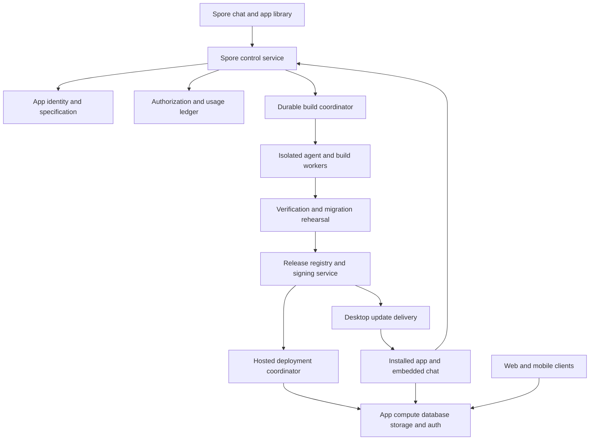

# Spore Product Requirements Document

**Status:** Complete launch scope for product and engineering review  
**Version:** 1.1  
**Date:** November 13, 2026  
**Product:** Spore, a separate application and subscription service built using reusable Minnow and Reef systems  
**Audience:** Product, design, engineering, infrastructure, security, support, and launch operations

Spore lets people create, install, use, and maintain applications for themselves and their businesses through conversation. A person describes what they need, works with the resulting app, and requests improvements from inside that app. Spore builds changes in the background, verifies them, and delivers managed updates. When an app needs accounts, shared data, storage, or background services, Spore provisions and operates those capabilities.

This is one complete launch commitment. All requirements in this document are launch requirements. Product boundaries identify capabilities outside this product; decisions awaiting resolution block dependent implementation or launch and do not exempt requirements. Implementation workstreams establish dependency order; they do not create a reduced public release. An incomplete requirement blocks launch or requires an explicit scope revision by the product owner. There is no deferred feature tier in this PRD.

The confirmed product direction is a separate Spore experience, personal and business applications, chat as the development interface, packaged apps with continuing access to the agent, background builds and updates, managed backends, and a subscription with unlimited local app count and one included hosted app. Numeric allowances, platform coverage, architecture choices, and operational targets below are proposed defaults, not previously approved commercial commitments. They must be settled and tested before public sales.

The [review findings](spore-prd-review.md) explain the corrections in version 1.1. The [implementation plan](spore-implementation-plan.md) assigns every numbered requirement to work and validation. These documents specify work; they do not certify that Spore has been implemented or is ready to launch.

## 1 Product purpose

People should be able to obtain software that matches their actual workflow and keep changing it as that workflow evolves. They should not need to learn a programming language, select infrastructure, administer a database, or diagnose a build failure.

Spore owns the entire delivery cycle: understand the request, create the application, make it usable, preserve its data, maintain it, and recover when a change fails. A generated codebase or successful compiler run is insufficient delivery.

The product promise is: **Describe the app you need. Use it. Ask it to change.**

### 1.1 Product principles

1. The user interacts with conversation and their application. Technical tools remain implementation details.
2. The current working app remains available while a change is being built. Activation may require a disclosed, bounded maintenance window for an exclusive data migration; zero-downtime destructive migrations are not promised.
3. Application data is durable and separate from replaceable code and runtime releases.
4. A change is complete only when the requested behavior has been verified and the release is usable.
5. The agent asks about business intent, access, money, and consequential actions. It chooses routine engineering details.
6. Users can see what changed, try it, recover, export their data, and understand their spending.
7. Local apps remain usable without an active subscription for capabilities that do not depend on paid services.
8. Security and release authority are enforced outside generated application code and model instructions.
9. Shared technology improvements should benefit Minnow and Spore without making either product depend on the other's interface.

## 2 Customers and jobs

| Customer | Job | Successful outcome |
| --- | --- | --- |
| Individual | Create a tool for a personal workflow | A useful installed app with private local data and no development setup |
| Small business owner | Replace spreadsheets and fragmented processes | An app that reflects the business, supports staff, and preserves operational records |
| Authorized business builder | Improve an existing business app | Changes can be requested, previewed, approved, and deployed without disrupting staff |
| Staff member | Use the business app and report problems | Appropriate access, dependable workflows, and a simple way to request improvements |
| Customer or invited guest | Complete a business interaction | A usable public or authenticated form, portal, booking flow, or shared view |

Representative apps include booking and inquiry management, inventory, client records, internal approvals, task coordination, asset tracking, document collection, personal finance recordkeeping, reporting, and customer portals. These examples define a validation corpus rather than a template-only product. Users can request original interfaces and custom business logic within the supported runtime capabilities.

### 2.1 Product boundaries

- App marketplaces, selling software subscriptions to other Spore builders, royalty handling, and third-party app resale are outside this personal and business product scope. Sharing an app with staff or customers is included.
- Responsive mobile web use and installable web apps are included. Native iOS and Android store binaries and app-store submission are not promised distribution formats.
- Spore is not a replacement for arbitrary operating-system software. Kernel drivers, unrestricted background surveillance, arbitrary native extensions, and software that requires unavailable hardware capabilities are outside the supported runtime contract.
- Regulated certifications, enterprise procurement programs, and guarantees for safety-critical workloads are not product claims. Sensitive data handling still receives the controls specified here.
- A developer editor, terminal, Git interface, and provider-configuration workflow are not required user surfaces. Source export remains available for portability.

These are explicit product boundaries, not a later-release feature list. A request outside them receives an explanation and a useful alternative before a paid build begins.

## 3 Complete launch experience

### 3.1 Create and use an app

1. The user installs Spore or signs into its web interface and sees a conversation asking what they want to make.
2. They describe the desired workflow and may attach files, screenshots, sample records, or brand assets.
3. Spore identifies who uses the app, what data it needs, and whether local or shared storage fits. It asks a small number of material questions, preserving answers in an app brief.
4. Spore presents a plain-language description, access assumptions, proposed hosting, and the build spending limit. Routine technical choices are not questions for the user.
5. Spore builds in the background and shows readable progress. The user can continue talking, add information, pause, or cancel.
6. A working preview opens with synthetic or explicitly authorized test data. The user tries real workflows and requests corrections.
7. Spore reports which acceptance checks passed and any unresolved behavior. It cannot label an unverified app ready.
8. The user installs an independently named desktop app, publishes a hosted app, or uses both clients against the same shared backend.
9. Importing real records follows an explicit mapping and validation preview. Release sample data never becomes production data accidentally.

### 3.2 Change an app already in use

1. The owner opens Ask Spore inside the app and describes a change or problem.
2. Spore captures the current app identity, release, relevant screen context, and the authorized request. Screen contents and private records are only attached according to the data consent policy.
3. Spore describes any change to permissions, data, hosting, connected accounts, or spending. It requests approval when these exceed existing grants.
4. A background build uses an isolated source revision and test environment. People continue using the current release.
5. The owner receives an update-ready notification containing a behavior summary, verification results, and a preview action.
6. The owner approves immediately or schedules an update. Publication and each device's installation are tracked separately.
7. Spore verifies the deployed release, preserves recovery options, and reports the final outcome in the original conversation.

### 3.3 Add shared data and accounts

An owner says, "Let my staff use this and keep everyone in sync." Spore explains the new shared-data arrangement, proposes roles, identifies the hosted-app entitlement, and shows any price change. After authorization, it provisions the backend, database, storage, authentication, and app URL; rehearses the data transfer; validates record counts and permissions; and switches the application through a recoverable migration. No infrastructure dashboard, API key, or terminal is required.

### 3.4 Repair a problem

The user says, "Export stopped working," or reports a problem from the affected screen. Spore correlates the installed release and redacted diagnostics, tries to reproduce the issue, builds a repair, and verifies both the repair and existing workflows. If it cannot reproduce or safely fix the problem, it preserves the working release and explains what information or support is needed. Repeated retries have a bounded budget and cannot run indefinitely.

## 4 Product surfaces and interaction requirements

| Surface | Required behavior |
| --- | --- |
| First-run conversation | Explain the product, sign-in and billing, data location, and the first app request without development setup |
| App library | Search, open, create, rename, duplicate, archive, export, and delete apps; show build and update states |
| Build conversation | Preserve intent, questions, decisions, progress, attachments, spending, and previews across sessions |
| App preview | Interact with the app, point to a screen element, test responsive layouts, and describe corrections |
| Installed application | Open directly into the user's workflow with its own identity and a consistent Ask Spore entry point |
| Embedded conversation | Operate the app or request a change according to the user's permissions; preserve context across clients |
| Update review | Explain changes, access changes, migration impact, verification, timing, and recovery |
| Business administration | Manage people, roles, connected accounts, data, hosting, domain, backups, and spending using chat and concise controls |
| Account settings | Subscription, devices, security, data processing, accessibility, notifications, support, and account export/deletion |

**UX-01:** Users must complete creation, first use, revision, hosting, and recovery without seeing a source tree, shell command, raw stack trace, branch, deployment configuration, or model-provider setup.

**UX-02:** Technical details may be available through a support disclosure or downloadable diagnostic bundle. They are never the only explanation or recovery action.

**UX-03:** The conversation accepts text, file and image attachments, screen selection, and optional voice input. A text equivalent remains available for every voice operation.

**UX-04:** Progress describes work such as "Checking appointment conflicts" or "Preparing your update." Show elapsed time, queued/running state, cancellation, and when user input is needed. Do not invent completion percentages or precise time estimates without evidence.

**UX-05:** Stop cancels pending work and cooperatively ends running work. It distinguishes a cancelled build, an external action already committed, and a release already installed. The conversation remains recoverable.

**UX-06:** Mid-build feedback is acknowledged immediately. Changes apply at a recorded safe boundary or become a queued revision. Spore states which request the candidate implements and never silently drops steering.

**UX-07:** Generated apps and Spore surfaces support keyboard navigation, visible focus, screen readers, reduced motion, text scaling, and responsive layouts. WCAG 2.2 AA is the proposed acceptance target for applicable web interfaces; automated checks are supplemented by manual task testing.

**UX-08:** Formatting respects locale, currency, time zone, and daylight-saving behavior. The app brief records business time-zone rules. The interface is localization-ready; English is the launch support language unless the decision register expands it.

**UX-09:** The Spore builder itself has tested desktop and web account, library, conversation, preview, and administration flows. Desktop installs and file access use an explicit device handoff from the web builder. A browser-only session cannot silently install software, read local folders, or guarantee permanent browser storage. Web/PWA clients explain browser storage eviction and sync status; a standalone durable local desktop app is a distinct distribution target.

## 5 App creation and specification

**APP-01:** Creation assigns an immutable app ID, owner, source lineage, data namespace, and conversation namespace. Renaming cannot change identity, invalidate links, or create a different update channel.

**APP-02:** Every app has a durable, versioned brief containing its purpose, users, workflows, data entities, access rules, supported devices, integrations, visual direction, acceptance scenarios, and decisions. The brief is maintained as the app changes and is distinct from the raw transcript.

**APP-03:** Spore generates a complete working application: interface, business logic, validation, storage access, error states, empty states, loading states, and required documentation for the owner. Placeholder buttons and hard-coded successful results do not satisfy a workflow.

**APP-04:** Builds use a supported application contract: web interface, controlled server functions, typed data access, migrations, capability declarations, and verification scenarios. The generator can create custom layouts and logic; it is not limited to selecting prewritten templates.

**APP-05:** Uploads are scanned and parsed in isolation. Instructions found in documents, imported records, websites, or screenshots cannot grant agent permissions. Import analysis previews mappings, rejected rows, duplicates, relationships, and dates before production writes.

**APP-06:** The owner can duplicate an app, choose whether to include data, and obtain a new app identity. Credentials and external-action grants are never copied automatically. Duplication does not make the new app an update recipient of the original.

**APP-07:** Archive preserves the app and records without consuming active build resources. Delete explains the separate effects on source, installed apps, hosted data, backups, and other users. Destructive deletion requires owner authorization and a recoverable retention interval where applicable.

**APP-08:** An app can be exported with source, lockfiles, assets, schema, migration history, build instructions, runtime compatibility metadata, and license notices. Data export is a separate selection. Secrets and platform signing keys are excluded; connection reconnection instructions are included.

**APP-09:** Conversion between local and hosted storage is a managed migration with validation and a recovery checkpoint. Converting a shared app to a standalone local copy explicitly explains that the copy stops sharing data and receiving business-wide changes.

**APP-10:** The application contract includes an editable theme, layout, navigation, visual assets, and reusable accessible components. Users can request substantial visual redesigns through chat, supply brand references, and obtain generated image assets when needed. Asset generation consumes the disclosed build budget, retains provenance and usage rights metadata, and never requires an image-provider account from the user.

**APP-11:** Every maintained app has a recoverable source capsule containing the approved source, brief, dependency lockfile, asset provenance, migration history, and build/runtime recipe. A creator's private local vault or verified owner export can hold it; it is never included in member/public packages. Cloud archival cannot delete the last recoverable capsule without explicit owner deletion. At cloud capacity, stop new billable storage or request an export/capacity choice; do not disable installed local apps. Reimporting a capsule validates provenance and ownership and restores the app's maintenance context without replaying old jobs or grants.

**APP-12:** Archive, pause hosting, cancel a subscription, uninstall, and delete are distinct operations. Archiving hides an app and stops new builds; it does not silently stop production hosting or erase data. A business ownership transfer verifies both parties, billing responsibility, data access, active builds, signing/update identity, and connection ownership before committing. Private apps are shared through authenticated invitations or expiring installation links; downloading a package alone grants no hosted-data or builder access.

## 6 Embedded chat and app authority

The chat can answer questions, operate the application, diagnose behavior, and request changes. These actions have distinct authority even though they share one conversational interface.

| Role | Use authorized app data | Request improvements | Build changes | Publish releases | Manage billing and ownership |
| --- | --- | --- | --- | --- | --- |
| Owner | According to business access policy | Yes | Yes | Yes | Yes |
| Administrator | According to assigned policy | Yes | If separately granted | If separately granted | Billing only if separately granted |
| Builder | Only data explicitly granted | Yes | Yes | Only if separately granted | No |
| Member | According to assigned policy | Yes | No | No | No |
| Guest or public visitor | Explicitly permitted records/actions | Feedback if enabled | No | No | No |

**CHAT-01:** "Show unpaid deposits" is an application operation. "Add deposit reminders" is a software change. Ambiguous requests are clarified before a consequential action.

**CHAT-02:** App operations use the same server-enforced record and action permissions as the normal interface. A chat answer cannot reveal information the user cannot otherwise access.

**CHAT-03:** Build and publication permissions are app-specific. A member's suggestion becomes an owner-visible request; it does not modify source or initiate paid inference beyond the allowed feedback path.

**CHAT-04:** Development history, source, diagnostics, and build costs are private to authorized builders. Customer-facing chat cannot retrieve them through prompt injection or direct API calls.

**CHAT-05:** Sending messages, deleting business records, changing access, making purchases, and modifying connected external systems require suitable action grants. Repeated authorized workflows can use scoped standing grants with visible revocation.

**CHAT-06:** The agent uses authenticated, short-lived app-scoped capabilities. Generated code and user prompts cannot escalate them. Authorization is rechecked at execution and publication, including after a role is revoked mid-build.

**CHAT-07:** Owners can disable operational AI for members while retaining the owner's development chat. Runtime AI consumption and app-building consumption have separate budgets and usage records.

**CHAT-08:** Installed apps retain Ask Spore without requiring the full builder window to be open. An authenticated owner can resume from another supported device. A platform outage leaves local non-AI app functions available.

**CHAT-09:** Owner development conversations and member operational conversations use separate contexts and data retrieval policies even when presented through one chat entry point. Switching between operating and changing the app is visible and authority-checked. Service outage or entitlement expiry leaves an explanation and durable unsent draft/feedback option rather than a dead composer or a falsely accepted cloud request.

## 7 Build and verification lifecycle

**BUILD-01:** The service records an accepted change request before enqueueing work. Admission is idempotent: retries after a lost response do not create duplicate builds, charges, hosted resources, or releases.

**BUILD-02:** Each build captures the request revision, source revision, app brief revision, runtime version, dependency lockfile, tool/model configuration, authorization, and budget. The same identifiers connect progress, diagnostics, artifacts, and accounting.

**BUILD-03:** Build execution is isolated from production, other customers, platform credentials, and signing infrastructure. Dependency installation, generated tests, and generated server code are treated as untrusted execution, not protected merely by an Electron renderer sandbox.

**BUILD-04:** The controlled pipeline performs request analysis, planning, implementation, dependency resolution, static checks, functional tests, browser checks, security checks, migration rehearsal, packaging, and release preparation. Required stages cannot be skipped because the model says it succeeded.

**BUILD-05:** Acceptance scenarios originate from the user's brief and preserved business rules. A separate verification context evaluates them. Builder-authored tests provide additional evidence but cannot alone determine readiness.

**BUILD-06:** Verification covers empty and realistic datasets, access denial, validation, error recovery, mobile layouts, accessibility, and existing critical workflows. A screenshot or page-load check alone does not establish functional completion.

**BUILD-07:** Durable checkpoints support retries, infrastructure restarts, cancellation, and continuation with preserved budgets. A restart cannot refill a repair or spending allowance. Infrastructure failures and implementation failures have distinct retry policies.

**BUILD-08:** Multiple conversations can propose changes, but publication is serialized per app. A candidate built from an obsolete release must be reconciled and reverified against the current source and schema before publication. Users never resolve Git conflicts manually.

**BUILD-09:** Cloud builds continue when the owner's device closes. An owner-selectable local build route also ships under the same job, budget, and verification contracts; choosing it is optional for the user, not optional implementation work. It uses automatically managed tooling and service model access without requiring a local model server. Local execution may pause when the device sleeps and must accurately report that state. If a certified local sandbox cannot start, offer cloud execution with explicit source/data-transfer consent; do not silently run unsandboxed or upload the project. OS-specific signing can still require a remote signing worker even when implementation runs locally; explain that dependency before starting.

**BUILD-10:** A job has bounded execution time, dependency size, disk, memory, network access, child processes, repair attempts, and inference spend. Proposed default: a 45-minute active build deadline with three automatic code-repair attempts. Longer work is checkpointed and requires an explicit budget extension.

**BUILD-11:** Browser and external-service verification uses test credentials and non-production side effects. Spore never sends real customers test emails, books actual appointments, or initiates real payments merely to check a generated workflow.

**BUILD-12:** Failure preserves useful work, identifies the failing stage, and offers a meaningful next action. Users can resume, change the request, restore the previous candidate, or request support without editing internal directories.

**BUILD-13:** Model routing, context compaction, asset generation, voice processing, and fallback preserve the app's data-processing policy and recorded spending authorization. Fallback to a different provider or region requires compatible consent and contractual processing settings. A model/dependency/runtime upgrade triggers regression evaluation before becoming a default; cost or quota failure cannot silently select a lower quality path and claim equivalent verification.

### 7.1 Build and release states

| Object | States | Invariant |
| --- | --- | --- |
| Change request | Captured, clarifying, authorized, queued, building, needs input, cancelled, failed, candidate ready, delivered | Accepted requests have stable identity and durable history |
| Build attempt | Preparing, implementing, verifying, packaging, complete, interrupted, failed, cancelled | A failed attempt never becomes a verified artifact |
| Release | Candidate, verified, approved, publishing, active, withdrawn, superseded | Activation requires policy, authorization, artifact, and compatibility checks |
| Device installation | Offered, downloading, staged, installing, healthy, failed, recovered | A server publication is not proof that a device installed successfully |

Publication failure cannot rewrite the previous active release. Terminal states include evidence and a reason; user-visible progress is a projection of these records.

## 8 Packaging and desktop runtime

**PKG-01:** Every packaged app has its own name, icon, stable application identity, data directory, installer, and update channel. It launches into the app rather than the Spore library.

**PKG-02:** The package contains the application, supported runtime, capability bridge, embedded chat client, and update/recovery client. It does not contain a complete duplicate development environment, provider secrets, source history, or platform administration credentials.

**PKG-03:** Installing and using a local app requires no Git, Node.js, package manager, browser driver, or model-server installation. Build tooling is provisioned by Spore in a controlled environment.

**PKG-04:** Launch supports Windows x64, macOS arm64 and x64, and Linux x64 through explicitly tested installer formats. Proposed formats are Windows installer, signed/notarized macOS installer distribution, and Linux AppImage with a verified update path. Exact minimum OS versions are frozen before the release test matrix is executed; platform support cannot be inferred from source compilation.

**PKG-05:** Desktop capabilities include owner-approved file open/save, printing, notifications, clipboard use, and selected-folder access. Each capability is mediated by a trusted broker and declared in the release. New capabilities trigger review. Arbitrary filesystem and shell access are not generated-app defaults.

**PKG-06:** Packages and release metadata have verifiable provenance. Signing happens after verification in infrastructure inaccessible to generated code. Owners do not supply code-signing certificates for ordinary Spore distribution.

**PKG-07:** Uninstalling an app clearly distinguishes application files from retained local data. Reinstallation with the same identity recovers retained data safely. Installing a duplicate app cannot silently adopt another app's data.

**PKG-08:** Installed apps keep operating if the Spore builder is removed. Subscription cancellation removes paid build/service entitlements according to the billing policy, not the ability to open local records.

**PKG-09:** The installed app uses a stable, signed Spore host plus independently signed, immutable app bundles stored outside the signed host installation. Only the trusted host verifies and activates bundles; generated code cannot change trust roots or its bundle directory. Host security updates require no model-driven app rebuild and can be delivered without a build subscription. Each app still has a distinct signed installer, identity, and data directory. Platform signing/update constraints must be proven with this exact design before freezing packaging; a design revision must preserve independent host patching and app identity.

**PKG-10:** Local app data, private source capsules, OS credentials, and cached shared-app records have different access and encryption rules. Device enrollment, app linking, sign-out, multiple OS users, lost-device revocation, and local account recovery are tested. Standalone personal app access does not require a paid license check; business-managed cached data remains subject to access-expiry policy. Owner-requested deletion cannot be guaranteed on an offline or unmanaged device, which is stated accurately.

## 9 Updates and migrations

**REL-01:** An immutable release manifest binds app ID, publisher, source revision, artifact hashes, platform/architecture, runtime compatibility, schema compatibility, permissions, acceptance evidence, and migration plan. The publication decision binds the exact reviewed manifest.

**REL-02:** Updates download and stage while the app is running. Installation occurs at a safe point, after unsaved work is preserved and the user is notified. Maintenance windows and an opt-in automatic update policy are available.

**REL-03:** Update clients verify identity, signature, integrity, compatibility, and authorized channel before activation. They reject tampered files, another app's artifact, and unauthorized rollback/replay of old releases.

**REL-04:** Interrupted download, disk exhaustion, process crash, power loss, and startup failure have tested recovery behavior. A known working runtime and an installation journal remain available until the new release passes health checks.

**REL-05:** Application releases and the shared Spore runtime have separate version lifecycles. A compatibility matrix prevents a runtime update from breaking installed apps or a generated app from using unsupported APIs.

**REL-06:** Local migrations take a validated backup or transactional checkpoint before mutation. Hosted migrations rehearse on an isolated dataset with equivalent structure and representative scale. Destructive changes require a specific approval that describes affected data.

**REL-07:** Prefer additive schema changes and bounded compatibility windows for old and new clients. A hosted API must not silently break devices that have not updated. Clients below a required minimum version receive a recoverable upgrade screen without discarding pending data.

**REL-08:** Code rollback and data recovery are separate operations. Automatic rollback is permitted only when the manifest establishes schema compatibility. Otherwise Spore uses a verified forward repair or a coordinated restore with explicit handling of writes since the recovery point.

**REL-09:** A restore that would discard newer business records shows the recovery time and affected writes and requires owner authorization. The service must never describe a lossy restore as a transparent undo.

**REL-10:** Hosted publication uses a candidate environment, readiness checks, controlled traffic activation, and monitored health. Database changes and queued jobs have compatible transition rules. Only one release coordinator can advance an app's active version.

**REL-11:** A withdrawn release stops new offers and supports an emergency repair path. Signing-key rotation and revocation are operational procedures tested before launch.

**REL-12:** Notifications distinguish "ready to review," "published," "installed on this device," and "action needed." Owners can inspect other devices' versions without receiving a notification for every routine background stage.

**REL-13:** Desktop app bundles, the signed host, hosted APIs, schema, sync protocol, and web service-worker caches have an explicit compatibility matrix. Proposed online protocol support is the current and previous protocol major for at least 90 days; long-disconnected clients preserve pending operations and follow DATA-14. Web/PWA activation must not combine new UI code with incompatible cached assets or discard unsent work. Supported host major versions receive critical security patches for at least 12 months after supersession, with 90 days' end-of-support notice; these targets require D-11 approval and operating-cost validation.

**REL-14:** A release's permitted environments and target platforms are declared before approval. Approved artifacts must exist and pass checks for every selected target before a coordinated publication. A single-platform packaging failure cannot silently publish a partial multi-platform release. Activation maintenance requires a backup, drain/fence of relevant writes and jobs, a maximum duration, and a tested abort path. Automatic publication policies never waive a new capability or destructive migration approval.

## 10 Hosted backends and business capabilities

**HOST-01:** Spore provisions and operates compute, a fresh logical database, object storage, authentication configuration, secrets, jobs, logs, and a default HTTPS app URL. Users do not need a cloud account.

**HOST-02:** Provisioning is a durable state machine with idempotent resource creation, resource ownership tags, quotas, readiness checks, cancellation handling, and orphan cleanup. A partial failure must not produce an indefinitely billed, undiscoverable app.

**HOST-03:** Each app has separated production and preview resources. Preview deployments cannot use production credentials, mutate production records, or send production communications by default. Preview environments expire and release billable resources.

**HOST-04:** Generated apps support CRUD workflows, relationships, validation, indexed search, reports, uploads, background tasks, schedules, webhooks, and transactional notifications through supported service interfaces. Long-running work uses job workers rather than blocking ordinary requests.

**HOST-05:** Owners can invite members, assign access, revoke sessions, and configure public/customer-facing routes. Backend access checks are enforced independently of client UI visibility. Private apps are the default.

**HOST-06:** Hosted apps have a default Spore subdomain and support custom domains with guided ownership verification, certificate issuance, renewal, and failure recovery. Domain purchase is not included in the subscription. DNS changes may require user action with the domain provider.

**HOST-07:** Per-app resource limits cover requests, CPU, database operations and storage, object storage, transfer, authentication use, messaging, scheduled jobs, and runtime AI. Limits are enforced on the service side and cannot be bypassed by calling a provider endpoint directly.

**HOST-08:** A problematic app cannot exhaust another customer's capacity. Platform and tenant quotas, concurrency controls, circuit breakers, and outbound network policies apply before expensive work.

**HOST-09:** Hosted app identity survives renaming, domain changes, owner-device changes, and redeployment. Resource reassignment checks ownership rather than relying on names or URLs.

**HOST-10:** Owners can pause hosting, export data, restore a backup, and remove a hosted app through chat or app settings. Pausing explains what staff and customers experience and which resources remain billable.

**HOST-11:** Private previews and downloads require independent, expiring access grants and use origins isolated from the builder and production. Custom-domain removal/reassignment verifies ownership and prevents stale routing takeover. Public pages do not receive builder cookies, tokens, or source access; domain changes preserve canonical app identity and require tested OAuth redirect behavior.

**HOST-12:** An app's runtime need for a connector broker, scheduled cloud job, authentication, AI, or hosted data is recorded separately from build-time cloud use. A purely local app may use owner-initiated paid runtime services without occupying a hosted-app slot; persistent shared endpoints, cloud schedules, or shared databases require that slot. Creation and changes explain both entitlement and offline implications before committing resources.

### 10.1 Authentication and connected services

**AUTH-01:** Spore accounts, generated-app user accounts, and third-party service connections are distinct identities with separate grants. Signing into a generated app never grants access to the Spore builder.

**AUTH-02:** Launch supports managed email sign-in and Google and Microsoft sign-in for generated apps, including invite-only access, recovery, session expiry, and session revocation. Provider configuration and production verification are completed by Spore where a platform-owned integration is used.

**AUTH-03:** OAuth connection flows use maintained protocols and components with server-side token storage, redirect validation, anti-forgery protection, least-privilege scopes, refresh handling, and disconnect/revocation. Generated code never implements password storage or receives platform master credentials.

**AUTH-04:** Provider consent, organization restrictions, and provider verification requirements remain visible when they require user action. Spore must not claim a connection is complete until it has tested the required permissions.

**AUTH-05:** Launch connector families cover Google Calendar/Drive/Sheets, Microsoft calendar/mail/files, transactional email, generic authenticated HTTP APIs, and incoming/outgoing webhooks. Each advertised action has a tested connection, execution, revocation, and failure contract. Customer-organization policy can restrict available connectors.

**AUTH-06:** Business-side payment collection, when requested by an app, uses a connected payment provider's hosted checkout and test environment. Merchant onboarding and fees belong to the business and provider; Spore does not store card numbers. This does not create an app-resale marketplace.

**AUTH-07:** Recurring external actions have explicit schedules, idempotency rules, recipient scopes, spending limits where relevant, and an audit trail. Disconnecting an account disables dependent jobs and informs the owner without losing app data.

**AUTH-08:** Generated code cannot bypass record, field, file, or action policy by using a raw database credential or by declaring itself an administrator. A trusted data/capability service checks the end-user or narrowly scoped job principal on every operation. Generated queries and custom functions use that broker; privileged migrations execute only under the reviewed release service. Export, search, counts, joins, and attachments must not become indirect data leaks.

**AUTH-09:** Each connector action declares read/write scope, safe retry policy, idempotency support, timeouts, rate limits, reconciliation, and consent requirements. Where a provider cannot deduplicate or confirm an action after a lost response, mark the outcome uncertain and stop automatic retries until reconciled. Do not promise exactly-once external side effects without a provider-supported mechanism. Schedules specify business time zone, daylight-saving policy, missed-run behavior, overlap, bounded retries, and a dead-letter recovery path.

**AUTH-10:** Connection revocation propagates to runtime and queued work within five minutes under healthy connectivity. Generated-app sessions, Spore builder sessions, connector tokens, and cached authorization have separately tested revocation bounds. Identity linking cannot merge two accounts solely because unverified emails match. Notification services handle verified senders, bounces, complaints, recipient consent, and abuse controls; public feedback cannot trigger unbounded paid inference.

## 11 Data ownership and synchronization

**DATA-01:** The app owner controls application records and authorized exports. Spore keeps customer data, source, transcripts, and service metadata in distinct stores with separate access and retention policies.

**DATA-02:** A local app uses local durable storage by default. Cloud backup and cloud development disclose what leaves the device. Source and explicitly selected diagnostic samples can be sent for a build without uploading the entire live database.

**DATA-03:** Shared apps have a server-authoritative record model with scoped device caches. Offline-capable workflows show which changes are saved locally, awaiting synchronization, rejected, or conflicted.

**DATA-04:** Synchronization uses stable record IDs, operation IDs, versions, deletion markers, and idempotent retries. Concurrent changes cannot silently overwrite another person's work. Merge policies are defined per entity; unresolved conflicts have a human-readable choice.

**DATA-05:** Workflows requiring global uniqueness or immediate authority, such as scarce appointment slots or payment confirmation, cannot promise final success offline. They show a pending state until the server accepts the operation.

**DATA-06:** Revoked users lose online access immediately after the configured revocation propagation bound. Offline cached information cannot be remotely guaranteed erased from a disconnected device; sensitive apps must support disabling offline storage or requiring expiring online access. This limitation is explained at policy configuration.

**DATA-07:** Data export includes structured records, attachments, relationship keys, schema descriptions, and time-zone metadata in documented formats. It is available without an active build subscription during the retention window.

**DATA-08:** Import and local-to-hosted migration validate counts, relationships, rejected records, and checksums where applicable. Interrupted transfers resume without duplicating business records.

**DATA-09:** Backups are encrypted, access-controlled, monitored, and periodically restored in isolation. Proposed defaults: 30 days of daily recovery points plus a journal or incremental snapshot mechanism with no more than a 15-minute recovery gap for hosted data, recovery points before every schema migration, and a four-hour recovery-time objective for the included size envelope. Database rows, referenced objects, sync cursors, and encryption-key references form a consistent recoverable set. Daily snapshots alone do not satisfy the recovery-point objective. These are launch test targets, not assumptions about a selected provider.

**DATA-10:** Local apps create migration recovery points and support user-controlled export plus opt-in managed backup. Backup failures are visible; a local device failure cannot be presented as recoverable unless a usable off-device backup exists.

**DATA-11:** Preview datasets are synthetic or explicitly approved, minimized copies. Data masking protects sensitive fields where possible. Production secrets never enter test snapshots.

**DATA-12:** Account and app deletion specify retention, backup expiry, legal retention exceptions where applicable, and completion status. Deleted material is not reintroduced by restoring a stale backup without applying deletion records.

**DATA-13:** A hosted restore creates a new recovery epoch and fences old clients and job workers. Reconcile acknowledged writes, object versions, deletion records, and outbox receipts before reopening writes. Old offline operations are quarantined for migration or owner review, not replayed blindly. Restoring app records must not resend emails, replay payments, reverse membership revocation, or restore expired external grants. Operator disaster recovery follows the same invariants.

**DATA-14:** Proposed offline incremental-sync window is 30 days. Tombstone and operation retention cover that window plus a seven-day safety margin. Older devices perform an authenticated resnapshot; pending local edits are exported or transformed through an explicit reconciliation path before any cache replacement. Schema migration preserves the local pending-operation queue and can reject incompatible edits without deleting them. No indefinitely disconnected client blocks server cleanup forever.

**DATA-15:** Publish and enforce a retention schedule for source capsules, raw transcripts, attachments, audit events, backups, usage records, exports, revoked credentials, and expired previews. Proposed defaults are 30 days for downloadable export links, 90 days for detailed technical logs with secret redaction, and one year for security audit events; source/current app records remain while the account/app is maintained. Billing/statutory exceptions and account-deletion behavior require D-06 review. Limits never silently erase the last recoverable app source or required legal/audit evidence.

## 12 Subscription and economics

### 12.1 Commercial model

The proposed base subscription is **USD 20 per month** with unlimited local app count, included build usage, and one hosted app within a published resource envelope. Additional hosted apps and usage are purchasable. This is a pricing hypothesis requiring measured unit economics before launch; it is not an unlimited-inference promise.

| Item | Proposed launch default | Required behavior |
| --- | --- | --- |
| Base subscription | USD 20/month before applicable taxes | Clear recurring price, renewal date, cancellation, invoices, and entitlement status |
| Local app count | Unlimited | No artificial count limit; builds, backup storage, and optional online features have defined budgets |
| Hosted apps included | One logical production app | Includes its required backend and a bounded preview allowance; desktop clients do not count as separate hosted apps |
| Additional hosted app | USD 10/month with the same base envelope | Explicit purchase before provisioning paid capacity; proration and cancellation explained |
| Build allowance | USD 10 of monthly build balance at the published customer rate card | Show estimates, maximum authorization, remaining balance, and receipts; unused monthly allowance does not roll over |
| Additional build usage | Prepaid balance or explicit capped overage | No automatic uncapped billing; purchased balance and subscription allowance are distinguished |
| Runtime AI | Separate opt-in budget | End-user app usage cannot consume the owner's development allowance silently |
| Cloud source and release storage | 10 GB per account included | Local app count remains unlimited; owners can export/archive cloud history or buy capacity without deleting installed apps |
| Optional managed local-data backup | 5 GB per account included when enabled | Explicit upload consent and a separate storage meter; local migration recovery points do not require cloud backup |
| Seats | No separate seat fee in the base proposal | Identity usage and resource allowances still apply |
| Custom domain | One connection per hosted app included | Domain registration and provider charges are separate |

The customer rate card must define billable model use and build compute in understandable units with example tasks. Estimated task prices are ranges with a hard authorized maximum, not guarantees about model behavior. Platform-fault retries and duplicate deliveries do not consume customer balance; requested work and bounded implementation retries do, as disclosed before execution.

### 12.2 Proposed included hosting envelope

These are Spore product limits to validate against representative apps and vendor costs, not quoted infrastructure-provider allowances.

| Resource per hosted app | Proposed allowance |
| --- | --- |
| Production database | 1 GB including indexes |
| Object storage | 5 GB |
| Dynamic requests | 100,000 per billing month |
| Compute | 1 million CPU milliseconds per billing month |
| Database access | 10 million rows read and 1 million rows written per billing month |
| Data transfer | 10 GB per billing month |
| Monthly active authenticated users | 1,000 |
| Transactional email | 1,000 messages per billing month |
| Scheduled and queued executions | 10,000 per billing month, also subject to compute limits |
| Preview environments | Two simultaneous; expire after 72 hours of inactivity |
| Backup retention | The recovery policy in DATA-09; backup storage costs included in the economic model |

All metered allowances are defined precisely in the rate card, including period boundaries, delayed vendor telemetry, storage accounting, and preview activity. Preview compute, tests, and temporary data are charged to the authorized build balance or an explicitly purchased test allowance, never the production hosting request/CPU pool. This prevents a build from exhausting a working app's serving quota. Preview resources still have hard platform caps and expiry.

**BILL-01:** Show warnings at 70%, 90%, and 100% of a resource allowance. Owners can purchase capacity or authorize a capped overage. An agent cannot approve its own spending increase.

**BILL-02:** At a hard limit, reject the affected new billable operation with a recoverable explanation. Never truncate records, partially acknowledge a write, or delete data to fit a plan. Owner administration and export have a separate protected access path.

**BILL-03:** An accepted build reserves a budget before work begins, reconciles actual usage, and releases unused reservation on settlement. Duplicate provider events and payment webhooks cannot double-charge.

**BILL-04:** Payment, entitlement, resource usage, and app state remain reconcilable after a service restart or missed webhook. A completed checkout with a delayed webhook can be recovered without asking the user to pay again.

**BILL-05:** Voluntary cancellation keeps paid features until the paid-through date, then suspends hosting and new builds. Failed renewal instead receives seven days of payment-recovery grace before suspension. Both paths retain hosted data and owner export access for 30 days after suspension before scheduled deletion with advance notices. Local non-service functions continue. Before suspension, reconcile running builds and new external side effects; allow already authorized work only within the reserved budget and published cutoff policy. Explicit immediate deletion follows the deletion flow instead.

**BILL-06:** Cancelled customers retain local source/data export and installed-app access. Cloud builds, hosted functions, runtime AI, managed backup, and premium integrations clearly identify their service dependencies.

**BILL-07:** Subscription purchase, extra hosting, usage purchases, refunds, receipts, tax handling, payment failure, and account recovery are complete operational workflows at launch.

**BILL-08:** Critical fixes to the supported shared desktop runtime remain available to installed apps without a build subscription. Custom application development, AI-powered repair, and hosted services remain subject to their entitlements. The supported runtime lifetime and end-of-support notice policy are published before launch.

**BILL-09:** Concurrent jobs reserve from a transactional ledger. Unknown downstream usage is bounded through enforceable per-operation limits or covered by platform risk reserves; delayed vendor reports cannot create an unapproved customer charge. Reconcile provider statements and customer debits, refund duplicate or platform-fault work, and retain the rate-card version used for each authorization. Capped overage is opt-in, and service outages cannot mint extra allowance on retry.

**BILL-10:** Hosting a business, collecting customer payments, and purchasing Spore are separate billing relationships. Guest/member app users do not need a Spore subscription. One billable business/account owns each app's entitlement, with an explicit process for transferring it or replacing the included hosted app. Removing an add-on cannot silently select another app for suspension. Protected owner export/admin access has abuse limits and operating capacity separate from ordinary app meters.

### 12.3 Economic acceptance

Finance/product must approve a measured model containing inference, repairs, sandbox compute, signing, artifact storage and transfer, authentication, databases, email, backups, support, payment processing, fraud, and idle-account overhead. Vendor headline prices alone cannot establish viability.

Proposed gate: at least 60% contribution margin on the representative paying cohort after variable delivery and support costs, with separately reported median, p90, and p99 customer cost. High-use customers must be bounded by published entitlements rather than subsidized by an unenforced promise. If the gate fails, revise prices or allowances before launch; do not remove core product capabilities silently.

## 13 Architecture requirements

The default design uses a shared agent core, a Spore control service, isolated cloud build workers, managed application backends, and a small runtime in each packaged app. Local execution can use the same protocol, but cloud execution is the standard subscription path.

### 13.1 Component contracts

| Component | Owns | Must not own |
| --- | --- | --- |
| Shared agent core | Tool loop, context, model adapters, structured events, bounded continuation | Spore billing, UI navigation, production publication authority |
| Control service | Accounts, app ownership, requests, policy, entitlements, audit | Direct execution of arbitrary generated code |
| Build coordinator | Durable lifecycle, source identity, budgets, checkpoints, evidence | Unverified claims of success or direct access to signing keys |
| Build worker | Scoped source editing, dependency install, tests, packaging inputs | Cross-tenant credentials or production data access by default |
| Release service | Immutable manifests, approval binding, signature policy, artifacts | Mutable unreviewed source execution |
| Backend provisioner | Idempotent resource allocation, environment binding, quotas | Model-supplied unrestricted provider administration commands |
| Packaged runtime | App execution, local data, mediated OS capabilities, chat and update clients | Platform administration keys or unrestricted development tools |
| App backend | Business data operations within app identity and policy | Authority over other apps or the builder service |

**ARCH-01:** Publish versioned internal contracts for agent execution, tools, app manifests, runtime capabilities, identity, provisioning, synchronization, and release delivery. Compatibility tests run across the supported version window.

**ARCH-02:** App code and build code are separate trust domains. Build workers use disposable OS-level isolation. Hosted application compute uses a tenant-isolated execution environment. A web renderer sandbox is only one layer of desktop isolation.

**ARCH-03:** Separate the Spore control database from generated application databases. An app cannot query platform users, billing, conversations, or another app's metadata through its database binding.

**ARCH-04:** All mutations carry request IDs, actor identity, app/environment identity, expected revision where relevant, and audit correlation. Durable outboxes reconcile external effects whose results arrive after a network failure.

**ARCH-05:** A distributed lock/lease with fencing prevents concurrent release coordinators from publishing competing versions. Losing a lease revokes write authority even if a process continues running.

**ARCH-06:** Provider adapters hide infrastructure-specific provisioning details. Proposed hosted foundation: Cloudflare Workers for Platforms, D1, and object storage, subject to capacity, backup, identity, cost, and migration tests. Workers for Platforms supports customer-isolated code and service bindings; it does not replace the separate general-purpose build-worker environment. [Cloudflare platform documentation](https://developers.cloudflare.com/cloudflare-for-platforms/workers-for-platforms/).

**ARCH-07:** Vendor rate cards are inputs to an app-level cost ledger, not customer promises. Cloudflare separately prices platform execution and D1 operations/storage; model, authentication, email, build, and support costs also apply. [Platform pricing](https://developers.cloudflare.com/cloudflare-for-platforms/workers-for-platforms/reference/pricing/), [D1 pricing](https://developers.cloudflare.com/d1/platform/pricing/).

**ARCH-08:** Spore has separate configuration, credentials, local storage root, app identity, telemetry, and subscription lifecycle from Minnow. Importing code must not cause Spore to read or mutate the user's existing Minnow profile.

**ARCH-09:** The generated-app contract has one schema and capability API across local and hosted adapters. The supported query, transaction, type, date/time, decimal, file, and migration semantics are explicit and covered by parity tests. Cloud-only capabilities return declared offline states. An arbitrary Node backend cannot be exported as compatible with a restricted local runtime or Worker without passing this contract.

**ARCH-10:** Hosted serving uses bounded cached policy/entitlement snapshots during a control-plane outage; it does not depend on a synchronous builder service call for every read. Proposed policy-cache maximum age is five minutes for privileged mutations. When safe authorization cannot be established, protected operations fail closed with a clear outage state. Public/read-only access may continue under explicit policy. Revocation, stale-policy behavior, and the availability SLO are tested together rather than promised independently.

### 13.2 Required data entities

| Entity | Essential fields or relationships |
| --- | --- |
| Account and business | Owner, members, billing identity, security policy, region |
| App | Immutable ID, owner/business, name, brief revision, source lineage, active release, data mode |
| Membership | App/account, role, record/action policy, build/publish grants, revocation version |
| Conversation | App, participants, purpose, visibility, durable messages and attachments |
| Change request | Intent, brief revision, initiator, authorization, source base, budget, lifecycle |
| Build attempt | Request, execution environment, checkpoints, model/tool versions, costs, outcome |
| Verification record | Scenario version, inputs, observations, artifacts, verdict, reviewer identity |
| Release | Manifest, source digest, artifacts, schema range, capability set, approvals, signature |
| Installation | App, device, platform, release, runtime, last health report, update state |
| Hosted environment | App, purpose, resource IDs, region, quotas, deployment, health |
| Connection | App/business scope, provider, encrypted credential reference, grants, expiry |
| Migration and recovery point | From/to schema, data lineage, compatibility, validation, backup location |
| Sync operation | App, actor, device, operation ID, record version, accepted/rejected/conflicted state |
| Usage and entitlement | Meter, period, reservation, settlement, invoice correlation, plan revision |
| Audit event | Actor, authority, object, operation, before/after references, outcome, correlation |

Secrets are stored as protected references rather than inline fields in these records. Retention and deletion apply per entity category.

## 14 Minnow and Reef reuse plan

Reuse should preserve well-tested contracts while extracting product-specific dependencies. A copy of the entire Minnow interface is not the Spore architecture.

| Existing system | Evidence and reuse | Adaptation required |
| --- | --- | --- |
| Shared runner | `server/runner/run-turn.js`, `server/runner/turn-runner.js`, and the runner README expose injected tools, models, transcripts, and events | Package stable host-neutral entry points; bind Spore authorization and job context |
| Headless execution | `src/headless/` provides non-SPA execution and packaged bundle work | Remove Minnow profile/bootstrap assumptions; provide a Spore worker entry point |
| Durable chats and execution | `server/chats/`, `server/chat-turns/`, and execution rollout documentation provide persistence and recovery foundations | Add account/app tenancy, authorization, budgets, cloud leases, and retention |
| Tools and permission engine | `server/tools/` and `src/lib/permissions.mjs` centralize dispatch and policy | Add app/build/environment capabilities; keep production publication outside model discretion |
| Source isolation and checkpoints | `server/git/`, `server/worktree/`, and workspace checkpoint systems provide reusable mechanics | Managed per-app source lifecycle; no human branch management; verify isolation and recovery under cloud workers |
| Models and usage | `server/providers/`, `server/generations/`, `server/usage/` provide adapters and accounting inputs | Service-owned inference, cost reservations, billing ledger, customer privacy rules |
| Memory and knowledge | `server/brain/` and `server/memory/` provide retrieval and durable context patterns | App brief and behavior history; strict per-app visibility; bounded retrieval |
| Preview and verification | Browser tooling, preview isolation, and Reef browser scenarios | Cloud browser testing, independent acceptance criteria, production-safe fixtures |
| Reef pipeline | Recoverable source before extraction includes plan/build/check/repair/promote stages | Integrate current runner; extend for service tenancy, concurrent changes, hosted data, and signed releases |
| Reef app store and runtime | Historical `server/reef/store.js`, runtime host, and app identity | Versioned durable records, slim library summaries, corruption isolation, new runtime contract |
| Reef exports | Historical `server/reef/exports.js` and Electron wrapper package independent apps | Embedded owner chat, signed installers, authenticated updates, platform health checks |
| Minnow desktop updater | `electron/updater.ts` and `electron/updater-core.ts` provide updater state and host integration | Multi-app private feeds, manifest binding, migration coordination, runtime compatibility |
| Backups and scheduling | `server/backup/` and `server/scheduler/` provide reusable engine patterns | App-scoped recovery, hosted backups, tenant jobs, business permission enforcement |
| Chat presentation | Existing streaming, attachments, questions, steering, and accessibility patterns | New consumer interface; no dependency on Code workspace navigation |

Reef was removed from the current Minnow runtime by commit `e21dad63086757a81dbfbc8dbf3e32b961d464d5`. Its parent contains the historical implementation. Recovery uses a pinned snapshot, preserves applicable notices, and audits historical defects against the recovered revision. It does not restore obsolete behavior into Minnow.

The historical export configuration used `publish: null`; independent packaging therefore does not establish a completed generated-app update service. The existing review also identified verification limitations, trusted local execution, and app-record scaling concerns. Those boundaries must be resolved in the Spore implementation rather than inherited as acceptable launch behavior.

Reuse confidence is high for the agent loop and tool mechanics, substantial but adaptation-heavy for Reef's lifecycle, and partial for desktop updates, memory, backups, and UI. The subscription service, tenant isolation, hosted provisioning, synchronization, and release authority are new product work. No percentage of completion is claimed before a dependency and integration audit.

### 14.1 Extraction requirements

- Establish shared packages with explicit imports and contract tests. Avoid two independently evolving copies of the tool loop.
- Keep Minnow's product, profile, licensing notices, and released behavior intact.
- Port the tests relevant to extracted behavior and add Spore boundary tests. Historical tests are evidence, not proof of the new cloud/service model.
- Inventory source provenance, third-party dependencies, generated-app dependencies, and distribution notices. Resolve the commercial distribution and contribution policy with appropriate review before launch; do not assume a rebrand changes existing license obligations.
- Import existing Reef app data only through an explicit migration tool. Detect malformed records individually, preserve source data, and never modify a live legacy profile in place.

## 15 Security and privacy

**SEC-01:** Threat modeling covers hostile generated code, malicious attachments, dependency compromise, prompt injection, account takeover, cross-tenant access, public endpoint abuse, signing compromise, and malicious update delivery.

**SEC-02:** Production secrets, platform tokens, signing material, and customer credentials are unavailable to inference by default. Tools use scoped handles and redact results. Diagnostic exports undergo secret scanning before sharing.

**SEC-03:** Build sandboxes restrict filesystem, processes, network destinations, runtime, and resources. Metadata services and internal control-plane networks are unreachable. Dependency retrieval uses controlled egress and integrity-locked inputs.

**SEC-04:** Generated renderers have no direct Node or shell access. Native IPC verifies caller identity, app, capability, parameters, and operation scope. A forged renderer message cannot invoke an update, read another app's records, or access platform credentials.

**SEC-05:** Public apps receive rate limits, upload restrictions, abuse reporting, authentication protections, and resource budgets. Platform operators can isolate abusive apps without interrupting unrelated tenants.

**SEC-06:** App authorization is tested through direct APIs, background jobs, exports, search, attachments, chat, and synchronization, including revoked and expired identities. Hiding UI is never an authorization control.

**SEC-07:** Transport encryption and encryption at rest apply to hosted records, backups, and secrets. Local secrets use OS-protected storage where supported. Recovery and key rotation procedures are documented and exercised.

**SEC-08:** The user can understand which source, attachments, records, and diagnostics are sent to model providers or infrastructure services. Training use, subprocessors, regions, retention, and support access are explicitly documented before collecting customer data.

**SEC-09:** Support access is time-limited, least-privilege, audited, and owner-authorized for customer content except defined incident/legal procedures. Routine telemetry excludes raw chat, source, secrets, and business records.

**SEC-10:** Dependency and runtime vulnerability monitoring creates bounded maintenance jobs and release proposals. Security fixes use the same verification and release authority as functional changes. Runtime emergencies have a documented notification and revocation procedure.

**SEC-11:** Account security includes strong session controls, owner MFA, recovery, device/session listing, and ownership transfer with reauthentication. Recovery cannot bypass app authorization or expose another business's data.

**SEC-12:** A launch security review must demonstrate tenant isolation, sandbox containment, update authenticity, and secret boundaries using adversarial tests. Any unresolved critical or high-severity finding in these boundaries blocks launch.

**SEC-13:** Locally generated backend logic runs in a capability-restricted runtime or an OS sandbox validated on each supported platform. Starting generated Node code as an ordinary subprocess is insufficient isolation. Filesystem, process, network, and native operations are unavailable except through declared broker capabilities; the broker cannot turn user-controlled parameters into unrestricted execution.

## 16 Reliability and performance targets

All values below are proposed launch targets measured under a documented hardware, network, dataset, concurrency, and provider envelope. They are not current Minnow benchmarks. The test report records end-to-end latency and external-provider time separately without hiding either.

| Area | Target and measurement |
| --- | --- |
| Local app startup | p95 usable in 3 seconds on the certified reference device with a 10,000-record dataset |
| Local interaction | p95 ordinary actions acknowledge within 100 ms; expensive work displays progress and remains cancellable |
| Hosted ordinary API | p95 500 ms and p99 2 seconds within the documented region, query, and included-size envelope, excluding explicitly asynchronous jobs |
| Chat acceptance | Durable acknowledgement within 1 second p95; queue state visible within 2 seconds |
| First build | p90 verified preview within 15 minutes for the benchmark's standard apps, including queueing; complex cases report separately |
| Ordinary revision | p90 verified candidate within 5 minutes for benchmark changes, including queueing |
| Active build cancellation | New tool dispatch stops within 5 seconds p95; sandbox termination completes within 30 seconds absent an explicitly non-cancellable committed external action |
| Update awareness | Connected active clients discover a published release within 60 seconds p95 |
| Update installation | p95 within 60 seconds after download for the benchmark package without a long migration; migration timing is reported separately |
| Cloud control and hosted serving | Separate 99.9% monthly availability objectives; measurement and maintenance policy published before sales |
| Recovery | DATA-09 RPO/RTO proven at the included size envelope; control-plane restoration separately tested |
| Build durability | Accepted requests survive process restart; no double publication or double charge under injected failures |
| Offline behavior | Local core workflows remain available with no cloud connection; shared workflows follow DATA-03 through DATA-06 |
| Resource fairness | At twice the forecast launch concurrency, load shedding preserves tenant isolation, administration, and honest queue reporting |

Generated apps receive performance budgets based on their supported workload. A change that breaches a declared budget cannot be promoted without a deliberate app-level requirement change and visible impact.

## 17 Operations and support

**OPS-01:** Operate dashboards for build queues, inference failures, repair rates, provisioning, app health, synchronization, update adoption, migration failures, backup freshness, restore tests, security events, and cost anomalies.

**OPS-02:** Every user-visible failure has a correlation ID and a support action. Support can inspect redacted lifecycle evidence without requesting that the user open a terminal or collect internal files manually.

**OPS-03:** Runbooks cover provider outage, build-worker loss, cloud resource exhaustion, signing failure, compromised credentials, corrupt artifact, bad migration, billing mismatch, backup failure, and app abuse. Each has an accountable operational role and escalation path.

**OPS-04:** The service has a status page and an in-app outage explanation. Model-provider outage pauses builds without making healthy local apps unusable. A control-plane outage must not automatically disable already deployed hosted data paths.

**OPS-05:** Staff can drain queues, stop publication, revoke artifacts, disable a connector, cap resource use, and isolate one tenant without a platform-wide outage. Administrative actions are audited and protected by strong authentication.

**OPS-06:** Customer support, onboarding material, cancellation instructions, recovery guidance, ownership/data explanations, and incident communication are ready at launch. Public documentation describes only the capabilities that pass the release gates.

**OPS-07:** Retention and garbage collection reclaim expired previews, abandoned workers, unused artifacts, and deleted resources while preserving active releases and recovery obligations. Cleanup is idempotent and observable.

**OPS-08:** Production secrets and recovery keys have tested backup and rotation procedures. Disaster recovery does not depend on one developer's laptop, account session, or undocumented command.

**OPS-09:** Complete launch includes the customer acquisition and account lifecycle: product/pricing pages consistent with entitlements, download hosting, purchase/sign-in, transactional account email, support contact, public status, incident communication, and accessibility checks. Close applicable privacy, service, data-processing, acceptable-use, refund, vendor, and distribution reviews before public sales; jurisdiction-specific obligations are determined by qualified review rather than inferred by this PRD.

**OPS-10:** Freeze a release evidence manifest containing exact source/artifact revisions, configuration, infrastructure version, model-routing version, benchmark inputs, platforms, security findings, and gate approvals. A change that invalidates evidence triggers the affected checks again. Production deployment, DNS/payment-provider activation, and opening public signup follow a documented cutover checklist with stop authority, monitoring, rollback, and accountable on-call ownership.

## 18 Acceptance scenarios

Each scenario is an end-to-end launch test with retained evidence. Fake providers are useful for fault injection, but representative real model builds, signed packages, production-equivalent identity flows, and infrastructure integration tests are also required.

| ID | Scenario | Pass condition | Requirement coverage |
| --- | --- | --- | --- |
| AT-01 | New customer creates a booking app | Builds, previews, imports records, installs, and completes a booking workflow without developer tools | UX, APP, BUILD, PKG |
| AT-02 | Ten successive changes to one used app | Every release preserves existing records and critical behavior; history and cost remain understandable | APP-02, BUILD-05/08, REL, DATA |
| AT-03 | Installed app requests a repair | Embedded chat captures the correct app/release, reproduces the issue, builds, and delivers an update | CHAT, BUILD, REL |
| AT-04 | Build interrupted and owner device closed | Cloud work resumes from durable state; no duplicate job, charge, or publication | BUILD-01/07/09, BILL-03/04 |
| AT-05 | Feedback arrives during verification | Request is acknowledged and applied at a safe boundary or clearly queued; final evidence matches final intent | UX-06, BUILD-02/08 |
| AT-06 | Two authorized builders change the same app | Conflicts reconcile internally; only verified work based on the current release publishes | BUILD-08, ARCH-05 |
| AT-07 | Update fails during download, install, or startup | Working app and data recover without manual file operations | REL-02/04/08 |
| AT-08 | Schema changes while old clients remain online | Compatibility is maintained or clients receive a safe upgrade path; no acknowledged writes disappear | REL-06/07/08, DATA-04 |
| AT-09 | Owner restores an older backup | Recovery point and newer-write impact are shown; authorized restore meets recovery targets | REL-09, DATA-09 |
| AT-10 | Local app becomes a shared business app | Resources provision, data validates, staff sign in, and permissions work without cloud setup by the user | APP-09, HOST, AUTH, DATA-08 |
| AT-11 | Provider fails halfway through provisioning | Retry reconciles existing resources; orphan resources and unexpected billing are eliminated | HOST-02, BILL-04 |
| AT-12 | Member asks chat to expose private records or change code | Backend refuses access and mutation; feedback remains possible | CHAT-02/03/04, SEC-06 |
| AT-13 | Two tenants attack each other's identifiers and artifacts | No data, source, credentials, update, or authorization crosses the boundary | ARCH-02/03, SEC-03/06/12 |
| AT-14 | Tampered or wrong-app release is offered | Client rejects it before execution and keeps the current installation healthy | REL-01/03, SEC-04 |
| AT-15 | Offline staff edit conflicting records | No silent data loss; synchronization and conflicts follow business rules | DATA-03/04/05/06 |
| AT-16 | Connector consent is denied, expires, or is revoked | Clear recovery; no false connected state; dependent jobs stop safely | AUTH-03/04/07 |
| AT-17 | Build or hosted quota is reached | Hard spending/resource rules hold; owner can export/administer; data is not deleted | HOST-07, BILL-01/02/03 |
| AT-18 | Subscription expires or payment fails | Entitlements follow the documented grace/suspension policy; local core functions remain usable | PKG-08, BILL-05/06 |
| AT-19 | Owner exports and deletes an app | Export is usable, secrets excluded, deletion and backup expiry complete as promised | APP-08, DATA-07/12 |
| AT-20 | Clean installation on every supported desktop target | Identity, capabilities, sign-in, data persistence, embedded chat, update, recovery, and uninstall all pass | PKG, REL |
| AT-21 | Web and mobile customers complete a business workflow | Responsive UI, authentication, validation, accessibility, and error recovery pass | UX-07/08, HOST, AUTH |
| AT-22 | Generated dependency or document attacks the platform | Isolation holds; no secret exfiltration, host takeover, or grant escalation | APP-05, BUILD-03, SEC |
| AT-23 | Real scheduled notification and payment test workflow | Correct recipients and grants; retries do not duplicate external actions; payment uses provider test mode | BUILD-11, AUTH-06/07 |
| AT-24 | Platform disaster recovery drill | Restore control records, artifacts, app data, and release authority within approved objectives | DATA-09, OPS-03/08 |
| AT-25 | Representative customer completes the whole journey unassisted | Create, use, change, update, host, invite, recover, cancel, and export without engineering help | Entire product |
| AT-26 | Cloud history is full and an owner returns after cancellation | Private capsule export/rehydration restores maintenance; installed apps keep working; no last source is silently deleted | APP-11, BILL-05/06/08 |
| AT-27 | Daily snapshot is old and a recovery drill starts | Journal/object recovery meets 15-minute RPO; recovery epoch blocks old clients and duplicate side effects | DATA-09/13 |
| AT-28 | A client returns after 45 days with pending edits | Resnapshot preserves pending edits for reconciliation; tombstone expiry does not resurrect records | DATA-14, REL-13 |
| AT-29 | A runtime security fix reaches a cancelled customer | Signed host updates without a paid app rebuild; app bundle, identity, data, and OS signature remain valid | PKG-09, BILL-08 |
| AT-30 | Provider times out after possibly sending an email/payment action | Outcome remains uncertain until reconciled; no unsafe retry or false success | AUTH-09, BUILD-11 |
| AT-31 | Preview test creates heavy traffic while production is near quota | Production allowance is preserved; preview obeys its own authorized build budget | HOST-03/07, BILL-09 |
| AT-32 | Generated backend tries raw SQL or a service identity escalation | Trusted broker rejects access across rows, fields, joins, files, and action scopes | AUTH-08, ARCH-09 |
| AT-33 | Control service is unavailable and access was recently revoked | Bounded policy caches obey the documented failure rules; no indefinite privileged access | AUTH-10, ARCH-10 |
| AT-34 | Owner transfers a business app or replaces the included hosting slot | Ownership, billing, credentials, data, and update identity reconcile; no unrelated app is suspended | APP-12, BILL-10 |
| AT-35 | Web builder, PWA cache, and desktop handoff use different versions | Device handoff is authorized; mixed cache versions cannot lose drafts or operations | UX-09, REL-13 |
| AT-36 | Owner selects local build and sandbox setup fails | No developer setup or unsafe execution; cloud fallback requires consent; packaged output uses the same checks | BUILD-09, SEC-13 |
| AT-37 | One platform package fails or an exclusive migration exceeds its window | Multi-target release does not partially publish; maintenance abort recovers the approved working state | REL-14 |
| AT-38 | Concurrent builds race for the final allowance and vendor usage arrives late | Ledger admits only reserved work; no overspend charged to the customer or duplicate settlement | BILL-03/09 |
| AT-39 | Full visual redesign, generated assets, and voice input are used | Accessible behavior and existing workflows remain correct; consent, provenance, and usage are retained | APP-10, UX-03/07, BUILD-13 |
| AT-40 | New customer purchases through public site and completes cancellation/export | Website promises match actual entitlements; receipts, notices, support, and retention all work | OPS-09/10, BILL-05/07 |

### 18.1 Benchmark and evidence policy

Use at least 20 app briefs across personal tools, business records, scheduling, inventory, reporting, and customer portals. Run each through initial creation and five realistic revisions. At least five apps undergo ten revisions with accumulated data, migrations, and multiple clients. Include import errors, role changes, connector failures, and ambiguous requests.

Freeze brief versions, acceptance scenarios, representative datasets, performance envelopes, and scoring before the release candidate evaluation. Report all attempts, retries, costs, and unresolved failures. Do not count a manually repaired result as unassisted success.

Proposed gate: at least 90% of frozen generation/revision benchmark tasks complete within the authorized budget and bounded repair policy. All 40 end-to-end acceptance scenarios and every supported platform's mandatory contract suite must pass; the 90% generation metric does not waive a failed requirement. The unsuccessful generation attempts must fail safely and honestly. A systematic inability to implement an advertised capability blocks the complete launch. Record per-category success, model configuration, all trials, and uncertainty; do not improve the score by removing failed briefs or counting a manual repair as autonomous success.

## 19 Launch gates

| Gate | Required evidence | Accountable role |
| --- | --- | --- |
| Product completeness | All requirement families implemented; no placeholder core flows; decisions resolved | Product owner |
| User experience | Unassisted whole-journey tests, accessible controls, understandable failure recovery | Design and product |
| Engine and builds | Shared contracts, durable execution, real-model benchmark, bounded costs, isolation tests | Agent and build engineering |
| Application delivery | Signed installers, immutable manifests, tested updates and recovery on all targets | Desktop and release engineering |
| Data reliability | Migration rehearsals, sync conflict tests, backup and restore drills, export validation | Data engineering |
| Managed services | Production provisioning, auth/connector approvals, domains, quotas, reconciliation | Platform engineering |
| Security | Threat model, adversarial review, no unresolved high/critical boundary findings | Security owner |
| Commercial readiness | Confirmed pricing, rate card, measured economics, billing/refund/cancellation tests | Product and finance |
| Operational readiness | Monitoring, support, incident runbooks, on-call ownership, disaster recovery | Operations |
| Distribution readiness | Source/dependency provenance, notices, service terms, privacy disclosures, signing control | Product with legal/security review |

No launch gate is satisfied by the existence of a code path alone. Each has an evidence record tied to the exact release candidate and production configuration. No public launch occurs with unresolved release-blocking data-loss, authorization, isolation, billing, or update defects.

## 20 Implementation workstreams

All workstreams are required before the same launch. They may overlap where dependencies allow; completion of one is not a separate customer release.

| Workstream | Deliverable | Dependencies |
| --- | --- | --- |
| WS-01 Product contracts | App brief, identities, capability model, release/schema contracts, final scope and rate card | Product decisions |
| WS-02 Shared engine extraction | Versioned runner/tool interfaces, Spore execution adapter, relevant migrated tests | WS-01 |
| WS-03 Reef lifecycle adaptation | Durable app/build stores, source management, repair/recovery, independent verification | WS-01, WS-02 |
| WS-04 Consumer experience | First-run, chat, library, preview, embedded chat, administration, accessibility | WS-01; integrates WS-03 onward |
| WS-05 Cloud execution and control | Accounts, tenancy, isolated workers, queueing, budgets, audit, model routing | WS-01, WS-02 |
| WS-06 Managed app services | Compute/database/storage, auth, connectors, domains, jobs, quotas | WS-01, WS-05 |
| WS-07 Data lifecycle | Imports, migrations, synchronization, backup, restore, export, deletion | WS-01, WS-06 |
| WS-08 Packaging and releases | Desktop runtimes, signing, artifacts, update channels, rollout and recovery | WS-01, WS-03, WS-05, WS-07 |
| WS-09 Commerce | Subscription, usage reservations, payments, invoices, purchases, entitlement reconciliation | WS-01, WS-05, WS-06 |
| WS-10 Operations and assurance | Monitoring, incident controls, threat review, load tests, support, full acceptance evidence | Integrates every workstream |

Engineering estimates follow the extraction audit and end-to-end technical proofs for signing, database recovery, tenant isolation, and hosted authorization. This PRD does not assign an unsupported calendar deadline or completion percentage. Staffing and dependency estimates must account for operating a service as well as producing an application.

## 21 Decisions to close before implementation freeze

These decisions refine complete launch requirements; they do not authorize deferring them. The proposed defaults apply to design and estimation until explicitly revised.

| ID | Decision | Proposed default | Closure evidence |
| --- | --- | --- | --- |
| D-01 | Desktop and mobile distribution | Windows x64, macOS x64/arm64, Linux x64; responsive web and PWA for mobile | Certified OS/version matrix and chosen package/update formats |
| D-02 | Hosting and execution vendors | Workers-based app hosting with per-app database/storage; separate isolated build workers | Capacity, recovery, data location, cost, and sandbox proofs |
| D-03 | Authentication, email, and payments vendors | Maintained managed services behind Spore adapters | Production accounts, approved OAuth flows, contracts, rate cards, failure tests |
| D-04 | Subscription price and entitlements | USD 20 base, USD 10 additional hosted app, allowances in section 12 | Approved economics and customer-facing rate card |
| D-05 | Inference providers and model routing | Service-managed model selection with measured fallback; user-selectable managed local build execution under D-13 | Benchmark quality, cost, data handling, outage behavior |
| D-06 | Data regions and retention | Explicit primary region, isolated backups, 30-day recovery/deletion windows | Published policy, vendor capability, restore/deletion tests |
| D-07 | Distribution and shared-core governance | Separate Spore product with shared engine packages | Provenance/license review, ownership of shared interfaces, release policy |
| D-08 | Signing and app identity | Platform-operated signing with per-app identities and isolated signing service | Real signed multi-app installation/update tests and abuse controls |
| D-09 | Language and accessibility support | English support, locale-aware generated apps, WCAG 2.2 AA target | Test matrix, documented supported languages and assistive technologies |
| D-10 | Operational staffing and launch capacity | Named support/on-call owners and a forecast-backed capacity plan | Incident drill, support rehearsal, load/cost evidence |
| D-11 | Compatibility and offline support lifetime | 30-day sync window, seven-day cleanup margin, 90-day protocol window, 12-month superseded host security support | Cache/restore/update proof and funded support policy |
| D-12 | Local and hosted runtime parity | Capability broker with typed data contract; no unrestricted generated production SQL or Node APIs | Adversarial parity tests and local-sandbox/platform proof |
| D-13 | Local build execution and cloud fallback | Fully managed optional-to-user local route at launch, with service inference and explicit remote-signing/data consent | Setup, sleep/resume, failure, cost, and signing tests on every certified target |

## 22 Success measures

Measure results per app and per customer without collecting raw business content for analytics.

- **Activation:** The customer completes a meaningful workflow in an app they created, rather than merely generating a preview.
- **Maintenance success:** Requested changes reach a healthy deployed release within budget while preserving prior behavior and records.
- **Continued usefulness:** Customers use their apps and request further changes across weeks, including after the initial novelty of generation.
- **Independence:** Customers complete creation, deployment, update, and recovery without developer assistance.
- **Reliability:** Failed releases, lost acknowledged writes, sync conflicts, backup failures, and recovery times are visible and measured.
- **Trust:** Spending surprises, unexpected data sharing, unauthorized actions, and inability to export are treated as product failures.
- **Business health:** Contribution margin, paid retention, support burden, and usage distribution remain compatible with the published offer.

The central product test is a customer continuing to use an app with real data through repeated meaningful changes, with Spore reliably handling the engineering work throughout.

## 23 Reference material

Repository references describe available foundations and historical implementation, not completed Spore functionality.

- [Minnow architecture context](../context.md)
- [Minnow product definition](../../PRODUCT.md)
- [Shared runner contracts](../../server/runner/README.md)
- [Shared runner entry point](../../server/runner/run-turn.js)
- [Headless runner](../../src/headless/runner.ts)
- [Server execution rollout and boundaries](../contributor/chat-server-execution-rollout.md)
- [Reef lifecycle and product review](../reviews/2026-10-23/10-reef-and-product-placement.md)
- [Desktop updater integration](../../electron/updater.ts)
- [Desktop updater state](../../electron/updater-core.ts)
- Reef implementation snapshot: parent of `e21dad63086757a81dbfbc8dbf3e32b961d464d5`, including `server/reef/pipeline.js`, `store.js`, `exports.js`, and runtime modules.

External references were consulted on November 13, 2026. Provider selection and commercial terms must be revalidated at launch.

- [Cloudflare Workers for Platforms](https://developers.cloudflare.com/cloudflare-for-platforms/workers-for-platforms/)
- [Cloudflare platform pricing](https://developers.cloudflare.com/cloudflare-for-platforms/workers-for-platforms/reference/pricing/)
- [Cloudflare D1 pricing](https://developers.cloudflare.com/d1/platform/pricing/)
- [Electron update delivery](https://www.electronjs.org/docs/latest/tutorial/updates) describes platform-specific metadata and update hosting; Spore still needs app identity, private authorization, release policy, and recovery on top.
- [Electron code signing](https://www.electronjs.org/docs/latest/tutorial/code-signing) describes desktop signing and macOS notarization; Spore must test its own installers and update chain on actual supported systems.
